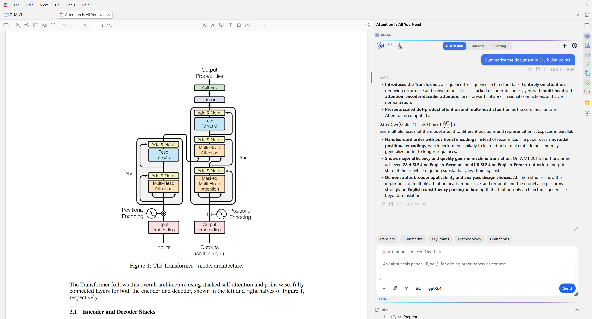
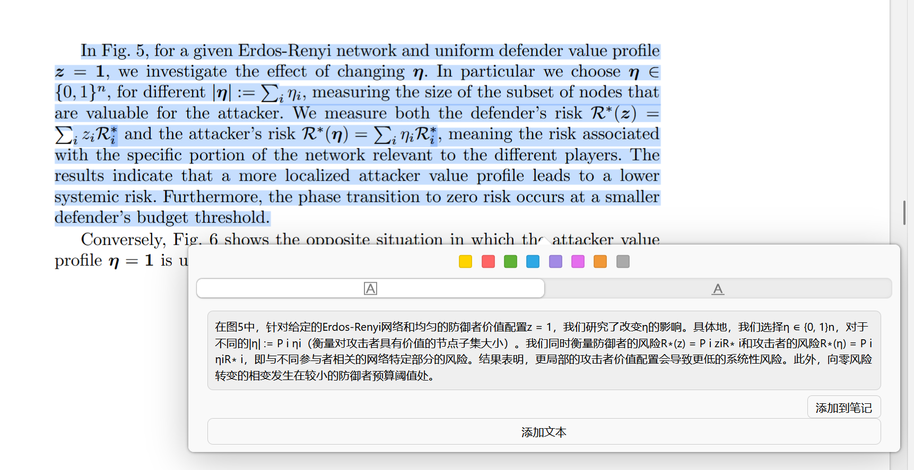
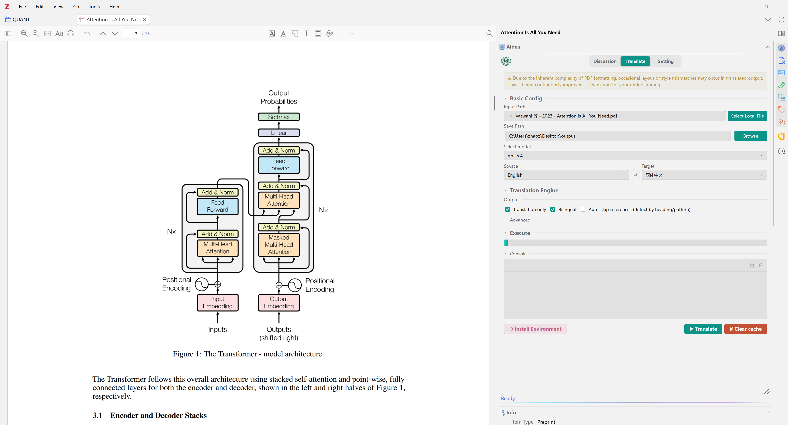
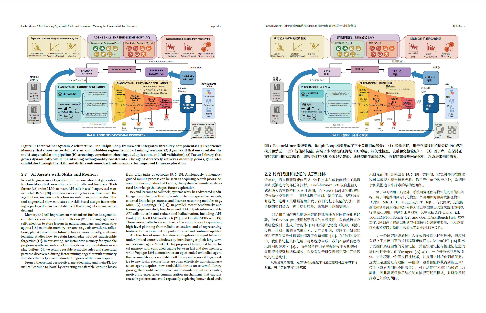

<p align="center">
  
</p>

<h1 align="center">AIdea</h1>

<p align="center">
  <a href="./README.md">English</a>
  ·
  <a href="./doc/readme/README.zh-CN.md">简体中文</a>
  ·
  <a href="./doc/readme/README.zh-TW.md">繁體中文</a>
  ·
  <a href="./doc/readme/README.ja.md">日本語</a>
  ·
  <a href="./doc/readme/README.ko.md">한국어</a>
  ·
  <a href="./doc/readme/README.fr.md">Français</a>
</p>

<p align="center">
  <strong>🌐 Website:</strong> <a href="https://visterainer.github.io/aidea-zotero/en/">https://visterainer.github.io/aidea-zotero/en/</a>
</p>

**Free, open-source AI assistant for Zotero 7–10**

Read PDFs and EPUBs with AIdea in the side panel. Ask about a passage, follow a page or chapter citation back to its source, or save an answer as a Zotero note. For full papers, translate one PDF or queue several and export translated-only or bilingual copies.

## Install AIdea

1. Download the **AIdea .xpi** from the [latest release](https://github.com/Visterainer/aidea-zotero/releases/latest).
2. In Zotero, open **Tools → Plugins**, click the gear, and choose **Install Plugin From File**. Select the download and restart Zotero.
3. Open **Zotero Settings → AIdea** and connect a model. Then open a PDF or EPUB and ask a question in the AIdea side panel.

## Connect a model

- **ChatGPT** — On the OpenAI card, install the standalone Codex CLI with **Install/Update Env**, sign in with **OAuth Login**, then **Refresh Models**.
- **GitHub Copilot** — On the Copilot card, start **OAuth Login**, authorize the device code in your browser, then refresh the model list.
- **Compatible API or local model** — Enter the API base URL and model ID. Supply a key if the service requires one. For Ollama running locally, the usual base URL is `http://localhost:11434/v1`.

Full-PDF translation uses a separate environment. Open **Translate → Install/Update Translation Environment** before the first job. Chat and selection translation only need a connected model.

## ✨ Features

### 💬 AI Chat in the Side Panel

Chat with AI directly in Zotero's side panel, available in the **Library** view and the **PDF or EPUB Reader**. Ask questions, get summaries, and stay inside the same research workflow. EPUB conversations use the book's EPUB 2/3 publisher structure and bounded local retrieval to select relevant sections without an additional planning-model request.

<p align="center">
  
</p>

### 📄 Paper-Aware Context

Select text in the PDF or EPUB reader and click **Add Text** to attach the selected passage to the context area. AIdea can then answer against the selected passage instead of relying on a generic summary.

### 📝 Selection Translation

Translate selected text directly in Zotero's PDF or EPUB reader popup. AIdea detects the active format automatically, with no manual switch required. Selection translation uses the same OAuth/API model list as the chat panel, but can be configured with its own enable switch, model, source language, and target language.

For PDFs, the first selection translation creates a local cold-start cache with a compact paper overview and terminology summary. If that context exceeds the model's input limit, AIdea progressively reduces it and retries, then falls back to translating only the selected text if needed. EPUB selections instead use bounded, selection-anchored book context without a separate warm-up request. Translated passages can be added to Zotero notes or written into a new highlight annotation by selecting **Write translation to annotation** before choosing a color; existing annotation comments are preserved. The checkbox remembers both enabling and disabling across selections, documents, and Zotero restarts. It is off by default; when enabled, wait for the translation to finish, then choose a highlight color.

<p align="center">
  
</p>

<p align="center">
  
</p>

### ⚡ Quick Action Shortcuts

Use one-click shortcuts for common tasks such as **Summarize**, **Explain**, and **Translate**. Shortcuts can be added, edited, reordered, or removed to match your workflow.

### 🖼️ Multimodal Support

Attach screenshots, figures, and charts to your messages. AIdea supports drag and drop, clipboard paste, and screenshot capture directly from PDF content.

### 📄 Full-Document Translation

Translate full papers directly inside Zotero and export a **side-by-side bilingual PDF** or a **single-language PDF**. Select the model and output path, then run the translation from the side panel.

**Batch translation.** Select several library items, add them to the Translate tab, and review the formats and destinations before starting. The queue fills missing outputs by default. After a restart, choose **Continue**. If filing fails, retry delivery from the queue to reuse the translated file.

<p align="center">
  
</p>

Example outputs:

<p align="center">
  
</p>

<p align="center">
  
</p>

<p align="center">
  
</p>

### 📝 Note Export

Save AI responses as Zotero notes with one click. Responses are stored in Markdown and support LaTeX math rendering.

### 💾 Persistent Chat History

All conversations are stored locally in Zotero's database. You can switch between conversations, continue previous threads, and manage local chat history.

Manually export and import chat archives with optional screenshots, images, and uploaded files. Imports merge new messages and preserve conversation branches without duplicating repeated imports. Settings, credentials, and the Memory database are not included.

Answers can include clickable PDF page or EPUB chapter citations when reliable locations are available. Cross-device navigation requires matching Zotero library items and unchanged source files; paper originals are not bundled in chat archives.

### 🧠 Memory System

AIdea captures and recalls useful information across conversations to improve continuity and context awareness over time.

- **Auto-capture** detects preferences, decisions, facts, and key entities from natural conversation
- **Per-library isolation** keeps memories scoped to each Zotero library
- **Smart deduplication** uses Jaccard token similarity to prevent redundant memories
- **Relevance-ranked retrieval** combines overlap, substring match, recency, and importance
- **Prompt injection defense** blocks malicious or irrelevant content from being stored
- **Fully local storage** keeps memory data inside Zotero's SQLite database

### 🎨 Rich Rendering

- Full **Markdown** rendering, including headings, lists, code blocks, and tables
- **LaTeX** math support via KaTeX
- **Syntax highlighting** for code blocks
- Smooth **streaming** responses

### 🌍 Interface Languages

The plugin interface supports **13 UI languages**: **English**, **简体中文**, **繁體中文**, **日本語**, **한국어**, **Français**, **Deutsch**, **Español**, **Русский**, **Português**, **العربية**, **فارسی**, and **हिन्दी**. The translation target is independent of the interface language.

**Persian (فارسی):** Selection translations and ordinary horizontal paragraphs in translated-only and bilingual PDFs support right-to-left text. With the verified translation environment, AIdea shapes these PDF paragraphs and preserves their logical text for selection and search in Zotero. Rotated text, overlapping elements, inline formulas and mixed-style paragraphs may retain the engine’s native layout; review the completion warnings for those pages. This correction does not modify the original side of a bilingual PDF.

### Corresponding author profiles

In AIdea settings, enable **Right-click author profile generation** under **Online Author Lookup**. Right-click a library item and choose **AIdea: Generate Corresponding Author Profile** to save a profile as a Zotero note.

### Reasoning effort

For models that publish supported reasoning levels, set **Reasoning effort** separately for chat, selection translation, and full-PDF translation. Refresh the model list if the control is unavailable.

## ⚙️ Configuration

| Setting                         | Description                                                            | Default                              |
| ------------------------------- | ---------------------------------------------------------------------- | ------------------------------------ |
| **UI Language**                 | Plugin interface language                                              | Auto-detected, fallback EN           |
| **System Prompt**               | Custom instructions for the model                                      | Empty                                |
| **Show "Add Text"**             | Show the Add Text option in the reader selection popup                 | On                                   |
| **Selection Translation**       | Translate selected reader text with automatic bounded document context | On                                   |
| **Selection Translation Model** | Dedicated model for reader selection translation                       | First available model unless changed |
| **Show All Models**             | Show all available models instead of a curated subset                  | Off                                  |
| **Tab Bar**                     | Show or hide the tab navigation bar                                    | Visible                               |

---

The default chat prompt favors direct, natural answers, with enough detail for the task and citations grounded in the available material. Extracted text does not imply access to unavailable pages or figure images.

To customize the response style, open **Settings → Advanced → Custom System Prompt**. Leave it blank to use the default; a non-empty value replaces the default chat prompt. Existing custom prompts are preserved. Changes apply to the next request without restarting Zotero; start a new conversation for a clean comparison because earlier answers remain in history. Selection translation, cold-start summaries, conversation compaction, and author profiles use independent task prompts, unaffected by this chat setting. Full-document translation retains its own configuration.

## 🔒 Privacy & Security

- OAuth tokens are stored **locally only**
- API requests are sent **directly** to the selected provider or configured endpoint
- AIdea **does not collect usage telemetry or user data**
- Chat history and memory remain in Zotero's local database
- The code is fully available for inspection on [GitHub](https://github.com/Visterainer/aidea-zotero)

---

## 🗺️ Roadmap

Planned directions for future releases include:

- **One-click architecture diagrams**, for generating structural visualizations from paper content

> 💡 Feature requests are welcome through [Issues](https://github.com/Visterainer/aidea-zotero/issues).

---

## 🛠️ Development

```bash
# Install dependencies
npm install

# Development mode
npm start

# Build production XPI
npm run build

# Run tests
npm run test:unit
```

---

## 📄 License

[AGPL-3.0-or-later](./LICENSE)

This project is derived from [llm-for-zotero](https://github.com/yilewang/llm-for-zotero) by Yile Wang. See [THIRD_PARTY_NOTICES.md](./THIRD_PARTY_NOTICES.md) for attribution details.

---

## ⭐ Star History

<a href="https://star-history.com/#Visterainer/aidea-zotero&Date">
 <picture>
   <source media="(prefers-color-scheme: dark)" srcset="https://api.star-history.com/svg?repos=Visterainer/aidea-zotero&type=Date&theme=dark" />
   <source media="(prefers-color-scheme: light)" srcset="https://api.star-history.com/svg?repos=Visterainer/aidea-zotero&type=Date" />
   
 </picture>
</a>

---

<p align="center">
  Author: <strong>zhile</strong>
</p>
