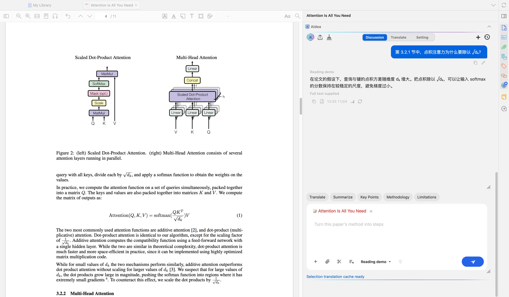
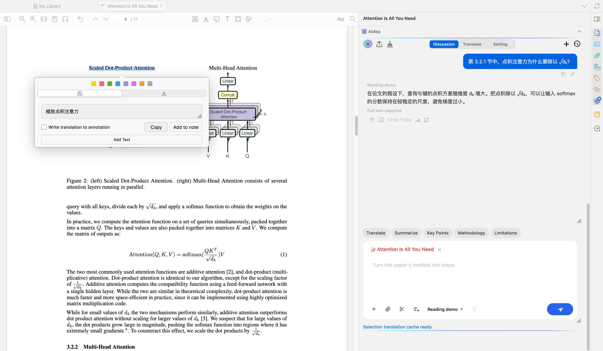
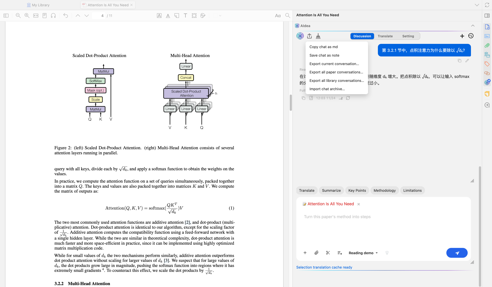

  

# AIdea

  <a href="../../README.md">English</a>
  ·
  <a href="./README.zh-CN.md">简体中文</a>
  ·
  <a href="./README.zh-TW.md">繁體中文</a>
  ·
  <a href="./README.ja.md">日本語</a>
  ·
  <a href="./README.ko.md">한국어</a>
  ·
  <a href="./README.fr.md">Français</a>

  <a href="https://visterainer.github.io/aidea-zotero/fr/">Site du projet</a> · <a href="../../doc/user-guide/fr.md">Guide d’utilisation</a> · <a href="https://github.com/Visterainer/aidea-zotero/releases/latest">Télécharger</a>

**AIdea est un assistant de lecture libre et gratuit pour Zotero 7 à 10.** Interrogez un passage de PDF ou d’EPUB, retrouvez la source citée et conservez l’explication dans une note rattachée à l’article.

## Lire des PDF et des EPUB

Dans [Attention Is All You Need](https://arxiv.org/html/1706.03762v7#S3.SS2.SSS1) de Vaswani et ses collègues, on peut demander « Pourquoi la section 3.2.1 divise-t-elle les produits scalaires par √dₖ ? » La figure 2 et l’équation (1) situent cette opération. Le texte explique comment elle évite des gradients très faibles dans le softmax. Une référence localisée dans la réponse ouvre la page du PDF ou le chapitre de l’EPUB. Ajoutez un second article avec `@` pour comparer deux méthodes ou deux résultats dans la même discussion. Les raccourcis permettent de résumer les points clés, les méthodes ou les limites. Une capture d’écran permet aussi de poser une question sur une figure. Les réponses prennent en charge Markdown, les tableaux, le code et les formules LaTeX et peuvent être enregistrées dans une note Zotero.

  
   <em>La figure 2 et l’équation (1) à côté d’une question sur le facteur d’échelle. Les réponses et la traduction de la sélection utilisent des exemples locaux en chinois simplifié.</em>

## Traduire et annoter un passage

La traduction d’un terme ou d’un paragraphe sélectionné dans un PDF ou un EPUB s’affiche près du texte source. Elle peut rejoindre une note ou devenir le commentaire d’un nouveau surlignage. Il suffit de rouvrir le surlignage pour la relire.

  
   <em>Le terme anglais « Scaled Dot-Product Attention » est traduit en chinois simplifié par « 缩放点积注意力 ». La traduction peut rejoindre une note ou un surlignage.</em>

## Traduire un PDF ou un lot d’articles

Un **PDF traduit** ou une **édition bilingue en vis-à-vis** peut être joint à la notice Zotero ou enregistré dans un dossier. Les pages numérisées sont réorientées avant la reconnaissance de caractères. La mise en page du texte traduit dans les tableaux et la copie des valeurs numériques ont également été améliorées.

Pour un lot, la liste des articles peut être vérifiée avant le lancement. Par défaut, seuls les fichiers manquants aux formats et emplacements choisis sont produits, ce qui préserve les traductions déjà annotées. La file peut reprendre après un redémarrage de Zotero. Si le classement échoue après la traduction, une nouvelle tentative réutilise le fichier déjà produit.

  
   <em>Les versions NeurIPS et arXiv du même article dans la liste du lot.</em>

  
   <em>Page 6 en anglais à gauche et en chinois simplifié à droite. Le tableau 1 compare la complexité de calcul de plusieurs types de couches.</em>

  
   <em>La traduction intégrale peut aussi traduire les libellés des schémas d’architecture. Dans la figure 1 de FactorMiner, suivez les flèches bleues entre « Memory Retrieval » et « Library Update » dans l’original anglais à gauche. Dans la version en chinois simplifié à droite, ces étapes portent les noms « 记忆检索 » et « 库更新 ».</em>

## Conserver et transférer les discussions

L’exportation peut porter sur **une discussion, toutes celles d’un article ou celles d’une bibliothèque entière**. Le format JSON conserve le texte et les références. Une archive ZIP peut aussi inclure les captures d’écran et les fichiers ajoutés. L’importation fusionne les nouveaux messages et préserve les branches des conversations. Les documents originaux sont synchronisés séparément par Zotero. Sur un autre appareil, les références retrouvent les notices et les fichiers correspondants.

  
   <em>Menu d’importation et trois périmètres d’exportation des discussions</em>

## Profils des auteurs correspondants

AIdea peut produire des profils pour un ou plusieurs articles à partir du texte et de sources scientifiques publiques. Chaque profil cite ses sources et est enregistré dans une note Zotero sous la notice concernée. Une nouvelle génération actualise la note de profil AIdea existante.

## Modèles et langues

AIdea accepte les comptes ChatGPT et GitHub Copilot, les API compatibles OpenAI et les modèles locaux servis par Ollama ou LM Studio. Les modèles compatibles peuvent utiliser des niveaux de raisonnement distincts pour la discussion, la traduction de passages et celle de PDF entiers. L’historique et la mémoire propre à chaque bibliothèque restent sur l’appareil. Le service de modèle choisi traite les extraits nécessaires à chaque demande.

L’interface existe en 13 langues. La langue de traduction se choisit indépendamment.

---

[AGPL-3.0-or-later](../../LICENSE) · Projet dérivé de [llm-for-zotero](https://github.com/yilewang/llm-for-zotero) (Yile Wang) · [Mentions des tiers](../../THIRD_PARTY_NOTICES.md)
