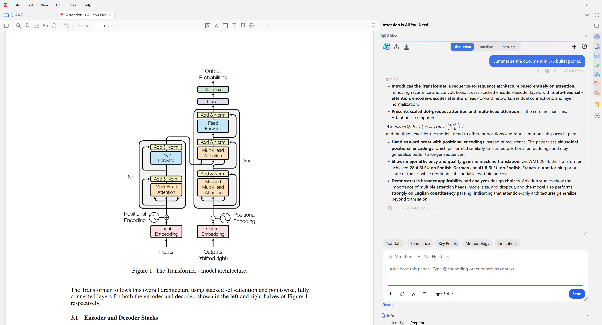
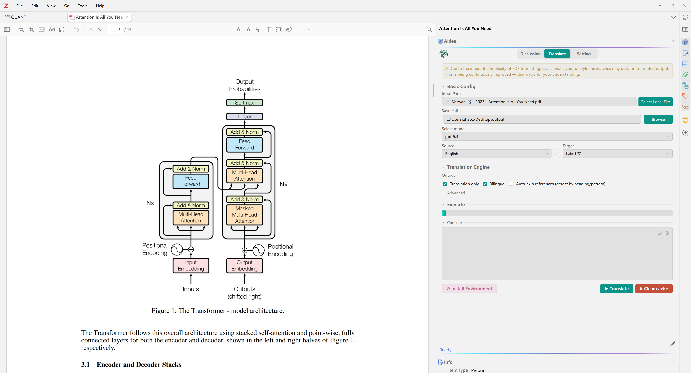
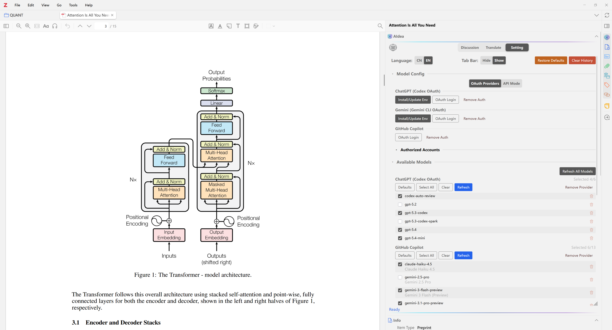

<p align="center">
  
</p>

# AIdea

<p align="center">
  <a href="../../README.md">English</a>
  ·
  <a href="./README.zh-CN.md">简体中文</a>
  ·
  <a href="./README.zh-TW.md">繁體中文</a>
  ·
  <a href="./README.ja.md">日本語</a>
  ·
  <a href="./README.ko.md">한국어</a>
  ·
  <a href="./README.fr.md">Français</a>
</p>

<p align="center">
  <strong>🌐 Website:</strong> <a href="https://visterainer.github.io/aidea-zotero/fr/">https://visterainer.github.io/aidea-zotero/fr/</a>
</p>

**Assistant IA libre et gratuit pour Zotero 7 à 10**

Interrogez un passage de PDF ou d’EPUB dans le panneau latéral de Zotero. Une référence de page ou de chapitre permet de revenir à la source, puis d’enregistrer la réponse dans une note Zotero. Traduisez un PDF ou préparez un lot pour exporter des copies traduites ou bilingues.

## Installer AIdea

1. Téléchargez le **fichier .xpi d’AIdea** depuis la [dernière version](https://github.com/Visterainer/aidea-zotero/releases/latest).
2. Dans **Outils → Extensions** de Zotero, ouvrez la roue dentée et installez l’extension depuis le fichier téléchargé. Redémarrez Zotero.
3. Ouvrez **Paramètres de Zotero → AIdea** et connectez un modèle. Ouvrez ensuite un PDF ou un EPUB et posez une question dans le panneau AIdea.

## Connecter un modèle

- **ChatGPT** — Dans la carte OpenAI, installez la version autonome de Codex CLI avec le bouton de mise à jour de l’environnement. Connectez-vous par OAuth, puis actualisez la liste des modèles.
- **GitHub Copilot** — Lancez la connexion OAuth depuis la carte Copilot, confirmez le code de l’appareil dans votre navigateur, puis actualisez les modèles dans Zotero.
- **API compatible ou modèle local** — Renseignez l’URL de base de l’API et l’identifiant du modèle. Ajoutez une clé si le service la demande. Pour Ollama en local, l’adresse habituelle est `http://localhost:11434/v1`.

Avant la première traduction intégrale de PDF, installez ou mettez à jour l’environnement depuis l’onglet **Traduire**. La discussion et la traduction de passages demandent seulement une connexion à un modèle.

## Capacités principales

- **Dialogue IA dans le panneau latéral** de la vue Bibliothèque et des lecteurs PDF et EPUB
- **Contexte centré sur le document** à partir de texte PDF sélectionné, de la structure éditoriale EPUB 2/3, de captures, de figures et de pièces jointes
- **Actions rapides** pour résumer, expliquer, traduire et exécuter d'autres tâches fréquentes
- **Plusieurs modes de connexion**, avec OAuth ou API compatible OpenAI
- **Traduction intégrale** exécutée dans Zotero avec export PDF
- **Traduction par sélection** dans les lecteurs PDF et EPUB, avec détection automatique du format, contexte documentaire borné et ajout possible aux notes Zotero
- **Historique et mémoire locale**, avec isolation par bibliothèque et export des réponses vers les notes Zotero
- **Rendu enrichi** pour Markdown, blocs de code, tableaux, LaTeX et réponses en flux

## Captures d'écran

### Dialogue dans le panneau latéral

<p align="center">
  
</p>

### Traduction intégrale

<p align="center">
  
</p>

### Traduction par sélection

<p align="center">
  
</p>

<p align="center">
  
</p>

### Paramètres des fournisseurs et des modèles

<p align="center">
  
</p>

## Confidentialité et traitement des données

- Les jetons OAuth sont conservés localement sur votre machine.
- Les requêtes API sont envoyées directement au fournisseur choisi ou au point de terminaison configuré.
- L'historique des conversations et la mémoire sont stockés dans la base SQLite locale de Zotero.
- Le projet n'exploite aucun service relais et ne collecte pas de télémétrie d'usage.

## Développement

```bash
npm install
npm start
npm run build
npm run test:unit
```

## Licence et attribution

AIdea est distribué sous licence [AGPL-3.0-or-later](../../LICENSE).

Le projet est dérivé de [llm-for-zotero](https://github.com/yilewang/llm-for-zotero). Consultez [THIRD_PARTY_NOTICES.md](../../THIRD_PARTY_NOTICES.md) pour les mentions tierces.

## ⭐ Star History

<a href="https://star-history.com/#Visterainer/aidea-zotero&Date">
 <picture>
   <source media="(prefers-color-scheme: dark)" srcset="https://api.star-history.com/svg?repos=Visterainer/aidea-zotero&type=Date&theme=dark" />
   <source media="(prefers-color-scheme: light)" srcset="https://api.star-history.com/svg?repos=Visterainer/aidea-zotero&type=Date" />
   
 </picture>
</a>
