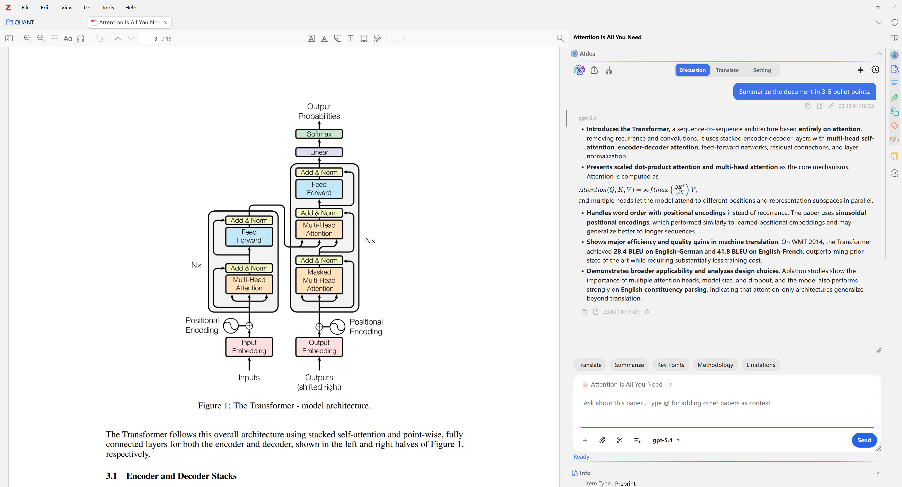
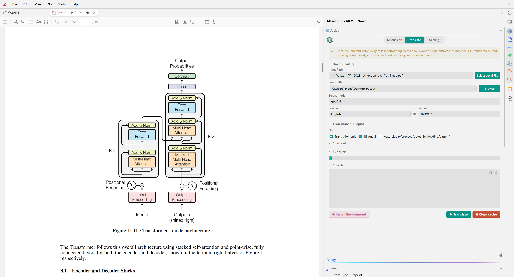
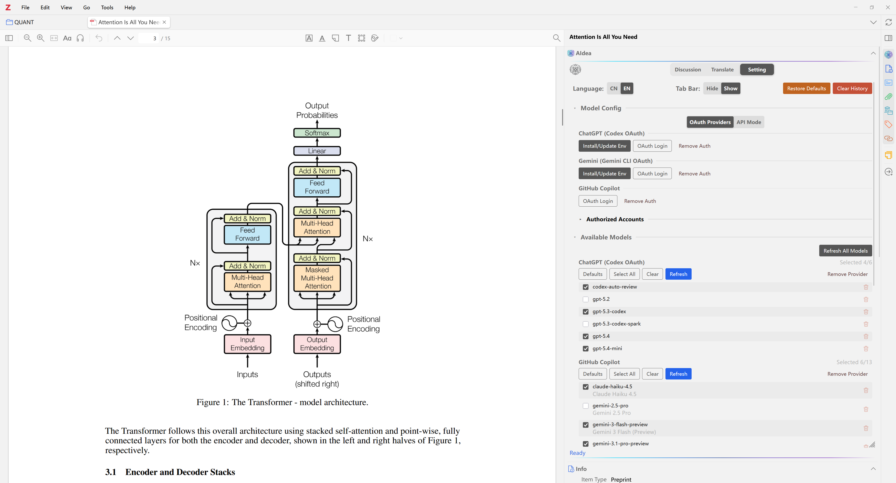

<p align="center">
  
</p>

# AIdea

<p align="center">
  <a href="../../README.md">English</a>
  ·
  <a href="./README.zh-CN.md">简体中文</a>
  ·
  <a href="./README.zh-TW.md">繁體中文</a>
  ·
  <a href="./README.ja.md">日本語</a>
  ·
  <a href="./README.ko.md">한국어</a>
  ·
  <a href="./README.fr.md">Français</a>
</p>

<p align="center">
  <strong>🌐 Website:</strong> <a href="https://visterainer.github.io/aidea-zotero/ja/">https://visterainer.github.io/aidea-zotero/ja/</a>
</p>

**Zotero 7–10 対応の無料オープンソース AI アシスタント**

Zotero のサイドパネルで PDF や EPUB を読みながら、選択した段落について質問できます。回答のページ番号や章の引用から原文を開き、回答を Zotero のノートに保存できます。PDF は個別または一括で翻訳し、訳文のみの版や対訳版を書き出せます。

## AIdea をインストールする

1. [最新リリース](https://github.com/Visterainer/aidea-zotero/releases/latest)から **AIdea の .xpi ファイル**をダウンロードします。
2. Zotero の **ツール → プラグイン** を開き、歯車メニューからファイルを指定してインストールします。ダウンロードしたファイルを選び、Zotero を再起動します。
3. **Zotero の設定 → AIdea** でモデルに接続します。PDF または EPUB を開き、AIdea のサイドパネルで質問します。

## モデルに接続する

- **ChatGPT** — OpenAI カードの環境インストールボタンでスタンドアロン版 Codex CLI を導入します。OAuth でログインし、モデル一覧を更新します。
- **GitHub Copilot** — Copilot カードから OAuth ログインを開始し、ブラウザーでデバイスコードを確認して認証します。Zotero に戻り、モデル一覧を更新します。
- **互換 API またはローカルモデル** — API のベース URL とモデル ID を入力します。サービスが認証を求める場合は API キーも入力します。ローカルの Ollama では通常 `http://localhost:11434/v1` を使います。

PDF 全文翻訳を初めて使うときは、**翻訳** タブで翻訳環境をインストールまたは更新してください。チャットと選択範囲の翻訳はモデルに接続すれば使えます。

## 主な機能

- **サイドパネル AI チャット** を Zotero ライブラリ画面、PDF リーダー、EPUB リーダーで利用可能
- **文書コンテキスト解析** により、PDF の選択箇所、EPUB 2/3 の出版者構造、スクリーンショット、図表、添付ファイルを参照可能
- **クイックアクション** による要約、解説、翻訳などの定型操作
- **複数の接続方式** として OAuth ログインと OpenAI 互換 API モードをサポート
- **全文翻訳** を Zotero 内で実行し、PDF として書き出し可能
- **選択範囲の翻訳** を PDF または EPUB リーダーで実行し、文書形式を自動判別して、範囲を制限した文書コンテキストを使いながら Zotero ノートへ追加可能
- **ローカル履歴と記憶** により、ライブラリ単位の分離、ノート書き戻し、継続対話を実現
- **豊富なレンダリング** として Markdown、コードブロック、表、LaTeX、ストリーミング表示をサポート

## スクリーンショット

### サイドパネルチャット

<p align="center">
  
</p>

### 全文翻訳

<p align="center">
  
</p>

### 選択範囲の翻訳

<p align="center">
  
</p>

<p align="center">
  
</p>

### プロバイダとモデル設定

<p align="center">
  
</p>

## プライバシーとデータ処理

- OAuth トークンはローカル環境に保存されます。
- API 通信は、選択したプロバイダまたは設定したエンドポイントへ直接送信されます。
- チャット履歴と記憶データは Zotero のローカル SQLite データベースに保存されます。
- このプロジェクトは中継サービスを提供せず、利用状況のテレメトリも収集しません。

## 開発

```bash
npm install
npm start
npm run build
npm run test:unit
```

## ライセンスと謝辞

AIdea は [AGPL-3.0-or-later](../../LICENSE) のもとで公開されています。

本プロジェクトは [llm-for-zotero](https://github.com/yilewang/llm-for-zotero) を基に発展したものです。サードパーティに関する記載は [THIRD_PARTY_NOTICES.md](../../THIRD_PARTY_NOTICES.md) を参照してください。

## ⭐ Star History

<a href="https://star-history.com/#Visterainer/aidea-zotero&Date">
 <picture>
   <source media="(prefers-color-scheme: dark)" srcset="https://api.star-history.com/svg?repos=Visterainer/aidea-zotero&type=Date&theme=dark" />
   <source media="(prefers-color-scheme: light)" srcset="https://api.star-history.com/svg?repos=Visterainer/aidea-zotero&type=Date" />
   
 </picture>
</a>
