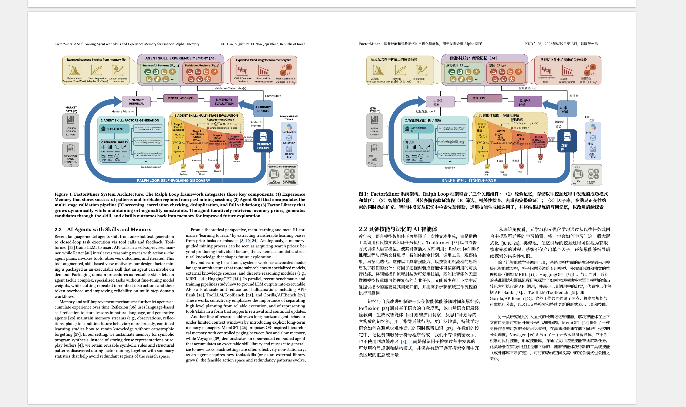

  

# AIdea

  <a href="../../README.md">English</a>
  ·
  <a href="./README.zh-CN.md">简体中文</a>
  ·
  <a href="./README.zh-TW.md">繁體中文</a>
  ·
  <a href="./README.ja.md">日本語</a>
  ·
  <a href="./README.ko.md">한국어</a>
  ·
  <a href="./README.fr.md">Français</a>

  <a href="https://visterainer.github.io/aidea-zotero/">プロジェクトサイト</a> · <a href="https://visterainer.github.io/aidea-zotero/guide/">使い方</a> · <a href="https://github.com/Visterainer/aidea-zotero/releases/latest">ダウンロード</a>

**AIdea は Zotero 7–10 対応の無料オープンソース読書アシスタントです。** PDF や EPUB の一節について質問し、引用から原文に戻り、役立つ説明を文献のノートに残せます。

## PDF・EPUB を読む

Vaswani らの論文 [Attention Is All You Need](https://arxiv.org/html/1706.03762v7#S3.SS2.SSS1) の第 3.2.1 節で、「なぜ内積を √dₖ で割るのか」と質問できます。図 2 と式（1）でスケーリングの位置を確認し、softmax の勾配が極端に小さくなるのを防ぐ仕組みを本文と照合できます。回答に位置情報付きの引用があれば、該当する PDF のページや EPUB の章を開けます。`@` で別の文献を加えて、同じ会話で手法や結果を比較することもできます。ショートカットで要点・研究手法・限界をまとめたり、図表のスクリーンショットを添えて質問したりできます。回答は Markdown、表、コード、LaTeX 数式に対応し、Zotero のノートに保存できます。

  
   <em>図 2 と式（1）を読みながらスケーリングについて質問した例。会話と選択範囲の訳文は簡体字中国語のローカル表示用サンプルです。</em>

## 選択範囲の翻訳と注釈

PDF や EPUB で語句や段落を選ぶと、原文のそばに訳文が表示されます。訳文をノートに加えたり、新しいハイライトのコメントに残したりできます。後でハイライトを開くと、訳文を読み返せます。

  
   <em>英語の「Scaled Dot-Product Attention」を簡体字中国語の「缩放点积注意力」に翻訳。訳文をノートやハイライトに保存できます。</em>

## PDF の全文翻訳と一括処理

**訳文のみの PDF** と **原文と訳文を並べた対訳 PDF** を文献に添付したり、フォルダーに書き出したりできます。スキャンページは OCR の前に向きが補正されます。表の訳文の収まりや数値のコピーも改善されています。

複数の文献はリストで確認してからまとめて翻訳できます。既定では不足している形式・保存先のファイルだけを作成し、注釈付きの既存訳文を保持します。再起動後はキューを再開できます。訳文が完成して保存だけが失敗した場合は、生成済みのファイルを使って保存をやり直せます。

  
   <em>同じ論文の NeurIPS 版と arXiv 版を一括翻訳リストに追加した例。</em>

  
   <em>6 ページの対訳。左が英語の原文、右が簡体字中国語の訳文です。表 1 は各層の計算量を比較しています。</em>

  
   <em>全文翻訳では、構成図の中のラベルも翻訳できます。FactorMiner の図 1 で青い矢印をたどると、左の英語原図にある「Memory Retrieval」と「Library Update」が、右の簡体字中国語版では「记忆检索」と「库更新」になっています。</em>

## 会話の保存と移行

**現在の会話、文献別の全会話、ライブラリ全体の会話**をエクスポートできます。JSON には文章と引用が、ZIP にはスクリーンショットやアップロードしたファイルも含められます。インポート時には新しいメッセージを統合し、会話の分岐を保ちます。文献の原本は Zotero で別途同期し、移行先に同じ文献とファイルがあれば引用から原文を開けます。

  
   <em>会話のエクスポート範囲とインポートのメニュー</em>

## 責任著者のプロフィール

論文と公開されている学術資料を基に、1 件または複数の文献の責任著者プロフィールを作成できます。確認用の出典を含むノートが各文献の下に保存され、再生成すると既存の AIdea プロフィールノートが更新されます。

## モデルと言語

ChatGPT、GitHub Copilot、OpenAI 互換 API、Ollama や LM Studio で動かすローカルモデルに対応しています。対応モデルでは、会話・選択範囲の翻訳・全文翻訳に別々の推論強度を使えます。履歴とライブラリごとのメモリーはローカルに保存され、各リクエストに必要な内容は選択したモデルのサービスで処理されます。

表示言語は 13 種類で、翻訳先の言語は個別に選べます。

---

[AGPL-3.0-or-later](../../LICENSE) · 派生元 [llm-for-zotero](https://github.com/yilewang/llm-for-zotero) (Yile Wang) · [第三者の著作権表示](../../THIRD_PARTY_NOTICES.md)
