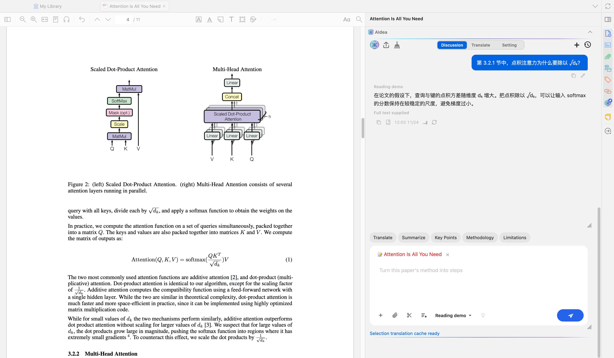
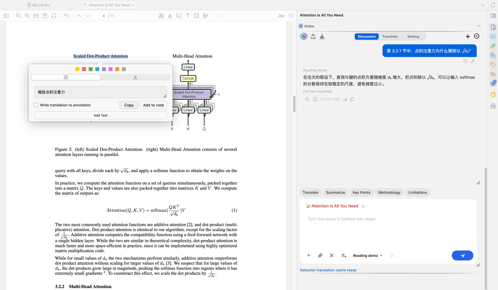
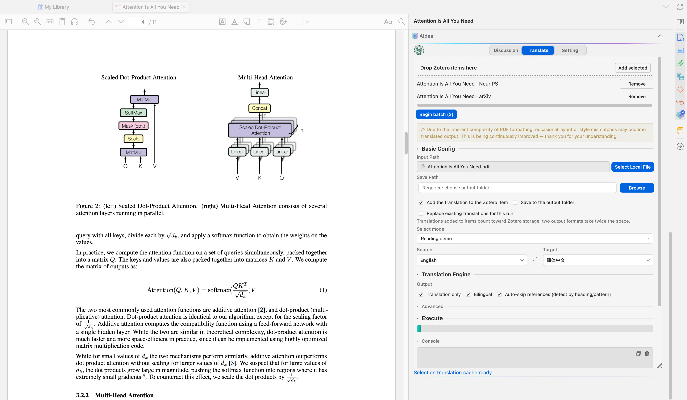
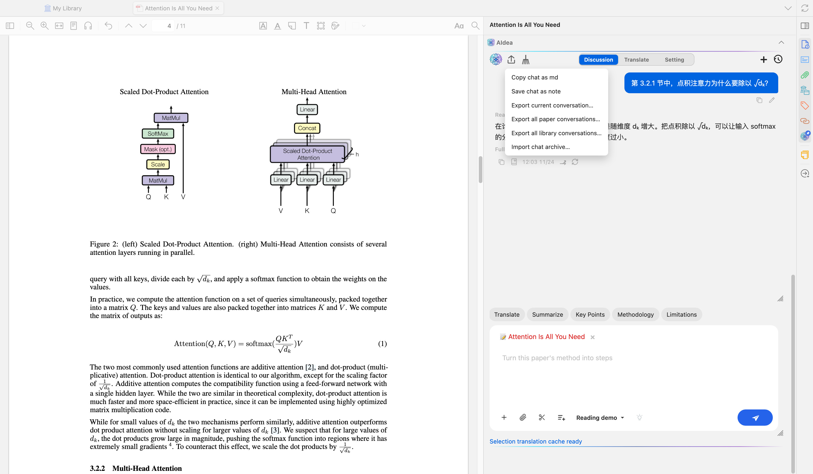

  

# AIdea

  <a href="../../README.md">English</a>
  ·
  <a href="./README.zh-CN.md">简体中文</a>
  ·
  <a href="./README.zh-TW.md">繁體中文</a>
  ·
  <a href="./README.ja.md">日本語</a>
  ·
  <a href="./README.ko.md">한국어</a>
  ·
  <a href="./README.fr.md">Français</a>

  <a href="https://visterainer.github.io/aidea-zotero/">프로젝트 웹사이트</a> · <a href="https://visterainer.github.io/aidea-zotero/guide/">사용 설명서</a> · <a href="https://github.com/Visterainer/aidea-zotero/releases/latest">다운로드</a>

**AIdea는 Zotero 7–10용 무료 오픈 소스 읽기 도우미입니다.** PDF나 EPUB의 한 구절에 관해 질문하고, 인용된 원문을 확인한 뒤, 필요한 설명을 문헌 노트로 남길 수 있습니다.

## PDF와 EPUB 읽기

Vaswani 등의 논문 [Attention Is All You Need](https://arxiv.org/html/1706.03762v7#S3.SS2.SSS1) 제3.2.1절을 읽으며 “왜 내적을 √dₖ로 나누나요?”라고 물을 수 있습니다. 그림 2와 식 (1)에서 나눗셈이 적용되는 위치를 보고, 이 연산이 softmax의 기울기가 지나치게 작아지는 것을 어떻게 막는지 본문에서 확인할 수 있습니다. 답변에 위치 정보가 있는 인용이 있으면 해당 PDF 페이지나 EPUB 장으로 이동할 수 있습니다. `@`로 다른 문헌을 더해 같은 대화에서 연구 방법이나 결과를 비교할 수도 있습니다. 단축 버튼으로 핵심 내용이나 연구의 한계를 요약할 수 있고, 그림이나 표는 스크린샷을 첨부해 질문할 수 있습니다. 답변은 Markdown, 표, 코드, LaTeX 수식을 지원하며 Zotero 노트로 저장할 수 있습니다.

  
   <em>그림 2와 식 (1) 옆에서 스케일링에 관해 질문한 예입니다. 대화와 선택 영역 번역에는 중국어 간체 로컬 예시 응답을 사용했습니다.</em>

## 선택 영역 번역과 주석

PDF나 EPUB에서 용어나 문단을 선택하면 원문 옆에 번역이 표시됩니다. 번역문을 노트에 추가하거나 새 하이라이트의 주석으로 남길 수 있습니다. 하이라이트를 다시 열면 해당 번역문을 읽을 수 있습니다.

  
   <em>영어 용어 “Scaled Dot-Product Attention”을 중국어 간체 “缩放点积注意力”로 번역한 예입니다. 노트나 하이라이트에 저장할 수 있습니다.</em>

## PDF 전체 번역과 일괄 번역

**번역문 전용 PDF** 또는 **원문 대조 PDF**를 원래 문헌의 첨부 파일이나 별도 폴더에 저장할 수 있습니다. 스캔 페이지는 OCR 전에 방향을 바로잡으며, 번역된 표 안에서 텍스트가 배치되는 방식과 숫자 복사가 개선되었습니다.

여러 문헌을 선택해 목록을 검토한 뒤 한꺼번에 번역할 수 있습니다. 기본값으로는 선택한 형식과 저장 위치에서 누락된 파일만 생성하므로 기존 번역본의 주석이 유지됩니다. Zotero를 다시 시작해도 대기열을 이어갈 수 있습니다. 번역은 끝났지만 저장에 실패했다면 이미 생성된 파일로 저장을 다시 시도합니다.

  
   <em>같은 논문의 NeurIPS 버전과 arXiv 버전을 일괄 번역 목록에 담은 모습입니다.</em>

  
   <em>6쪽의 영문 원문(왼쪽)과 중국어 간체 번역(오른쪽)입니다. 표 1은 여러 층의 계산 복잡도를 비교합니다.</em>

  
   <em>전문 번역은 구조도 안의 문구도 번역할 수 있습니다. FactorMiner의 그림 1에서 파란색 화살표를 따라가면 왼쪽 영어 원문의 “Memory Retrieval”과 “Library Update”가 오른쪽 중국어 간체 번역에서는 각각 “记忆检索”와 “库更新”으로 표시됩니다.</em>

## 대화 기록 보관과 기기 간 이동

**현재 대화, 한 문헌의 모든 대화, 라이브러리 전체의 대화**를 내보낼 수 있습니다. JSON은 텍스트와 인용을 보관하며 ZIP에는 스크린샷과 업로드한 파일도 담을 수 있습니다. 가져오기에서는 새 메시지를 병합하고 대화 분기를 보존합니다. 원본 문헌은 Zotero를 통해 별도로 동기화하며, 다른 기기에 같은 문헌과 파일이 있으면 인용을 눌러 원문으로 돌아갈 수 있습니다.

  
   <em>세 가지 대화 내보내기 범위와 가져오기 메뉴</em>

## 교신저자 소개

논문과 공개 학술 자료를 바탕으로 한 편 또는 여러 편의 교신저자 소개를 생성할 수 있습니다. 확인할 수 있는 출처와 함께 각 문헌의 Zotero 노트로 저장됩니다. 다시 생성하면 기존 AIdea 저자 소개 노트가 갱신됩니다.

## 모델과 언어

ChatGPT, GitHub Copilot, OpenAI 호환 API와 Ollama 또는 LM Studio 등에서 실행하는 로컬 모델을 지원합니다. 지원 모델에서는 대화, 선택 영역 번역, PDF 전체 번역의 추론 강도를 각각 지정할 수 있습니다. 기록과 라이브러리별 메모리는 로컬에 보관되며 요청에 필요한 내용은 선택한 모델 서비스가 처리합니다.

인터페이스는 13개 언어를 지원하며 번역 대상 언어는 별도로 선택할 수 있습니다.

---

[AGPL-3.0-or-later](../../LICENSE) · 원본 프로젝트 [llm-for-zotero](https://github.com/yilewang/llm-for-zotero) (Yile Wang) · [제3자 고지](../../THIRD_PARTY_NOTICES.md)
