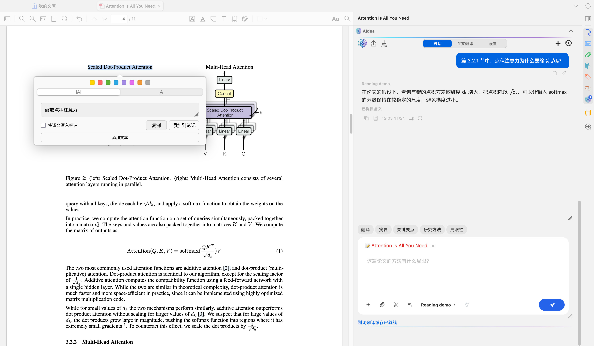
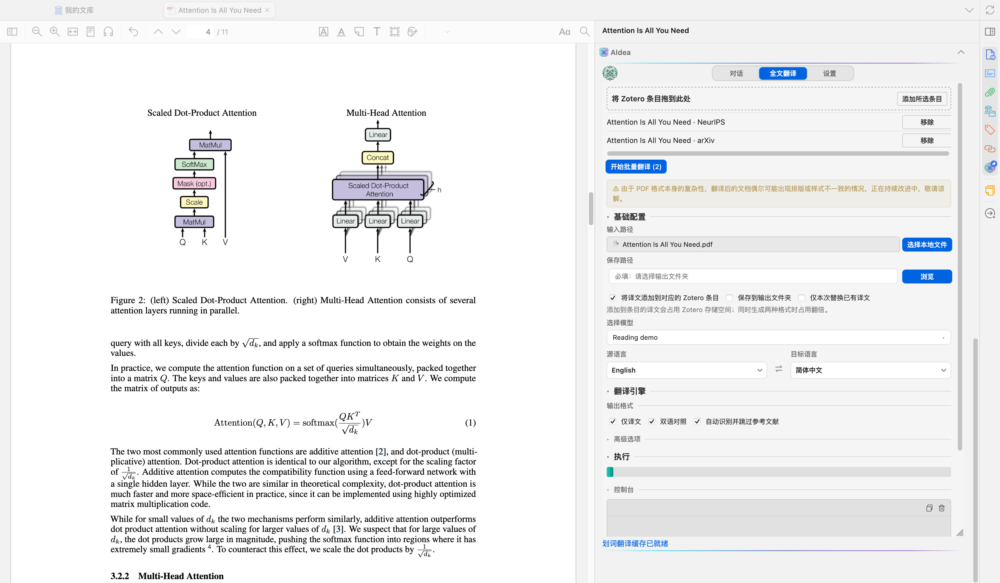

  

<h1 align="center">AIdea</h1>

  <a href="../../README.md">English</a>
  ·
  <a href="./README.zh-CN.md">简体中文</a>
  ·
  <a href="./README.zh-TW.md">繁體中文</a>
  ·
  <a href="./README.ja.md">日本語</a>
  ·
  <a href="./README.ko.md">한국어</a>
  ·
  <a href="./README.fr.md">Français</a>

  <a href="https://visterainer.github.io/aidea-zotero/">项目网站</a> · <a href="https://visterainer.github.io/aidea-zotero/guide/">使用手册</a> · <a href="https://github.com/Visterainer/aidea-zotero/releases/latest">下载</a>

**AIdea 是适用于 Zotero 7–10 的免费开源 AI 阅读助手。** 在同一个阅读器里，你可以针对 PDF 或 EPUB 中的段落提问，核对回答引用的原文，再把有用的解释留在文献笔记里。

## 阅读 PDF 和 EPUB

以 Vaswani 等人的 [《Attention Is All You Need》](https://arxiv.org/html/1706.03762v7#S3.SS2.SSS1) 为例，读到第 3.2.1 节时，可以问：“点积注意力为什么要除以 √dₖ？”结合图 2 和公式（1），可以理解这一缩放如何避免 softmax 的梯度过小。回答中有可定位的引用时，点击即可回到 PDF 对应页面或 EPUB 章节。通过 `@` 加入第二篇文献，还可以在同一对话中比较两篇论文的方法或结论。

快捷按钮可直接提取关键要点、概括研究方法或梳理局限性。讨论图表时可以附上截图。回答支持 Markdown、表格、代码和 LaTeX 公式，也可以一键保存为 Zotero 笔记。

  
   <em>论文图 2 和公式（1），以及侧栏中关于缩放因子的示例问答。问答与划词译文使用本地演示内容。</em>

## 划词翻译与高亮批注

在 PDF 或 EPUB 中选中术语或段落，译文会出现在原文旁。需要保留时，可以把译文加入笔记，也可以把它写入新建高亮的批注。下次点开高亮就能看到译文。

  
   <em>图 2 中的英文术语 Scaled Dot-Product Attention 译为「缩放点积注意力」，可加入笔记或随高亮保存。</em>

## 全文与批量 PDF 翻译

一篇论文可以导出**仅译文 PDF** 或**双语对照 PDF**，作为附件保存在原条目下，也可以输出到文件夹。对于扫描页，翻译流程会在 OCR 前校正页面方向；含表格的页面也改进了译文排版和数值复制。

多选文献后可先预览待译列表，再启动队列。默认只补齐缺少的格式或保存位置，已有译本上的批注得以保留。重启 Zotero 后可以继续队列；如果译文已经生成、只是在归档时失败，重试会复用已生成的文件。

  
   <em>同一篇论文的 NeurIPS 会议版和 arXiv 版加入批量翻译列表。</em>

  
   <em>论文第 6 页的英中对照译例。左侧为英文原文，右侧为简体中文；表 1 对比了不同网络层的计算复杂度。</em>

  
   <em>全文翻译也能翻译框架图里的文字。FactorMiner 图 1 的左侧是英文原图，右侧是简体中文译图。沿蓝色箭头对照两侧，可以看到 “Memory Retrieval” 译为「记忆检索」，“Library Update” 译为「库更新」。</em>

## 聊天记录与跨设备迁移

可以导出**当前会话、某篇论文的全部会话，或整个文库的会话**。JSON 保留文字和引用，ZIP 还能带走截图和上传文件。导入时会合并新增消息并保留对话分支。论文原件由 Zotero 单独同步，另一台设备上有相同文献和原文时，引用仍可跳转。

  
   <em>聊天导出菜单，包含三种导出范围和导入入口</em>

## 通讯作者介绍

AIdea 可以结合论文和公开学术资料，为单篇或多篇文献生成通讯作者介绍，保存在各自条目下的 Zotero 笔记中。介绍附有可核对的资料来源；再次生成时会更新已有的 AIdea 专用笔记。

## 模型与语言支持

支持 ChatGPT 和 GitHub Copilot 账号、OpenAI 兼容 API，以及通过 Ollama、LM Studio 等运行的本地模型。支持推理档位的模型可分别为对话、划词翻译和全文翻译选择思考强度。聊天记录与按文库保存的记忆位于本地；提问和翻译所需的内容由所选模型服务处理。

插件提供 13 种界面语言，翻译目标语言可独立选择。

---

[AGPL-3.0-or-later](../../LICENSE) · 本项目基于 [llm-for-zotero](https://github.com/yilewang/llm-for-zotero) (Yile Wang) · [第三方声明](../../THIRD_PARTY_NOTICES.md)
