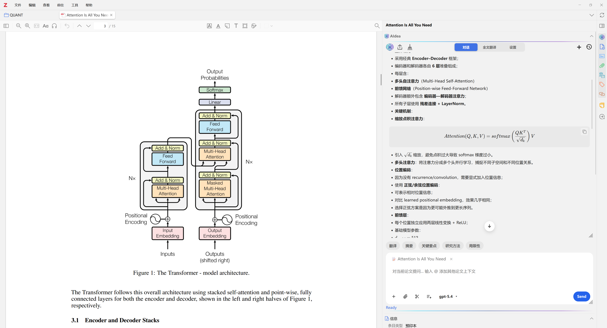
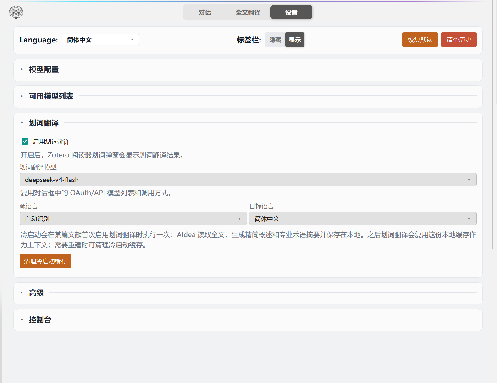
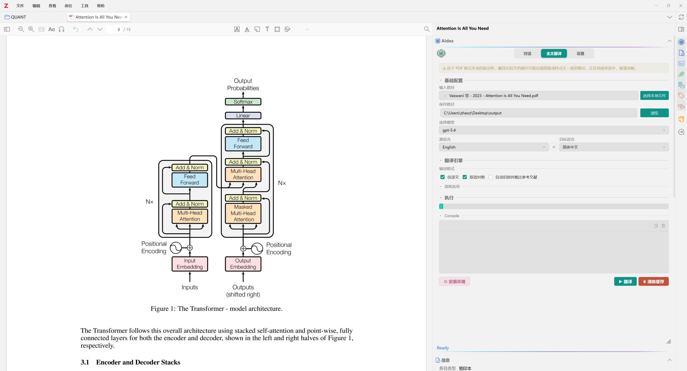
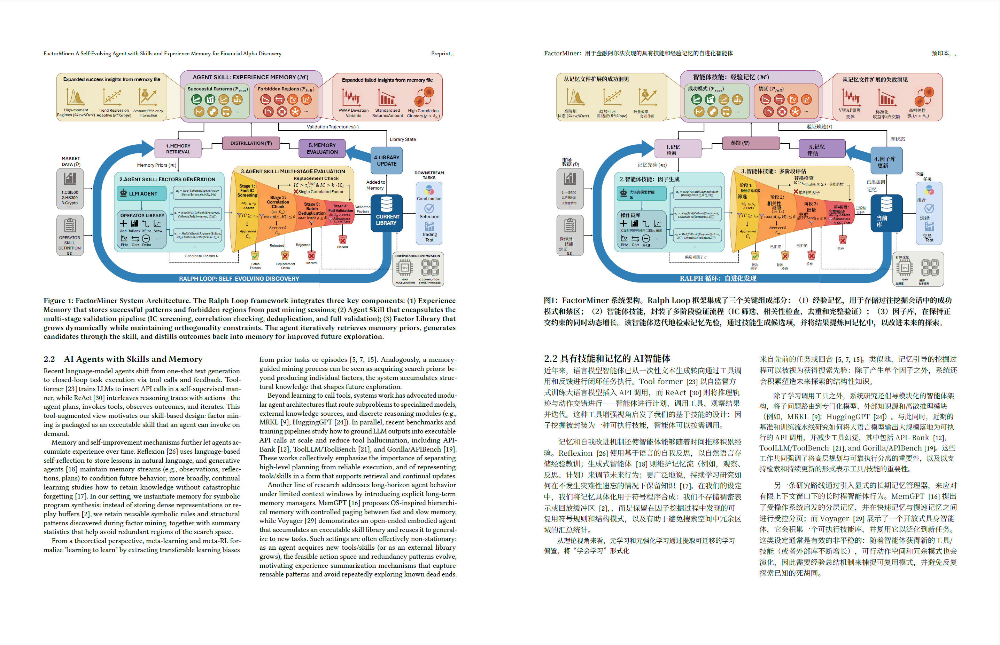
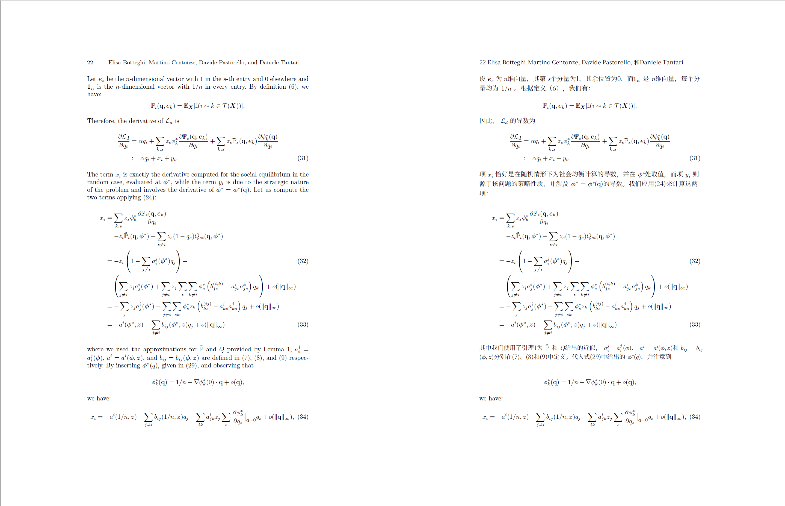

<p align="center">
  
</p>

<h1 align="center">AIdea</h1>

<p align="center">
  <a href="../../README.md">English</a>
  ·
  <a href="./README.zh-CN.md">简体中文</a>
  ·
  <a href="./README.zh-TW.md">繁體中文</a>
  ·
  <a href="./README.ja.md">日本語</a>
  ·
  <a href="./README.ko.md">한국어</a>
  ·
  <a href="./README.fr.md">Français</a>
</p>

<p align="center">
  <strong>🌐 Website:</strong> <a href="https://visterainer.github.io/aidea-zotero/">https://visterainer.github.io/aidea-zotero/</a>
</p>

**适用于 Zotero 7–10 的免费开源 AI 助手**

在 Zotero 侧栏阅读 PDF 和 EPUB。你可以针对选段提问，点击回答中的页码或章节引用返回原文，再把回答存为 Zotero 笔记。需要通读译文时，可以翻译一篇 PDF，也可以批量导出单语译本或双语对照版。

## 安装 AIdea

1. 从[最新发行版](https://github.com/Visterainer/aidea-zotero/releases/latest)下载 **AIdea 的 .xpi 安装包**。
2. 在 Zotero 打开 **工具 → 插件**，点击齿轮，选择 **从文件安装插件**，选中下载的文件后重启 Zotero。
3. 打开 **Zotero 设置 → AIdea**，按下方说明连接模型。打开一篇 PDF 或 EPUB，即可在 AIdea 侧栏提问。

## 连接模型

- **ChatGPT** — 在 OpenAI 卡片点击 **安装/更新环境** 安装独立的 Codex CLI，然后点击 **OAuth 登录**，完成授权后 **刷新模型**。
- **GitHub Copilot** — 在 Copilot 卡片点击 **OAuth 登录**，按提示在浏览器确认设备码，返回 Zotero 刷新模型列表。
- **兼容 API 或本地模型** — 填写 API 基础地址和模型 ID，按服务要求填写密钥。本机运行 Ollama 时，常用地址为 `http://localhost:11434/v1`。

首次翻译整篇 PDF 前，在 **全文翻译** 标签页点击 **安装/更新翻译环境**。对话和划词翻译只需连接模型。

## ✨ 功能特性

### 💬 侧边栏 AI 对话

在 Zotero 的侧边栏中直接与 AI 对话，**文库视图**、**PDF 阅读器**和 **EPUB 阅读器**中均可使用。提问、获取摘要、继续追问，都可以放在同一个研究工作流里完成。EPUB 对话会根据 EPUB 2/3 出版目录结构在本地进行有界检索，无需额外调用一次模型来规划章节。

<p align="center">
  
</p>

### 📄 论文感知上下文

在 PDF 或 EPUB 阅读器中选中文本，点击 **添加文本** 即可将选中内容添加到上下文区域。AI 在回答时会优先结合这些原文内容，而不是只给出泛化总结。

### 📝 划词翻译

可直接在 Zotero PDF 或 EPUB 阅读器的划词弹窗中翻译选中文本。AIdea 会自动识别当前阅读器中的文档格式，无需手动切换。划词翻译复用对话框中的 OAuth/API 模型列表和调用方式，但可以单独启用，并独立选择模型、源语言和目标语言。

PDF 首次使用划词翻译时，AIdea 会在本地生成包含精简概述和专业术语摘要的冷启动缓存。如果上下文超过模型输入限制，AIdea 会逐级缩减内容并自动重试，必要时最终退化为只翻译当前选中的文本。EPUB 划词翻译则直接使用以选中文本为锚点的有界图书上下文，不会额外执行冷启动请求。译文既可以添加到 Zotero 笔记，也可以先勾选 **将译文写入标注**，再选择颜色，将译文写入新建的高亮标注；已有批注内容会被保留。勾选和取消状态都会记住，后续划词、切换文献及重启 Zotero 后仍然保持。该选项默认关闭；开启后，等待译文生成再选择高亮颜色即可。

<p align="center">
  
</p>

<p align="center">
  
</p>

### ⚡ 快捷操作按钮

支持一键触发常用任务，如 **总结**、**解释**、**翻译** 等。快捷按钮可自由添加、编辑、排序和删除，以适配不同研究习惯。

### 🖼️ 多模态支持

可在消息中附加截图、图表、示意图等图片内容。支持拖拽、从剪贴板粘贴，以及直接从 PDF 中截图。

### 📄 全文翻译

可直接在 Zotero 侧边栏选择模型和输出路径，翻译整篇论文并导出 **左右并排的双语对照 PDF** 或 **单语言 PDF**。

在文库多选条目后，通过右键菜单加入翻译列表。确认输出格式和保存位置后再启动队列。默认只补齐缺少的译文。重启 Zotero 后可以继续，归档失败时可重试保存已生成的文件。

<p align="center">
  
</p>

示例结果：

<p align="center">
  
</p>

<p align="center">
  
</p>

<p align="center">
  
</p>

### 📝 笔记导出

可一键将 AI 回复保存为 Zotero 笔记。回复采用 Markdown 格式，并支持 LaTeX 数学公式渲染。

### 💾 持久化聊天记录

所有对话都保存在 Zotero 的本地数据库中，可以在多个会话之间切换，继续之前的讨论，并管理本地聊天历史。

支持手动导出、导入聊天归档，可选择包含截图、图片和上传文件。导入时合并新增消息并保留对话分支，重复导入避免重复添加。不包含设置、认证凭据或 Memory 数据库。

有可靠位置时，回答支持点击引用跳转到 PDF 页面或 EPUB 章节。跨设备跳转需要匹配的 Zotero 文献条目及内容一致的原文文件；聊天归档不打包论文原件。

### 🧠 记忆系统

AIdea 会在多轮对话中捕捉和回忆有价值的信息，以便后续回答更具连续性和上下文相关性。

- **自动捕捉**：识别自然对话中的偏好、事实、决定和关键实体
- **按文库隔离**：不同 Zotero 文库之间的记忆互不干扰
- **智能去重**：通过 Jaccard 相似度避免重复记忆
- **相关性排序检索**：结合词元重叠、子串匹配、时间衰减和重要性进行排序
- **提示注入防护**：防止无关或恶意内容写入记忆
- **完全本地**：所有记忆保存在 Zotero 的 SQLite 数据库中

### 🎨 丰富的渲染效果

- 完整的 **Markdown** 渲染，包括标题、列表、代码块和表格
- **LaTeX** 数学公式支持（KaTeX）
- 代码块 **语法高亮**
- 流畅的 **流式输出**

### 🌍 语言支持

插件界面当前支持 **13 种界面语言**：**English**、**简体中文**、**繁體中文**、**日本語**、**한국어**、**Français**、**Deutsch**、**Español**、**Русский**、**Português**、**العربية**、**فارسی** 和 **हिन्दी**。全文翻译保留独立的目标语言列表，不受界面语言列表限制。

### 通讯作者介绍

在 AIdea 设置里启用 **右键生成通讯作者介绍**，然后在文库中右键点击文献，选择 **AIdea: 生成通讯作者介绍**，即可将结果保存为 Zotero 笔记。

### 思考强度

如果服务商提供模型支持的强度档位，可以分别为对话、划词翻译和全文翻译设置思考强度。控件不可用时，先刷新模型列表。

## ⚙️ 配置选项

| 设置项              | 说明                                                     | 默认值           |
| ------------------- | -------------------------------------------------------- | ---------------- |
| **界面语言**        | 插件界面语言                                             | EN               |
| **系统提示词**      | 模型的自定义指令                                         | 空               |
| **显示 "Add Text"** | 在阅读器选择菜单中显示 Add Text                          | 开启             |
| **划词翻译**        | 在阅读器划词弹窗中翻译选中文本，并自动使用有界文档上下文 | 开启             |
| **划词翻译模型**    | 用于阅读器划词翻译的独立模型                             | 默认使用可用模型 |
| **显示所有模型**    | 显示全部模型而非精选模型                                 | 关闭             |
| **标签栏**          | 显示或隐藏标签导航栏                                     | 显示             |

---

默认对话提示词强调直接、自然地回答问题，根据任务保留必要细节，并以实际提供的材料为依据引用。已提取的文本不代表模型能够看到未提供的页面或图像。

如需调整回答风格，可打开 **设置 → 高级 → 自定义系统提示词**。留空使用默认提示词；填写后替换默认对话提示词。已有自定义内容不会被覆盖。修改从下一次请求生效，无需重启 Zotero；旧回答仍在历史中，建议新建对话进行干净对比。划词翻译、冷启动摘要、历史压缩和作者档案使用独立任务提示词，不受此对话设置影响。全文翻译仍使用自身配置。

## 🔒 隐私与安全

- OAuth 令牌**仅保存在本地**
- API 请求**直接发送**到所选服务商或你配置的端点
- AIdea **不收集遥测或用户数据**
- 聊天记录与记忆保存在 Zotero 的本地数据库中
- 源码可在 [GitHub](https://github.com/Visterainer/aidea-zotero) 公开查看

---

## 🗺️ 未来计划

计划中的方向包括：

- **一键生成框架图**：从论文内容中生成结构化可视图

> 💡 欢迎通过 [Issue](https://github.com/Visterainer/aidea-zotero/issues) 提出需求建议。

---

## 🛠️ 开发

```bash
# 安装依赖
npm install

# 开发模式
npm start

# 构建生产版 XPI
npm run build

# 运行测试
npm run test:unit
```

---

## 📄 许可证

[AGPL-3.0-or-later](../../LICENSE)

本项目基于 [llm-for-zotero](https://github.com/yilewang/llm-for-zotero) 演进而来。完整第三方声明见 [THIRD_PARTY_NOTICES.md](../../THIRD_PARTY_NOTICES.md)。

---

## ⭐ Star History

<a href="https://star-history.com/#Visterainer/aidea-zotero&Date">
 <picture>
   <source media="(prefers-color-scheme: dark)" srcset="https://api.star-history.com/svg?repos=Visterainer/aidea-zotero&type=Date&theme=dark" />
   <source media="(prefers-color-scheme: light)" srcset="https://api.star-history.com/svg?repos=Visterainer/aidea-zotero&type=Date" />
   
 </picture>
</a>

---

<p align="center">
  作者：<strong>zhile</strong>
</p>
