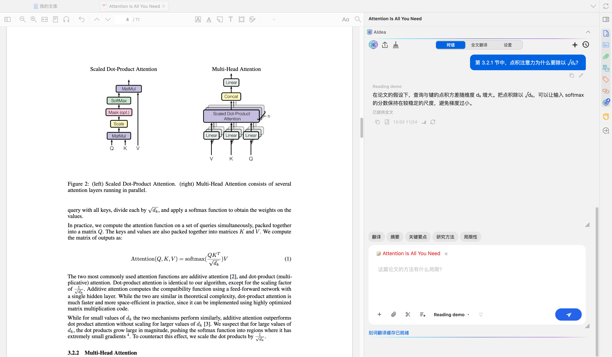

  

# AIdea

  <a href="../../README.md">English</a>
  ·
  <a href="./README.zh-CN.md">简体中文</a>
  ·
  <a href="./README.zh-TW.md">繁體中文</a>
  ·
  <a href="./README.ja.md">日本語</a>
  ·
  <a href="./README.ko.md">한국어</a>
  ·
  <a href="./README.fr.md">Français</a>

  <a href="https://visterainer.github.io/aidea-zotero/zh-tw/">專案網站</a> · <a href="../../doc/user-guide/zh-TW.md">使用手冊</a> · <a href="https://github.com/Visterainer/aidea-zotero/releases/latest">下載</a>

**AIdea 是適用於 Zotero 7–10 的免費開源 AI 閱讀助手。** 閱讀 PDF 或 EPUB 時，可以針對段落提問，從回答中的引用回到原文，再把解釋存為文獻筆記。

## 閱讀 PDF 與 EPUB

以 Vaswani 等人的 [《Attention Is All You Need》](https://arxiv.org/html/1706.03762v7#S3.SS2.SSS1) 為例，讀到第 3.2.1 節時，可以問：「點積注意力為什麼要除以 √dₖ？」圖 2 與公式（1）有助於理解這項縮放如何避免 softmax 的梯度過小。回答若附上可定位的引用，點選即可開啟對應的 PDF 頁面或 EPUB 章節。用 `@` 加入另一篇文獻，就能在同一段對話中比較研究方法或結果。快捷按鈕可整理重點、研究方法或限制。也可以附上圖表截圖提問。回答支援 Markdown、表格、程式碼與 LaTeX 公式，並可存為 Zotero 筆記。

  
   <em>圖 2、公式（1）與側邊欄的示例問答。對話與選取文字的譯文使用本機示例內容。</em>

## 翻譯選取文字並留下註解

在 PDF 或 EPUB 中選取術語或段落，即可在原文旁閱讀譯文。譯文可加入筆記，也可寫入新標示的註解，下次點選標示便能重讀。

  
   <em>圖 2 中的 Scaled Dot-Product Attention 譯為簡體中文「缩放点积注意力」，可加入筆記或存為標示的註解。</em>

## 整份或批次翻譯 PDF

可將**僅譯文 PDF** 或**雙語對照 PDF** 附加到原文獻，也可匯出至資料夾。掃描頁會在 OCR 前校正方向，譯文中的表格也改善了文字排列與數值複製。

多選文獻後可先檢查清單，再啟動佇列。預設只補齊缺少的格式或目的地，保留已有註解的譯本。重新啟動 Zotero 後可以繼續；若譯本已產生但儲存失敗，重試時會沿用已產生的檔案。

  
   <em>同一篇論文的 NeurIPS 會議版與 arXiv 版已加入批次翻譯清單。</em>

  
   <em>第 6 頁的英中對照：左側是英文原文，右側是簡體中文。表 1 比較不同網路層的計算複雜度。</em>

  
   <em>全文翻譯也能翻譯架構圖中的文字。FactorMiner 圖 1 左側是英文原圖，右側是簡體中文譯圖。沿著藍色箭頭對照兩側，可以看到「Memory Retrieval」譯為「记忆检索」，「Library Update」譯為「库更新」。</em>

## 保存與移轉對話

可匯出**目前的對話、單篇文獻的全部對話，或整個文獻庫的對話**。JSON 包含文字與引用，ZIP 還可包含截圖和上傳的檔案。匯入時會合併新增訊息並保留分支。原文由 Zotero 另行同步，在另一部裝置找到相同條目與檔案後，引用便能回到原文。

  
   <em>對話選單中的三種匯出範圍與匯入功能</em>

## 通訊作者介紹

可根據論文與公開學術資料，為一篇或多篇文獻建立通訊作者介紹。結果會附上可查證的來源，並存為各篇文獻下的 Zotero 筆記。重新產生會更新原有的 AIdea 作者介紹筆記。

## 模型與語言

支援 ChatGPT、GitHub Copilot、OpenAI 相容 API，以及透過 Ollama 或 LM Studio 執行的本機模型。若模型支援推理強度，可分別用於對話、選取文字翻譯與全文翻譯。對話紀錄與各文獻庫的記憶儲存在本機，每次請求所需的內容由選定的模型服務處理。

介面提供 13 種語言，翻譯目標語言可獨立選擇。

---

[AGPL-3.0-or-later](../../LICENSE) · 本專案源自 [llm-for-zotero](https://github.com/yilewang/llm-for-zotero) (Yile Wang) · [第三方聲明](../../THIRD_PARTY_NOTICES.md)
