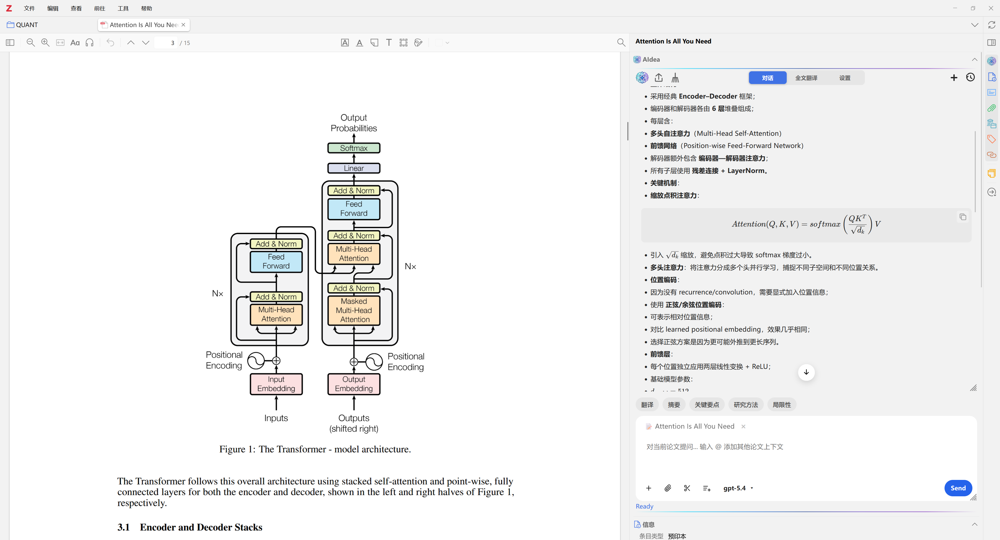
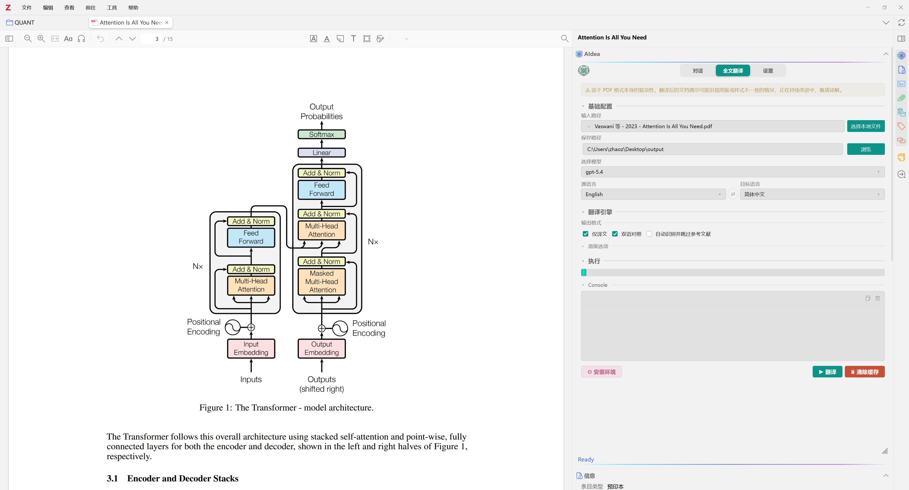
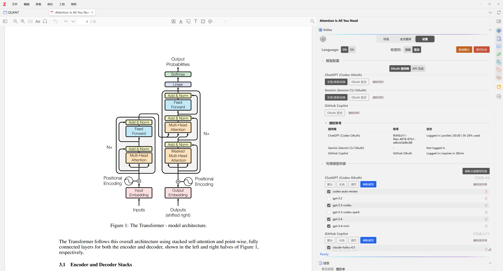

<p align="center">
  
</p>

# AIdea

<p align="center">
  <a href="../../README.md">English</a>
  ·
  <a href="./README.zh-CN.md">简体中文</a>
  ·
  <a href="./README.zh-TW.md">繁體中文</a>
  ·
  <a href="./README.ja.md">日本語</a>
  ·
  <a href="./README.ko.md">한국어</a>
  ·
  <a href="./README.fr.md">Français</a>
</p>

<p align="center">
  <strong>🌐 Website:</strong> <a href="https://visterainer.github.io/aidea-zotero/zh-tw/">https://visterainer.github.io/aidea-zotero/zh-tw/</a>
</p>

**適用於 Zotero 7–10 的免費開源 AI 助手**

在 Zotero 側邊欄閱讀 PDF 與 EPUB。針對選取段落提問，點選回答中的頁碼或章節引用回到原文，再將回答存為 Zotero 筆記。需要整篇譯文時，可翻譯單一 PDF，也可批次匯出單語譯本或雙語對照版。

## 安裝 AIdea

1. 從[最新版本](https://github.com/Visterainer/aidea-zotero/releases/latest)下載 **AIdea 的 .xpi 安裝檔**。
2. 在 Zotero 開啟 **工具 → 外掛程式**，點選齒輪，選擇從檔案安裝，選取下載的檔案後重新啟動 Zotero。
3. 在 **Zotero 設定 → AIdea** 連接模型，再開啟 PDF 或 EPUB，從 AIdea 側邊欄提問。

## 連接模型

- **ChatGPT** — 在 OpenAI 卡片按下安裝或更新環境，安裝獨立的 Codex CLI。選擇 OAuth 登入，授權後重新整理模型清單。
- **GitHub Copilot** — 在 Copilot 卡片選擇 OAuth 登入，依提示在瀏覽器確認裝置代碼，再重新整理模型清單。
- **相容 API 或本機模型** — 填入 API 基底網址與模型 ID，並依服務要求輸入金鑰。本機 Ollama 常用的位址為 `http://localhost:11434/v1`。

首次翻譯整份 PDF 前，請在 **翻譯** 分頁安裝或更新翻譯環境。對話與選取文字翻譯只需連接模型。

## 核心能力

- **側邊欄 AI 對話**，可在 Zotero 資料庫檢視、PDF 閱讀器與 EPUB 閱讀器中使用
- **文件感知上下文**，支援 PDF 選段、EPUB 2/3 出版目錄結構、截圖、圖表與附件參與分析
- **快捷操作按鈕**，可用於總結、解釋、翻譯等常見任務
- **多種連線方式**，支援 OAuth 登入與 OpenAI 相容 API 模式
- **全文翻譯**，可在側邊欄內執行並匯出 PDF
- **劃詞翻譯**，可在 PDF 或 EPUB 閱讀器選取文字後直接翻譯，自動識別目前格式、使用有界文件上下文並加入 Zotero 筆記
- **本地歷史與記憶**，支援按文庫隔離、筆記回寫與持續對話
- **豐富渲染能力**，支援 Markdown、程式碼區塊、表格、LaTeX 與串流輸出

## 截圖

### 側邊欄對話

<p align="center">
  
</p>

### 全文翻譯

<p align="center">
  
</p>

### 劃詞翻譯

<p align="center">
  
</p>

<p align="center">
  
</p>

### 提供商與模型設定

<p align="center">
  
</p>

## 隱私與資料處理

- OAuth 權杖保存在本地裝置上。
- API 請求直接傳送至所選服務商或你設定的端點。
- 聊天記錄與記憶資訊保存在 Zotero 本地 SQLite 資料庫中。
- 專案本身不提供中繼服務，也不收集外掛使用遙測。

## 開發

```bash
npm install
npm start
npm run build
npm run test:unit
```

## 授權與致謝

AIdea 採用 [AGPL-3.0-or-later](../../LICENSE) 授權發佈。

本專案基於 [llm-for-zotero](https://github.com/yilewang/llm-for-zotero) 演進而來。第三方聲明請參閱 [THIRD_PARTY_NOTICES.md](../../THIRD_PARTY_NOTICES.md)。

## ⭐ Star History

<a href="https://star-history.com/#Visterainer/aidea-zotero&Date">
 <picture>
   <source media="(prefers-color-scheme: dark)" srcset="https://api.star-history.com/svg?repos=Visterainer/aidea-zotero&type=Date&theme=dark" />
   <source media="(prefers-color-scheme: light)" srcset="https://api.star-history.com/svg?repos=Visterainer/aidea-zotero&type=Date" />
   
 </picture>
</a>
