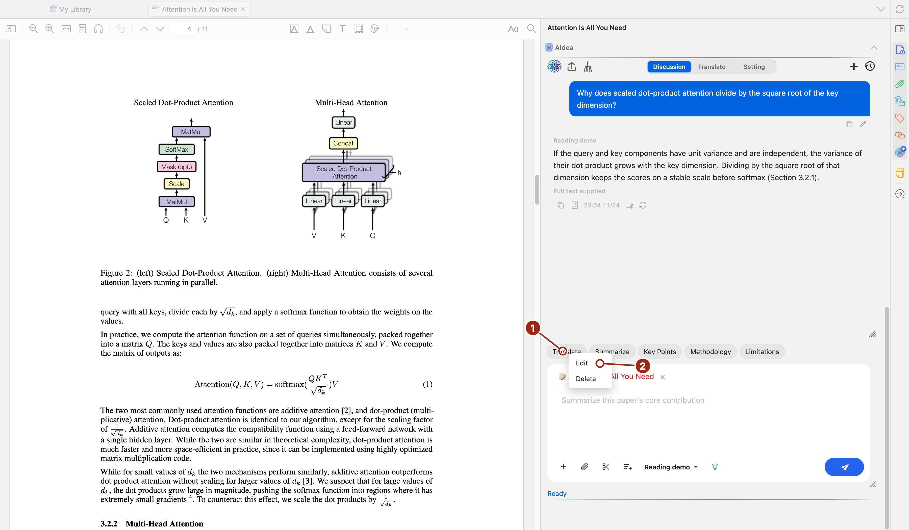
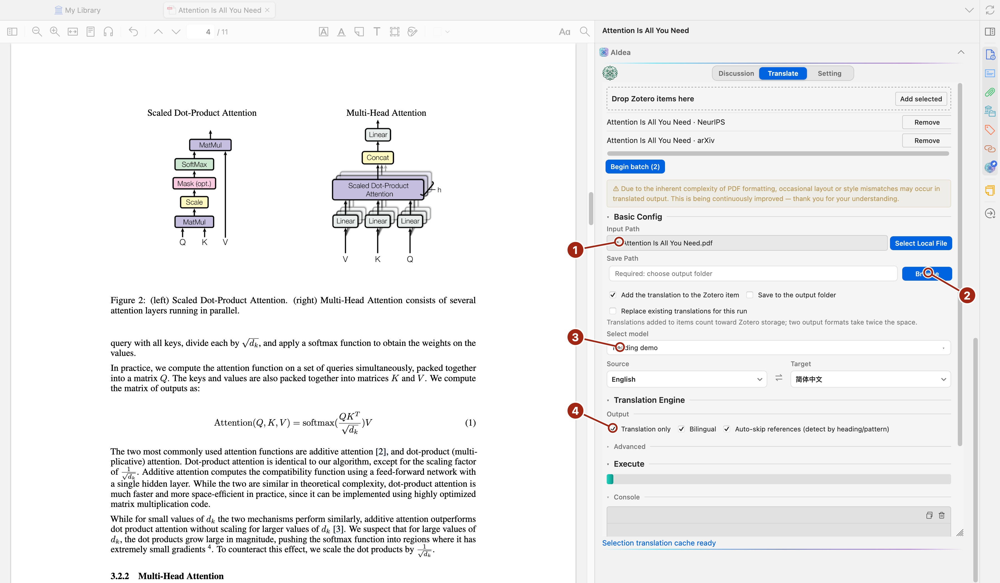
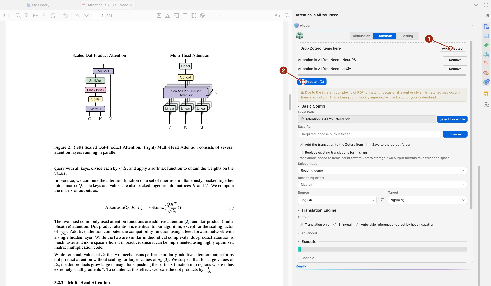
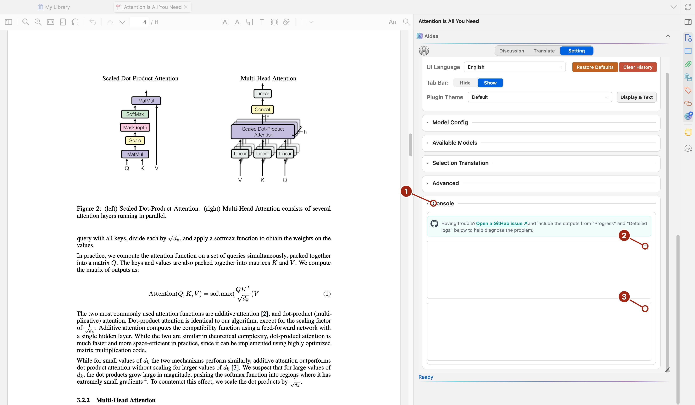

# دليل استخدام AIdea

[简体中文](./zh-CN.md) · [繁體中文](./zh-TW.md) · [English](./en.md) · [日本語](./ja.md) · [한국어](./ko.md) · [Français](./fr.md) · [Deutsch](./de.md) · [Español](./es.md) · [Русский](./ru.md) · [Português](./pt.md) · **العربية** · [हिन्दी](./hi.md)

لإصدار AIdea 4.0.2 مع Zotero من 7 إلى 10. اربط نموذجًا، واختبر إجابته عن القسم 3.2.1 من بحث *[Attention Is All You Need](https://arxiv.org/html/1706.03762v7#S3.SS2.SSS1)*، ثم أنشئ ملف PDF بالإنجليزية والصينية. عناوين الاتصال الواردة أمثلة توضيحية.

## المحتويات

1. [تثبيت AIdea وربط نموذج](#تثبيت-aidea-وربط-نموذج)
2. [إعدادات الواجهة](#إعدادات-الواجهة)
3. [إعداد المحادثة](#إعداد-المحادثة)
4. [ترجمة ملف PDF كاملًا](#ترجمة-ملف-pdf-كاملًا)
5. [ترجمة النص المحدد](#ترجمة-النص-المحدد)
6. [استكشاف الأخطاء وإصلاحها](#استكشاف-الأخطاء-وإصلاحها)

## تثبيت AIdea وربط نموذج

نزّل ملف ‎`.xpi` من [أحدث إصدار](https://github.com/Visterainer/aidea-zotero/releases/latest). في Zotero افتح قائمة الأدوات ثم الإضافات، واضغط رمز الترس واختر التثبيت من ملف. حدّد الملف وأعد تشغيل Zotero، ثم افتح بحثًا ووسّع لوحة AIdea على اليمين وانتقل إلى **Settings → Model Config**.

**ChatGPT.** اضغط **Install/Update Env** في بطاقة OpenAI لتثبيت أداة Codex CLI المستقلة. اختر **OAuth Login** وأكمل التفويض في المتصفح، ثم ارجع إلى Zotero واضغط **Refresh Models**. تدير الأداة تسجيل الدخول محليًا، وتظهر النماذج المتاحة لحسابك.

**GitHub Copilot.** اختر **OAuth Login** في بطاقة Copilot، وطابق رمز الجهاز، ووافق على الطلب في GitHub ثم حدّث قائمة النماذج. يعمل هذا المسار دون Codex CLI.

**مفتاح API أو نموذج محلي.** في وضع API أدخل عنوان الخدمة الأساسي مثل `https://api.example.com/v1` والمفتاح ومعرّف النموذج الدقيق. اجلب القائمة أو أضف المعرّف يدويًا. مع Ollama شغّل الخادم وأدخل `http://127.0.0.1:11434/v1` واسم نموذج مثبّت. اترك المفتاح فارغًا فقط إذا سمحت الخدمة بالدخول دون مصادقة.

**تحديث CLI.** يظهر افتراضيًا تنبيه بعد الفحص الدوري. يبدأ التحديث التلقائي بعد 60 ثانية من التنبيه؛ يؤجله التصغير أو التأجيل 24 ساعة. يوقف الوضع الصامت الفحص والتنبيهات. للتحديث يدويًا اضغط **Install/Update Env**. تُدار بيئة ترجمة PDF على حدة في **Translate**.

إعداد اتصال النموذج في لوحة Zotero الجانبية.

## إعدادات الواجهة

### المظهر وشريط التبويبات

افتح **Settings → Basic Configuration**. إذا أخفيت التبويبات فمرّر المؤشر فوق أعلى اللوحة لتظهر. اختر مظهرًا فاتحًا أو داكنًا أو افتراضيًا. يمكنك أيضًا تغيير لغة الواجهة هنا.

① شريط التبويبات ② المظهر ③ العرض والخط.

### حجم الخط وتباعد الأسطر والهوامش

في **Display & Text** اختر أحد الأنماط الأربعة واسحب النافذة من عنوانها لترى النتيجة. أبقِ حجم الخط عند 13 بكسل وغيّر ارتفاع السطر في الإجابة من 1.45 إلى 1.65. اكتب سطرين لاختبار حقل الإدخال وحدّد فقرة لاختبار نافذة الترجمة. لكل منطقة حجم خط مستقل.

يضبط **Message spacing** المسافة بين الرسائل و**Bubble padding** الهامش داخل الفقاعة. وسّع نافذة الترجمة لتقليل التفاف الأسطر. يضبط **Images → Display scale** حجم الصور ويستعيد **Reset** إعدادات الخط الأصلية.

 

① تباعد أسطر المحادثة ② حقل الكتابة ③ نافذة ترجمة النص المحدد.

### عرض اللوحة وارتفاع النافذة

اسحب الفاصل بين البحث وAIdea إلى اليسار لتوسيع اللوحة. لزيادة الارتفاع اسحب حافة نافذة Zotero السفلية أو كبّر النافذة.

### ضبط ارتفاع المحادثة وحقل الكتابة كلٌّ على حدة

في **Discussion** اسحب المقبض إلى أسفل لزيادة الارتفاع أو إلى أعلى لتقليله. يحتفظ AIdea بالارتفاعين. مرّر اللوحة لأسفل إذا اختفى المقبض.

① عرض اللوحة ② مقبض فوق الاختصارات للمحادثة ③ مقبض أسفل الإرسال لحقل الكتابة.

## إعداد المحادثة

### اختيار نموذج للمحادثة

بعد تسجيل الدخول حدّث القائمة في **Settings → Model Config**. عند استخدام واجهة API خاصة، اجلب النماذج أو أدخل معرّفاتها الدقيقة. حدّد كل النماذج التي تريد الاحتفاظ بها ثم اختر **Save Models**. لتبديل نموذج المحادثة اضغط اسمه أسفل حقل الكتابة. للعمل على الصور اختر نموذجًا يدعمها.

① افتح قائمة النماذج. ② تشير العلامة إلى النموذج الحالي.

### ضبط مستوى الاستدلال والسياق والتعليمات

 مرّر المؤشر فوق المصباح لعرض مستوى الاستدلال، واضغطه لاختيار مستوى يدعمه النموذج. إذا ظهر بالرمادي فقد تكون المستويات غير متاحة أو بيانات النموذج ناقصة. جرّب تحديث القائمة. للمحادثة وترجمة التحديد وترجمة PDF إعدادات مستقلة. في **Settings → Advanced** أدخل حجم السياق بوحدات الرمز أو اتركه فارغًا للاختيار التلقائي. تنطبق تعليمات النظام على الطلب التالي، وحذفها يعيد التعليمات الافتراضية.

① قائمة المصباح ② المستوى الحالي. لهذا النموذج ستة مستويات.

### إرفاق الأبحاث والمقاطع والأشكال والملفات

في القارئ يظهر عنوان ملف PDF أو EPUB الحالي بجوار حقل الكتابة. في المكتبة ابحث عن مرجع باستخدام @، ثم اختره بالأسهم وEnter أو Tab.  يضيف **Add Text** النص المحدد. إذا غاب الزر فأظهره من الإعدادات المتقدمة.  استخدم المقص لتحديد جزء من صفحة PDF، أو Esc للإلغاء. يمكنك أيضًا لصق الصور أو سحبها إلى الحقل.

 يتيح المشبك إرفاق ملفات PDF حتى 50 ميبيبايت للملف، وصور وملفات Markdown ونصوص وشيفرة. تبقى المراجع والملفات حتى تزيلها بعلامة ×، بينما يُزال النص المحدد والصور الملصقة من المسودة بعد الإرسال.

① المشبك ② رفع ملف ③ اختيار بحث مرجعي.

### إرسال الأسئلة وتعديل الاختصارات

 يرسل Enter الطلب، ويبدأ Shift+Enter سطرًا جديدًا. في قائمة @ يختار Enter المرجع أولًا. يوقف **Cancel** توليد الإجابة. يحل الاختصار محل المسودة ويُرسَل فورًا. انقر بزر الفأرة الأيمن لإضافة الاختصارات أو تحريرها أو نقلها أو حذفها.

① انقر بزر الفأرة الأيمن على اختصار الترجمة ② عدّل الأمر أو احذفه.

### اختبار الاتصال باستخدام مقطع من البحث

افتح القسم 3.2.1 من *[Attention Is All You Need](https://arxiv.org/html/1706.03762v7#S3.SS2.SSS1)* وأرفق المعادلة (1). اسأل «لماذا يُقسم الضرب النقطي في الشكل 2 على √dₖ؟ وما الافتراض المتعلق بالتباين؟». افتح الاستشهاد وراجعه في صفحة PDF أو موضعه في EPUB. إذا اقتصر السياق على مقتطف أو ملخص، فأضف الفقرة المطلوبة. ثم اسأل عما يتغير إذا اختلف التباين عن الواحد.

الشكل 2 بجوار إجابة توضيحية عن معامل القياس في المعادلة (1).

### رسم مخطط معماري للعرض التقديمي

في تجربة Zotero أنشأ **gpt-6.1-sol** صورة عبر **ChatGPT OAuth (Codex)**. اختر نموذجًا يدعم توليد الصور وأرفق ملف PDF لبحث *[Attention Is All You Need](https://arxiv.org/html/1706.03762v7#S3.SS2.SSS1)* باستخدام المشبك. جرّب هذا الطلب:

> ارسم بنية Transformer من القسم 3 لشريحة علمية بنسبة 16:9. استخدم خلفية عاجية وتسميات إنجليزية كبيرة. مثّل المرمّز ومفكّك الترميز بكتلتين متكررتين بالأزرق والأحمر القرمزي وضع ×6 على كل منهما. أظهر التضمينات والترميز الموضعي، وارسم سهمي K وV من المرمّز وQ من مفكّك الترميز إلى الانتباه المتقاطع. اختم بتوزيع احتمالات الرمز التالي وأعد الصورة.

ملف PDF المرفق وطلب رسم المخطط في حقل الكتابة داخل Zotero.

اضغط الصورة بزر الفأرة الأيمن واختر **Export** لحفظها بصيغة PNG. راجع اتجاه الأسهم بمقارنتها بالشكل 1. [الصورة المحفوظة في التجربة بتسميات صينية](../../site/public/media/reader/transformer-generated-zh.png).

### تعديل الأسئلة ومقارنة الإجابات

بعد اكتمال الإجابة اضغط القلم لتعديل السؤال وإرساله مجددًا. يتيح **Retry** اختيار نموذج للمحاولة الجديدة وللرسالة التالية. قارن النسخ بالأسهم. ينقل **Branch to new chat** السجل حتى تلك النقطة، بينما يبدأ **New chat** محادثة فارغة.

① تعديل السؤال ② توليد الإجابة مجددًا.

### الاحتفاظ بالأدلة في المحادثات الطويلة

عند امتلاء السياق قد تُلخّص الرسائل القديمة. للتحقق من رقم أو معادلة أو شرح شكل، أرفق المقطع مجددًا وراجع الاستشهادات.

### حفظ الإجابات وإدارة السجل

يتيح **Copy** نسخ الإجابة ويحفظها **Save as note** كملاحظة ملحقة بالبحث أو مستقلة عند غياب بحث. ينسخ **Export** المحادثة كاملة بتنسيق Markdown أو يحفظها كملاحظة.  تفتح الساعة السجل لاستئناف المحادثات أو إعادة تسميتها أو تثبيتها. تمسح المكنسة المحادثة الحالية، ومن السجل يمكنك حذف عدة محادثات.

### نقل المحادثات إلى جهاز آخر

 بعد اكتمال الإجابة صدّر المحادثة الحالية أو محادثات البحث أو المكتبة كاملة. يتضمن JSON النص والاستشهادات ويضيف ZIP المرفقات المتاحة. على الجهاز الآخر استورد الأرشيف من القائمة نفسها وراجع المعاينة وأكّد الدمج. زامن الأبحاث الأصلية عبر Zotero بصورة منفصلة. تُحفظ بيانات الدخول والإعدادات والذاكرة على حدة.

قائمة اختيار نطاق التصدير أو استيراد أرشيف محادثات.

## ترجمة ملف PDF كاملًا

### ترجمة ملف واحد

قبل المهمة الأولى افتح **Translate → Install/Update Translation Environment** وانتظر حتى تصبح البيئة جاهزة. تُثبَّت هذه البيئة بصورة مستقلة عن Codex CLI. حدّد ملف PDF ولغتي المصدر والهدف والنموذج ومجلد الحفظ. اختر الترجمة وحدها أو نسخة ثنائية اللغة ثم اضغط **Translate**.

① الملف ② مجلد الحفظ ③ نموذج الترجمة ④ تنسيق الإخراج.

### إضافة مجموعة أبحاث إلى قائمة الترجمة

حدّد الأبحاث ذات ملفات PDF في المكتبة بالضغط على Ctrl (أو ⌘ في macOS)، واستخدم Shift لتحديد نطاق متصل. اختر **Prepare translation batch** من القائمة السياقية أو **Add selected** من تبويب الترجمة. راجع القائمة واختر تنسيقًا واحدًا على الأقل ووجهة حفظ (مرفق Zotero أو مجلد). اضغط **Begin batch** وراجع أعداد النتائج الناقصة والمتخطاة والمستبدلة ثم أكّد.

إذا أضفت تعليقات إلى ترجمة سابقة فأبقِ خيار استكمال النتائج الناقصة فقط. بعد إعادة التشغيل اختر **Continue**. إذا نجحت الترجمة وتعذّر حفظها، صحّح الوجهة واختر **Retry failed** لحفظ الملف الموجود.

① أضف الأبحاث المحددة ② ابدأ الدفعة بعد المراجعة. يظهر ملفان في المثال.

### خيارات الترجمة والجداول والأشكال

لإعادة التجربة اختر **English → Simplified Chinese**. عند ظهور 429 خفّض عدد الطلبات في الثانية وعدد المهام المتوازية ثم جرّب ملفًا واحدًا. فعّل التعرّف الآلي على النص للصفحات الممسوحة. يمكنك أيضًا ضبط نصوص الجداول والمراجع والملاحق والمسرد والخطوط.

يقارن الجدول 1 في الصفحة 6 التعقيد الحسابي. يظهر الأصل الإنجليزي يسارًا والترجمة الصينية المبسطة يمينًا.

تشمل الترجمة التسميات داخل المخطط. في الشكل 1 من FactorMiner تقابل عبارتا «Memory Retrieval» و«Library Update» على اليسار التسميتين «记忆检索» و«库更新» على اليمين.

## ترجمة النص المحدد

في **Settings → Selection Translation** فعّل الترجمة واختر النموذج ولغتي المصدر والهدف. في الوضع التلقائي يكفي تحديد النص في PDF أو EPUB. في الوضع اليدوي اضغط **Translate** في النافذة المنبثقة. يمكنك ضبط مستوى الاستدلال المدعوم وإظهار **Copy** و**Add to note** في النافذة.

① تفعيل الترجمة ② اختيار النموذج ③ ضبط اللغات.

حدّد «Scaled Dot-Product Attention» في الشكل 2. تظهر في المثال الترجمة «缩放点积注意力». فعّل **Write translation to annotation** وانتظر ظهور الترجمة ثم اختر لون التظليل. تُحفظ الترجمة في تعليق التظليل. الخيار معطّل أول مرة ويتذكر اختيارك. لحفظ ملاحظة مستقلة اختر **Add to note**.

① كتابة الترجمة في التعليق ② اختيار لون التظليل ③ الحفظ كملاحظة.

## استكشاف الأخطاء وإصلاحها

### اللوحة لا تظهر بعد التثبيت

تأكّد من تفعيل AIdea في **أدوات ← الإضافات**. اخرج تمامًا من Zotero (باستخدام ⌘Q على macOS)، ثم افتح ملف PDF ووسّع اللوحة اليمنى. إذا استمر غيابها فسجّل نظام التشغيل وإصداري Zotero وAIdea.

### نجح تسجيل الدخول ولكن قائمة النماذج فارغة

حدّث النماذج وابحث في **Settings → Console** عن الخطوة التي فشلت ورمز الحالة. بعد تغيير الوكيل قد ينجح الدخول في المتصفح بينما يستخدم Zotero المنفذ القديم. طابق بروتوكول تطبيق الوكيل ومنفذه النشط مع إعدادات وكيل النظام أو PAC. قد يختلف المسار بين المتصفح والطرفية وZotero. صحّح الإعداد ثم أعد تشغيل Zotero وحدّث النماذج وأرسل سؤالًا قصيرًا.

عند 401 تحقّق من التفويض أو المفتاح. إذا أشار 403 إلى قيود الحساب أو المنطقة فراجع إرشادات المزوّد. إذا ظهر 502 في PDF وحده فقارن أداء النموذج نفسه في المحادثة وترجمة التحديد وPDF وراجع سجل الترجمة.

[#34](https://github.com/Visterainer/aidea-zotero/issues/34) · [#109](https://github.com/Visterainer/aidea-zotero/issues/109) · [#60](https://github.com/Visterainer/aidea-zotero/issues/60) · [مشكلات الاتصال في Zotero](https://www.zotero.org/support/kb/connection_error)

### السجلات المطلوبة للتشخيص

**بيئة PDF أو الترجمة.** في **Translate → Console → Copy all** انسخ المخرجات من بدء العملية بما يشمل الخطأ الأول والحالة النهائية. إذا وُجد ملف سجل منفصل فأرفق المقطع المعني. اذكر النظام والمعمارية وإصداري Zotero وAIdea والخطوة والنموذج وطريقة التفويض. وضّح هل المهمة فردية أم دفعة، وهل الملف نصّي أم ممسوح، وتنسيق الإخراج وعدد الملفات المتأثرة.

**OAuth أو CLI أو قائمة النماذج.** في **Settings → Console** استخدم زرّي النسخ لجمع سجل التقدم والسجل التفصيلي. اذكر المزوّد والزر الذي ضغطته ونتيجة التفويض في المتصفح والحالة في Zotero ورمز الخطأ ونتيجة الاختبار بعد فحص الوكيل وإعادة التشغيل.

① فتح السجل ② نسخ التقدم ③ نسخ التفاصيل.

### إخفاء البيانات الخاصة قبل المشاركة

في محرر محلي استبدل البريد والمفاتيح والرموز ورموز الجهاز ومعاملات إعادة توجيه OAuth وبيانات الوكيل والأسماء في المسارات بعبارة `<redacted>`. افحص أيضًا شريط العنوان وحقول الحساب في الصور. احتفظ بالخطوات والإصدارات ورموز الحالة ورسائل الخطأ. [الإبلاغ عن مشكلة](https://github.com/Visterainer/aidea-zotero/issues/new/choose).

### طلب المساعدة من وكيل محلي

> النظام والمعمارية […]، Zotero […]، AIdea […]. ضغطت […] وتوقعت […] لكن حصلت على […]. مع النموذج نفسه كانت نتيجة المحادثة […] وترجمة التحديد […] وPDF […]. السجل بعد إخفاء البيانات: […]. حدّد أول خطأ قابل للإصلاح واقترح فحصًا واحدًا للوكيل أو OAuth أو البيئة أو النموذج أو الحفظ. استخدم هذه المعلومات فقط ولا تقرأ بيانات الدخول أو ترفع الملفات.

### أسئلة أخرى

**لا تظهر ترجمة التحديد؟** تحقّق من التفعيل والنموذج ولغة الهدف ثم جرّب نسخ جملة. يحتاج المستند الممسوح إلى طبقة نص قابلة للتحديد.

**تعمل المحادثة وحدها؟** ثبّت بيئة PDF أو أصلحها من **Translate**. تشمل الأنظمة المدعومة macOS 13 فأحدث، وLinux مع glibc 2.28 فأحدث، وإصدارات Windows المتوافقة ذات 64 بت.

**أين يُحفظ النص؟** يُحفظ السجل والذاكرة محليًا، ويتلقى مزوّد النموذج المقاطع والمرفقات اللازمة. للمعالجة على الجهاز اختر عنوان خدمة على حاسوبك.
