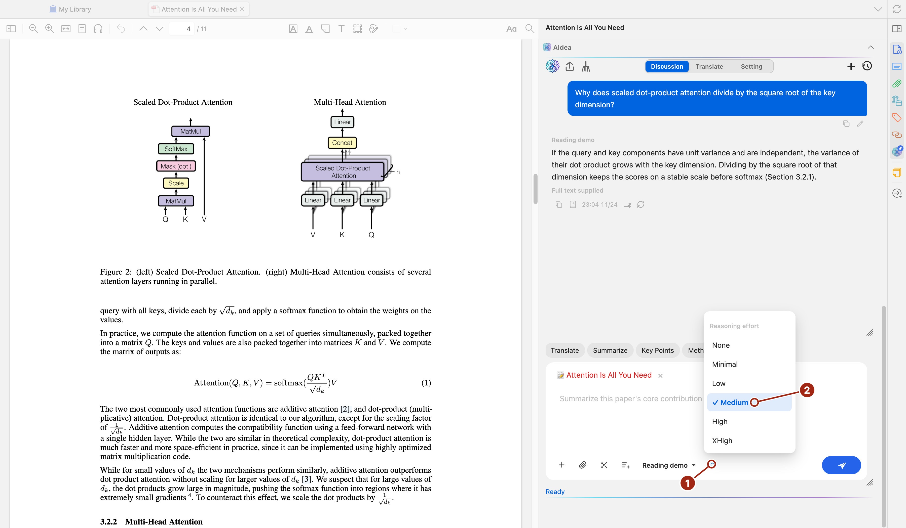
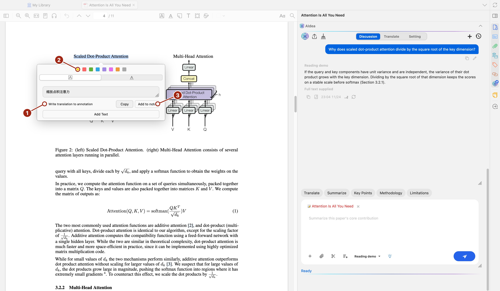

# AIdea-Handbuch

[简体中文](./zh-CN.md) · [繁體中文](./zh-TW.md) · [English](./en.md) · [日本語](./ja.md) · [한국어](./ko.md) · [Français](./fr.md) · **Deutsch** · [Español](./es.md) · [Русский](./ru.md) · [Português](./pt.md) · [العربية](./ar.md) · [हिन्दी](./hi.md)

Für AIdea 4.0.2 in Zotero 7–10. Verbinden Sie ein Modell, stellen Sie eine Frage zu § 3.2.1 von *[Attention Is All You Need](https://arxiv.org/html/1706.03762v7#S3.SS2.SSS1)* und erzeugen Sie ein englisch-chinesisches PDF. Die Adressen in den Beispielen sind Platzhalter.

## Inhalt

1. [AIdea installieren und ein Modell verbinden](#aidea-installieren-und-ein-modell-verbinden)
2. [Oberfläche anpassen](#oberfläche-anpassen)
3. [Chat einrichten](#chat-einrichten)
4. [Vollständige PDFs übersetzen](#vollständige-pdfs-übersetzen)
5. [Markierten Text übersetzen](#markierten-text-übersetzen)
6. [Fehler beheben](#fehler-beheben)

## AIdea installieren und ein Modell verbinden

Laden Sie die Datei `.xpi` aus dem [aktuellen Release](https://github.com/Visterainer/aidea-zotero/releases/latest) herunter. Öffnen Sie in Zotero **Werkzeuge → Plugins**, dann über das Zahnrad **Plugin aus Datei installieren**. Wählen Sie die Datei und starten Sie Zotero neu. Öffnen Sie einen Artikel und rechts **AIdea → Settings → Model Config**.

**ChatGPT.** Wählen Sie auf der OpenAI-Karte **Install/Update Env** für die eigenständige Codex CLI. Klicken Sie auf **OAuth Login**, bestätigen Sie die Freigabe im Browser und wählen Sie zurück in Zotero **Refresh Models**. Die CLI verwaltet die Anmeldung lokal; verfügbar sind die Modelle Ihres Kontos.

**GitHub Copilot.** Wählen Sie auf der Copilot-Karte **OAuth Login**, vergleichen Sie den Gerätecode, bestätigen Sie ihn bei GitHub und aktualisieren Sie die Modellliste. Dafür wird die Codex CLI nicht benötigt.

**API oder lokales Modell.** Im API-Modus Basis-URL (z. B. `https://api.example.com/v1`), Schlüssel und genaue Modell-ID eintragen. Rufen Sie die Liste ab oder ergänzen Sie die ID manuell. Bei Ollama den lokalen Dienst starten und `http://127.0.0.1:11434/v1` sowie den installierten Modellnamen verwenden. Der Schlüssel darf nur bei Diensten ohne Authentifizierung leer bleiben.

**CLI aktuell halten.** Standardmäßig erscheint nach der regelmäßigen Prüfung ein Hinweis. Im Automatikmodus beginnt die Aktualisierung nach 60 Sekunden. Verschieben oder Minimieren vertagt sie um 24 Stunden. Der stille Modus deaktiviert Prüfung und Hinweise. **Install/Update Env** aktualisiert manuell; die PDF-Umgebung wird im Reiter **Translate** verwaltet.

Modellkonfiguration in der Zotero-Seitenleiste.

## Oberfläche anpassen

### Farbschema und Registerleiste

Öffnen Sie **Settings → Basic Configuration**. Eine ausgeblendete Registerleiste erscheint wieder, wenn Sie den Zeiger an den oberen Rand bewegen. Wählen Sie eine helle, dunkle oder die Standarddarstellung. Hier lässt sich auch die Oberflächensprache ändern.

① Registerleiste ② Farbschema ③ Anzeige und Schrift.

### Schrift, Zeilenhöhe und Abstände

Unter **Display & Text** eine Voreinstellung wählen und das Fenster am Titel verschieben, um die Wirkung zu sehen. Bei 13 px die Zeilenhöhe in einer Antwort von 1,45 auf 1,65 erhöhen. Für das Eingabefeld zwei Zeilen schreiben; für das Übersetzungsfenster einen Absatz markieren. Jede Gruppe hat eine eigene Schriftgröße.

**Message spacing** trennt Nachrichten, **Bubble padding** setzt den Innenabstand. Ein breiteres Übersetzungsfenster verringert Zeilenumbrüche. **Images → Display scale** skaliert Bilder, **Reset** setzt die Typografie zurück.

 

① Zeilenhöhe für Fragen und Antworten ② für den Entwurf ③ für die Übersetzung der Auswahl.

### Breite der Seitenleiste und Fensterhöhe

Ziehen Sie im Leser die Trennlinie links von AIdea nach links. Für mehr Höhe ziehen Sie die untere Fensterkante nach unten oder maximieren Sie Zotero.

### Chat und Eingabe getrennt vergrößern

Unter **Discussion** den jeweiligen Griff nach unten ziehen, um den Bereich zu vergrößern, oder nach oben, um ihn zu verkleinern. Die Höhen bleiben gespeichert. Ist ein Griff verdeckt, scrollen Sie in der Seitenleiste.

① Breite ② Griff über den Schnellaktionen für den Verlauf ③ Griff unter Senden für die Eingabe.

## Chat einrichten

### Das Modell für eine Unterhaltung wählen

Nach der Anmeldung unter **Settings → Model Config** die Modellliste aktualisieren. Bei einer eigenen API die Modelle abrufen oder genaue IDs ergänzen. Alle gewünschten Modelle markieren und mit **Save Models** speichern: Die Auswahl ersetzt die bisherige Liste. Unter dem Eingabefeld auf den Modellnamen klicken. Für Abbildungen ein Modell mit Bildunterstützung wählen.

① Modellmenü öffnen. ② Das Häkchen kennzeichnet das aktive Modell.

### Denkaufwand, Kontext und Anweisungen einstellen

 Die Glühbirne zeigt beim Überfahren den Denkaufwand. Klicken Sie darauf, um eine unterstützte Stufe zu wählen. Grau bedeutet, dass keine Stufen wählbar oder bekannt sind. Aktualisieren Sie gegebenenfalls die Modelle. Chat, Auswahlübersetzung und PDF haben getrennte Einstellungen. Unter **Settings → Advanced** kann die Kontextgröße in Tokens angegeben werden. Leer lassen für die Automatik. Eine eigene Systemanweisung gilt ab der nächsten Anfrage. Löschen stellt den Standard wieder her.

① Menü der Glühbirne ② Aktive Stufe. Dieses Modell bietet sechs Stufen.

### Artikel, Textstellen, Abbildungen und Dateien anhängen

Im Leser erscheint der aktuelle PDF- oder EPUB-Titel am Eingabefeld. Im Bibliothekschat einen Artikel mit @ suchen und per Pfeiltaste und Eingabe oder Tab auswählen.  Mit **Add Text** eine markierte Passage übernehmen. Die Schaltfläche bei Bedarf in den erweiterten Einstellungen einblenden.  Mit der Schere einen PDF-Ausschnitt ziehen, mit Esc abbrechen. Bilder können Sie auch einfügen oder hineinziehen.

 Über die Büroklammer PDFs (je bis zu 50 MiB), Bilder, Markdown-, Text- und Codedateien hinzufügen. Referenzartikel und Dateien bleiben bis zum Entfernen mit × verfügbar. Markierter Text und eingefügte Bilder werden nach dem Senden aus dem Entwurf entfernt.

① Büroklammer ② Datei hochladen ③ Referenzartikel wählen.

### Fragen senden und Schnellaktionen bearbeiten

 Eingabe sendet, Umschalt+Eingabe beginnt eine neue Zeile. In der @-Liste wählt Eingabe zunächst den Artikel. **Cancel** stoppt die Antwort. Eine Schnellaktion ersetzt den Entwurf und sendet sofort. Per Rechtsklick lassen sich Aktionen hinzufügen, bearbeiten, verschieben oder löschen.

① Rechtsklick auf die Übersetzungsaktion ② Befehl bearbeiten oder entfernen.

### Die Verbindung an einer Textstelle prüfen

Öffnen Sie *[Attention Is All You Need](https://arxiv.org/html/1706.03762v7#S3.SS2.SSS1)* bei § 3.2.1 und fügen Sie Gleichung (1) hinzu. Fragen Sie: „Warum wird das Skalarprodukt in Abbildung 2 durch √dₖ geteilt? Welche Varianz wird angenommen?“ Prüfen Sie die Quellenangabe im PDF. Bei EPUB öffnet sie die entsprechende Stelle. Ist nur ein Auszug oder Abstract verfügbar, fügen Sie den fehlenden Absatz hinzu. Fragen Sie anschließend, was sich bei einer anderen Varianz ändert.

Abbildung 2 neben einer Beispielantwort zur Skalierung in Gleichung (1).

### Ein Architekturdiagramm für einen Vortrag erstellen

Im Zotero-Test erzeugte **gpt-6.1-sol** über **ChatGPT OAuth (Codex)** ein Bild. Wählen Sie ein Modell mit Bildgenerierung und laden Sie *[Attention Is All You Need](https://arxiv.org/html/1706.03762v7#S3.SS2.SSS1)* über die Büroklammer als PDF hoch. Ein Beispielauftrag:

> Erstelle aus Abschnitt 3 ein 16:9-Diagramm des Transformers für eine wissenschaftliche Präsentation. Nutze einen elfenbeinfarbenen Hintergrund und große englische Beschriftungen. Zeichne Encoder und Decoder als kobaltblaue und zinnoberrote Stapel mit ×6. Zeige Einbettungen, Positionskodierung, K und V vom Encoder und Q vom Decoder zur Cross-Attention. Schließe mit der Wahrscheinlichkeitsverteilung für das nächste Token. Gib das Bild aus.

Angehängtes PDF und Diagrammauftrag im Zotero-Eingabefeld.

Das fertige Bild mit Rechtsklick **Export** als PNG speichern. Die Pfeile mit Abbildung 1 vergleichen. [Im Test gespeichertes PNG mit chinesischen Beschriftungen](../../site/public/media/reader/transformer-generated-zh.png).

### Fragen bearbeiten und Antworten vergleichen

Nach der Antwort den Stift neben der Frage anklicken, bearbeiten und erneut senden. **Retry** unter der Antwort erlaubt die Modellwahl für einen neuen Versuch und setzt dieses Modell für die nächste Nachricht. Mit den Pfeilen zwischen Versionen wechseln. **Branch to new chat** übernimmt den Verlauf bis hierhin, **New chat** beginnt leer.

① Frage bearbeiten ② Antwort erneut erzeugen.

### Quellen in langen Unterhaltungen prüfen

Bei knappem Kontext können ältere Nachrichten zusammengefasst werden. Hängen Sie bei Fragen zu einer Zahl, Formel oder Bildunterschrift die betreffende Stelle erneut an und prüfen Sie die Zitate.

### Antworten speichern und Verlauf verwalten

Mit **Copy** oder **Save as note** eine Antwort kopieren oder als Notiz beim Artikel speichern. Ohne Artikel entsteht eine eigenständige Notiz. Über **Export** lässt sich der ganze Chat als Markdown kopieren oder als Notiz speichern.  Die Uhr öffnet den Verlauf zum Fortsetzen, Umbenennen und Anheften. Der Besen löscht den aktuellen Chat. Im Verlauf können mehrere Chats gelöscht werden.

### Chats auf ein anderes Gerät übertragen

 Nach Abschluss der Antwort den aktuellen Chat, die Chats des Artikels oder die ganze Bibliothek exportieren. JSON enthält Text und Zitate, ZIP zusätzlich verfügbare Anhänge. Am Zielgerät im selben Menü importieren, Vorschau prüfen und zusammenführen. Originalartikel separat mit Zotero synchronisieren. Zugangsdaten, Einstellungen und Gedächtnis sind separat gespeichert.

Exportumfang wählen oder ein vorhandenes Chatarchiv importieren.

## Vollständige PDFs übersetzen

### Ein einzelnes PDF übersetzen

Vor dem ersten Auftrag unter **Translate → Install/Update Translation Environment** die PDF-Umgebung installieren und auf Bereitschaft warten. Sie wird unabhängig von der Codex CLI gepflegt. PDF, Quell- und Zielsprache, Modell und Speicherort wählen. Ausgabe als reine Übersetzung oder zweisprachiges PDF festlegen und **Translate** anklicken.

① PDF ② Zielordner ③ Übersetzungsmodell ④ Ausgabeformat.

### Mehrere Artikel zur Warteschlange hinzufügen

In der Bibliothek mit Strg (macOS: ⌘) einzelne Artikel mit PDF, mit Umschalt einen Bereich markieren. **Prepare translation batch** im Kontextmenü oder **Add selected** im Übersetzungsreiter wählen. Liste prüfen, mindestens ein Format und einen Zielort (Zotero-Anhang oder Ordner) wählen. **Begin batch** anklicken, Anzahl der fehlenden, übersprungenen und zu ersetzenden Ausgaben kontrollieren und bestätigen.

Bei bereits annotierten Übersetzungen nur fehlende Ausgaben ergänzen. Nach einem Neustart mit **Continue** fortfahren. Falls die Übersetzung gelang, aber das Speichern scheiterte, Ziel korrigieren und die vorhandene Datei mit **Retry failed** erneut ablegen.

① Markierte Artikel übernehmen ② Nach Prüfung den Stapel starten. Hier sind zwei PDFs ausgewählt.

### Übersetzungsoptionen, Tabellen und Abbildungen

Für dieses Beispiel **English → Simplified Chinese** wählen. Bei Fehler 429 Anfragen pro Sekunde und parallele Aufträge reduzieren und ein PDF testen. Bei Scans automatische Texterkennung aktivieren. Weitere Optionen betreffen Tabellentext, Literaturverzeichnis, Anhänge, Glossar und Ausgabeschriften.

Tabelle 1 auf Seite 6 vergleicht die Rechenkomplexität. Links das englische Original, rechts die chinesische Übersetzung.

Auch Diagrammbeschriftungen werden übersetzt: In Abbildung 1 von FactorMiner entsprechen „Memory Retrieval“ und „Library Update“ links den Schritten „记忆检索“ und „库更新“ rechts.

## Markierten Text übersetzen

Unter **Settings → Selection Translation** die Funktion einschalten und Modell, Quell- und Zielsprache wählen. Im Automatikmodus genügt das Markieren in PDF oder EPUB. Im manuellen Modus im Popup **Translate** wählen. Denkaufwand je nach Modell einstellen. **Copy** und **Add to note** können im Popup eingeblendet werden.

① Übersetzung aktivieren ② Modell wählen ③ Sprachen einstellen.

Markieren Sie in Abbildung 2 „Scaled Dot-Product Attention“. Die Beispieldaten zeigen „缩放点积注意力“. Schalten Sie **Write translation to annotation** ein und wählen Sie nach der Übersetzung eine Markierfarbe. Der Text steht nun im Kommentar der Markierung. Das anfangs ausgeschaltete Kontrollkästchen merkt sich Ihre Wahl. Für eine separate Notiz **Add to note** wählen.

① Übersetzung in die Annotation schreiben ② Markierfarbe wählen ③ Als Notiz speichern.

## Fehler beheben

### Nach der Installation fehlt die Seitenleiste

Unter **Werkzeuge → Plugins** prüfen, ob AIdea aktiviert ist. Zotero vollständig beenden (macOS: ⌘Q), ein PDF öffnen und die rechte Seitenleiste ausklappen. Bleibt das Panel aus, Betriebssystem sowie Zotero- und AIdea-Version notieren.

### Angemeldet, aber die Modellliste bleibt leer

Modelle aktualisieren. In **Settings → Console** den fehlgeschlagenen Schritt und Statuscode ablesen. Nach einem Proxywechsel kann die Browseranmeldung noch funktionieren, während Zotero einen veralteten Port nutzt. Protokoll und aktiven Port der Proxy-App mit Systemproxy oder PAC abgleichen. Browser, Terminal und Zotero können verschiedene Verbindungen verwenden. Nach der Korrektur Zotero neu starten, Modelle aktualisieren und eine kurze Frage senden.

Bei 401 Anmeldung oder API-Schlüssel prüfen. Bei 403 mit Konto- oder Regionshinweis die Angaben des Anbieters prüfen. Bei 502 nur im PDF-Modus dasselbe Modell in Chat, Auswahlübersetzung und PDF testen und die PDF-Konsole vergleichen.

[#34](https://github.com/Visterainer/aidea-zotero/issues/34) · [#109](https://github.com/Visterainer/aidea-zotero/issues/109) · [#60](https://github.com/Visterainer/aidea-zotero/issues/60) · [Verbindungsfehler in Zotero](https://www.zotero.org/support/kb/connection_error)

### Die richtigen Protokolle kopieren

**PDF-Umgebung oder Übersetzung.** Unter **Translate → Console → Copy all** von der Aktion bis zum ersten Fehler und Endstatus kopieren. Bei separater Protokolldatei den betreffenden Abschnitt beilegen. Betriebssystem, Architektur, Zotero- und AIdea-Version, Schritt, Modell und Anmeldeart nennen. Bei PDF-Fehlern auch Einzel- oder Stapelauftrag, Scan oder Text, Ausgabeformat und betroffene Dateien angeben.

**OAuth, CLI oder Modellliste.** Unter **Settings → Console** Fortschrittsanzeige und Detailprotokoll mit beiden Kopierschaltflächen sichern. Anbieter, angeklickte Schaltfläche, Ergebnis im Browser, Meldung in Zotero und Fehlercode beilegen. Auch den Test nach Proxyprüfung und Neustart angeben.

① Konsole öffnen ② Fortschritt kopieren ③ Detailprotokoll kopieren.

### Persönliche Daten vor dem Teilen entfernen

Ersetzen Sie in einem lokalen Editor E-Mail, Schlüssel, Tokens, Gerätecodes, OAuth-Rückrufparameter, Proxy-Zugangsdaten und Namen in Dateipfaden durch `<redacted>`. Prüfen Sie auch Adresszeile und Kontofelder in Screenshots. Schritte, Versionen, Statuscodes und Fehlermeldungen erhalten. [Fehler melden](https://github.com/Visterainer/aidea-zotero/issues/new/choose).

### Einen lokalen Assistenten um Hilfe bitten

> Mein System und Architektur: […], Zotero […], AIdea […]. Nach […] erwartete ich […], erhielt aber […]. Dasselbe Modell liefert im Chat […], bei Auswahl […] und PDF […]. Bereinigtes Protokoll: […]. Finde den ersten behebbaren Fehler und schlage einen kleinen Test für Proxy, OAuth, Umgebung, Modell oder Speicherort vor. Nutze nur diese Angaben. Lies keine Zugangsdaten und lade keine Dateien hoch.

### Weitere Fragen

**Keine Übersetzung beim Markieren?** Funktion, Modell und Zielsprache prüfen. Versuchen Sie, einen Satz zu kopieren. Ein Scan benötigt eine auswählbare Textebene.

**Nur der Chat funktioniert?** PDF-Umgebung unter **Translate** installieren oder reparieren. Unterstützt werden macOS ab 13, Linux mit glibc ab 2.28 und unterstützte 64-Bit-Windows-Systeme.

**Wo liegen meine Texte?** Verlauf und Gedächtnis liegen lokal. Benötigte Auszüge und Anhänge gehen an den gewählten Modelldienst. Für lokale Verarbeitung einen Endpunkt auf dem eigenen Rechner verwenden.
