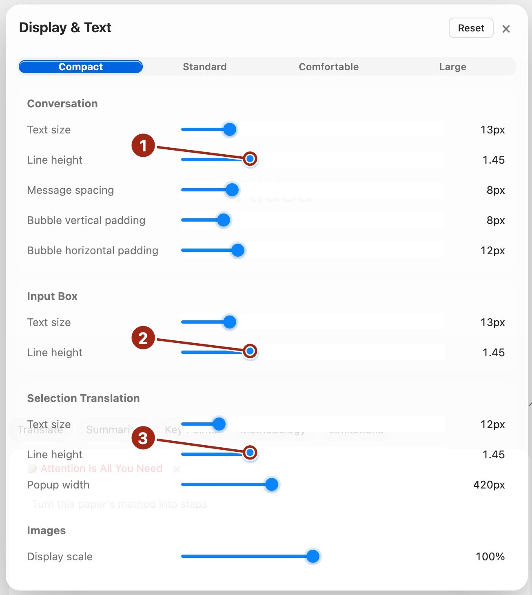
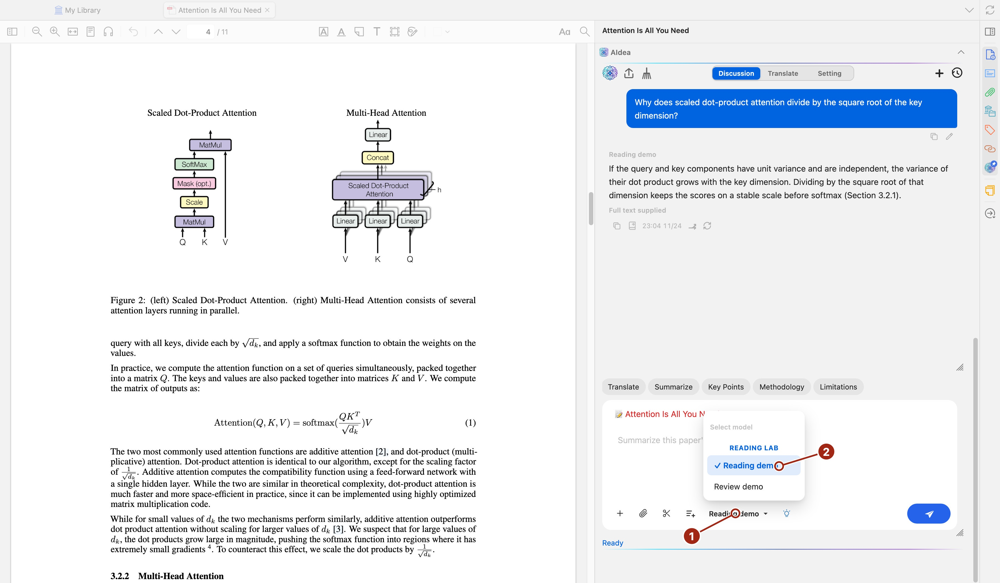
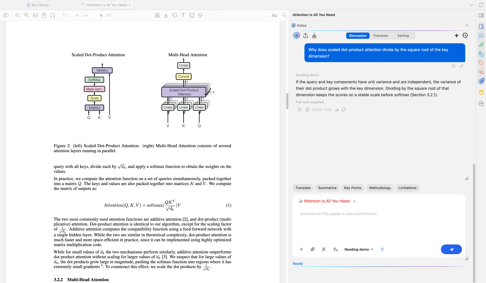
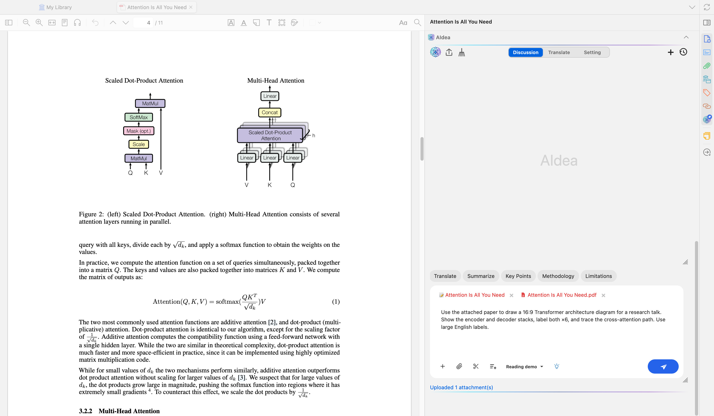

# AIdea user guide

[简体中文](./zh-CN.md) · [繁體中文](./zh-TW.md) · **English** · [日本語](./ja.md) · [한국어](./ko.md) · [Français](./fr.md)

For AIdea 4.0.2 on Zotero 7–10. Connect a model, test it on §3.2.1 of *[Attention Is All You Need](https://arxiv.org/html/1706.03762v7#S3.SS2.SSS1)*, then produce an English–Simplified Chinese PDF. The connection examples use placeholder addresses.

## Contents

1. [Install AIdea and connect a model](#install-aidea-and-connect-a-model)
2. [Interface settings](#interface-settings)
3. [Chat settings](#chat-settings)
4. [Full-text PDF translation](#full-text-pdf-translation)
5. [Selection translation](#selection-translation)
6. [Troubleshooting](#troubleshooting)
   - [Signed in but no models appear](#signed-in-but-no-models-appear)
   - [Which logs to copy](#which-logs-to-copy)
   - [Ask a local agent for help](#ask-a-local-agent-for-help)

## Install AIdea and connect a model

1. Download the AIdea `.xpi` from the [latest release](https://github.com/Visterainer/aidea-zotero/releases/latest). Open **Tools → Plugins** in Zotero, click the gear, choose **Install Plugin From File**, select the download, and restart Zotero.
2. Open a paper and expand AIdea on the right. In **Settings → Model Config**, choose your connection method.

**ChatGPT account.** On the OpenAI card, choose **Install/Update Env** to install the standalone Codex CLI. Click **OAuth Login**, authorize in the browser, return to Zotero, and select **Refresh Models**. The CLI handles sign-in on your computer. AIdea uses that authorization to access the models available to your account.

**GitHub Copilot account.** Choose **OAuth Login** on the Copilot card. Check the device code, approve the request on GitHub, then refresh the models in Zotero. This device-code flow runs without the Codex CLI.

**API key or local model.** Select the API connection mode. Enter your provider’s API base URL (for example, `https://api.example.com/v1`), key, and exact model ID. Fetch the model list or add an ID manually. For local Ollama, start the server and enter `http://127.0.0.1:11434/v1` and the name of an installed model. Leave the key blank only for services that allow unauthenticated access.

**CLI updates.** OAuth environment updates default to notifying you after a periodic check. Automatic mode proceeds 60 seconds after the notice appears. Postpone or minimize it to defer for 24 hours. Silent mode turns off checks and reminders. To update manually, use **Install/Update Env** on the OpenAI card. The Translate tab manages the separate PDF translation environment.

## Interface settings

### Change the theme and tab bar

Open **Settings → Basic Configuration**. ① Show or hide the tab bar. Hover at the top of the panel to reveal hidden tabs. ② Choose a theme, such as Warm Cream or Midnight Black, or select Default. ③ Open **Display & Text** for typography. You can also set the interface language here.

### Adjust text size, line height, and spacing

Open **Display & Text** and choose Compact, Standard, Comfortable, or Large. Drag the window by its title to keep a reply in view.

① **Conversation → Line height** affects questions and replies. Keep the text at 13 px and move the slider from 1.45 to 1.65 to see the lines in one reply move farther apart.

② **Input Box → Line height** affects your draft. Type two lines to compare. ③ **Selection Translation → Line height** affects the translation popup. Select a passage to check it.

 

Each area has its own text size. **Message spacing** sets the gap between messages. **Bubble padding** sets the space around text inside a bubble. Increase **Popup width** to wrap a translation less often. Use **Images → Display scale** for chat images. **Reset** restores the typography defaults.

### Resize the Zotero sidebar and window

Expand **AIdea** on the right of the reader. Drag the divider between the paper and sidebar to the left to widen the plugin. Drag the bottom of the Zotero window or maximize it for more height.

### Resize the conversation and composer separately

In **Discussion**, drag ② the corner just above the shortcuts to see more of a reply, or ③ the outer corner below Send to make room for a longer draft. Drag down to expand or up to shrink. The heights are saved. Scroll down the sidebar if a handle is out of view.

## Chat settings

Select your models once in Settings, then choose one in the composer. Before sending a question, check the papers, excerpts, and files above the input. After the answer arrives, check how much of the paper was supplied and open the citations you need to verify.

### Choose the model for this chat

1. **ChatGPT or Copilot sign-in.** Open **Settings → Model Config** and refresh the models on the provider card. Under **Available Models**, check the ones you want in the chat menu. This selection saves immediately.
2. **API key or local server.** Check the base URL and supply a key if the service requires one. Fetch the model list or add an exact model ID manually. In the resulting list, check every model you want to keep and click **Save Models**. Saving replaces the list for that endpoint.
3. Open **Discussion** and click the model name at the bottom of the composer. Select the provider and model for this request. Check the provider when two services list the same model ID.
4. If the menu is empty, check whether the provider returned any models and whether you selected them. If sign-in succeeded but refreshing returns zero models, [follow the proxy checks](#signed-in-but-no-models-appear).

Use a text model for a passage and an image-capable model for a diagram or scan. For derivations, look for adjustable reasoning effort. For several long papers, check the context limit.

Switching models keeps earlier replies. To try the same question with another model, click **Retry** beside the original reply.

### Set reasoning effort, context size, and instructions

 Hover over the lightbulb beside the model to see its reasoning effort. Click to choose a supported level before sending. If the tooltip shows an arrow, the level on the right is the one used. A gray bulb means no selectable levels are available or support information is missing. Refresh the model list in the latter case.

| Control | Location | When to change it |
| --- | --- | --- |
| Reasoning effort | Lightbulb beside the chat model | Start with the default. For a derivation, try a supported effort level. Switching models applies a level supported by the new model and keeps your saved preference. Chat, selection translation, and PDF translation save independent choices. |
| Context window in tokens | **Advanced settings** for the API model or for a model in the available list | Leave blank for automatic budgeting. If long papers repeatedly show partial coverage, check the provider’s actual context window before setting an override. AIdea reserves room for output. Raising the limit cannot recover text that failed to extract. |
| System prompt | **Settings → Advanced** | For example, “Give the conclusion first, then cite the equation or passage that supports it. Identify assumptions the authors do not state.” Changes replace the default chat prompt from the next request. Clear the field to restore the default. Selection translation uses its own instructions. |

### Attach papers, passages, figures, and files

In the PDF or EPUB reader, check the current paper’s title near the composer. You can also start a standalone chat in the library. Check the titles again after changing papers or adding a comparison.

| Material | Action | Check before sending |
| --- | --- | --- |
|  A passage | Select it in the reader and click **Add Text** in the popup or composer toolbar. | Look for the excerpt above the input. If the popup button is missing, enable **Add Text** for the reader selection popup in **Settings → Advanced**. |
|  Another paper | Type `@` and part of its title, or choose the reference-paper picker from the paperclip menu. Use the arrow keys and press **Enter** or **Tab** to add it. | Check both titles and versions. Name the comparison in your question, for example, “Which assumptions does each paper make about computational complexity?” |
|  A figure or equation | Click the scissors in the PDF reader, drag around the figure including its legend, and release. You can also paste or drop an image into the composer. | Choose a model that accepts images. Check that subscripts and arrows are legible in the preview. **Esc** cancels a capture. |
|  A local supplement | Choose **Upload files** from the paperclip menu or drop a file. Examples include PDF, image, Markdown, text, and code files. | Check the filename. Each uploaded PDF is limited to 50 MiB. If extraction is incomplete, add the relevant passage or a legible screenshot. |

Reference papers and uploaded files stay available across turns. Remove irrelevant items with **×** when you finish a comparison. The pending screenshots and text selections clear after sending. Reattach them when the next question needs to point explicitly to the same material.

① Open the paperclip below the input. Choose ② to upload a file or ③ to select a reference paper.

### Send a question or run a shortcut

 Press **Enter** to send and **Shift+Enter** for a new line. In the `@` picker, Enter selects a paper first. Use **Cancel** during generation to stop before revising the request.

Translate, Summarize, Key Points, Methodology, and Limitations are preset questions. Clicking one replaces the composer text with its prompt and sends it immediately. Attach the passage first and copy any draft you want to keep. Right-click a shortcut to edit its label or prompt, add or delete a shortcut, or enter move mode and drag to reorder. A useful custom prompt is “List two limitations reported by the authors and give a source location for each.”

① Right-click the Translate shortcut. ② Choose Edit to change its prompt or Delete to remove it.

### Test the connection with a passage

1. Open §3.2.1 of *Attention Is All You Need*. Use **Add Text** on the paragraph explaining the scale factor below equation (1). Attach Figure 2 if the diagram matters.
2. Ask “Why divide the dot product by √dₖ? Explain using the variance assumption in this paragraph and identify the evidence.” Read the coverage next to the answer. Full text means the whole text was provided for that request. Excerpts means selected material was supplied. If only the abstract or no body text was supplied, add the relevant passage.
3. Open a linked citation to check the PDF page or EPUB section. Verify page numbers written as plain text separately. If a source has no usable location, check that the matching item and unchanged original file are available locally.
4. In the same chat, ask “If the components of the query and key no longer have unit variance, which assumption in your explanation changes?” Compare the answer with the passage.

### Generate an architecture diagram from a paper

In a Zotero test, AIdea returned a Transformer diagram using **gpt-6.1-sol** via **ChatGPT OAuth (Codex)**. This chat model called an image-generation tool. Availability on other connections depends on the service and model.

1. In Discussion, open the paperclip menu and upload the PDF of *Attention Is All You Need*. Check the filename and the selected model below the input.
2. Send this prompt.

   > Use the image tool to turn Section 3 of the attached paper into a 16:9 Transformer diagram for projection at a research talk. Set large English labels on an ivory background. Draw the encoder and decoder as cobalt and vermilion isometric stacks, each marked ×6. Trace the source and shifted target sequences through embeddings and positional encoding. Highlight the encoder-to-cross-attention arrow carrying K and V, with Q supplied by the decoder. End with a small probability chart for the next token. Leave generous margins and make module names legible from the back of the room. Return the image.

3. Wait for the image to appear in the answer. Right-click **the image**, choose **Export**, and select a folder to save the PNG. Compare its arrows with Figure 1, especially the encoder output going into the decoder’s cross-attention layer.

[Open the PNG exported in the Zotero test (Chinese labels).](../../site/public/media/reader/transformer-generated-zh.png)

### Edit a question, retry, or branch

- **Change the question.** After generation finishes, click **Edit** beside your message, revise it in place, and send. Use the arrows to switch between available versions.
- **Compare answers.** Click **Retry** beside an eligible answer and choose a model from the menu. Use the arrows to compare answers to the same question. The model you choose for the retry also becomes the current model in the composer.
- **Explore a different direction.** Choose **Branch to new chat** beside an answer to carry the conversation up to that point into a separate chat. Choose **New chat** for an empty conversation.

① Click the pencil beside the question to edit it. ② Click the circular arrow below the answer to retry.

### Keep evidence available in a long chat

When history exceeds the context budget, earlier turns may be summarized or only recent messages retained. If there is room, AIdea can also retrieve relevant memories from the current library. For a question about a specific number, equation, or caption, attach the passage again and verify the citations in the new answer.

### Save answers and manage history

Use **Copy** or **Save as note** beside an answer. A paper chat saves the note under its item. A standalone chat can create a standalone library note. Code and math blocks have their own copy buttons. To keep the whole discussion, open **Export** and copy the conversation as Markdown or save it as a note.

 Open **History** with the clock button to resume, rename, or pin conversations. Use **New chat** for another topic. The broom clears the current conversation. The history actions for clearing unpinned or all conversations affect a wider set of records.

### Move conversations to another device

 Wait for active answers to finish. From the discussion panel’s export menu, export the current conversation, all conversations for this paper, or all conversations in this library. Choose JSON for text and citations or ZIP to include available screenshots and uploaded files. On the other device, import the archive from the same menu, review the preview, and confirm the merge. Sync the original papers separately through Zotero so citations can locate the same items and files. Credentials, settings, and memory are outside the chat archive.

## Full-text PDF translation

### Translate one PDF

Open **Translate** in the AIdea panel. Before the first job, click **Install/Update Translation Environment** and wait until it is ready. This environment produces PDFs and is separate from the CLI used for OpenAI login.

① Check the PDF, ② choose an output folder, ③ select the translation model, and ④ choose translation only or bilingual output. Set the source and target languages, then click **Translate**.

### Add several papers to a batch

In the library, hold **Ctrl** (Windows/Linux) or **⌘** (macOS) to select individual items, or **Shift** to select a range. After adding them, remove unintended files and check the model, formats, and destinations.

1. For several papers, select items with PDF attachments in the library and choose **Prepare translation batch** from the context menu, or click **Add selected** in the Translate tab. You can review the list before any job starts.
2. Choose at least one format and one destination (Zotero attachment or folder). Click **Begin batch**, review the counts for skipped, missing, and replaced outputs, and confirm. Open a finished PDF under its library item or in the output folder.

By default, the queue fills missing outputs. Keep this setting if you have annotated a translated PDF. Replacing the file may invalidate its annotations. After restarting Zotero, open the queue and choose **Continue**. If translation succeeded but filing failed, fix the destination and use **Retry failed** to deliver the existing file.

① Add the selected library items. Check the list, then use ② to start the batch. In this example, both the list and the button show two papers.

### Advanced translation options

For this example choose **English → Simplified Chinese**. If requests return `429`, lower requests per second (QPS) and the worker count, then retry one PDF. Enable automatic OCR for scanned pages when needed. You can also control table text, reference skipping, appendix translation, glossary generation, and output fonts.

English on the left and Simplified Chinese on the right. Table 1 on page 6 compares the computational complexity of different layer types.

Full-text translation also covers labels inside architecture diagrams. In Figure 1 of FactorMiner, follow the blue arrows from “Memory Retrieval” to “Library Update” in the English original on the left. The same steps are labeled “记忆检索” and “库更新” in the Simplified Chinese translation on the right.

## Selection translation

Under **Settings → Selection Translation**, ① enable translation, ② select the model, and ③ set the source and target languages. With automatic translation on, select text in a PDF or EPUB to see its translation. In manual mode, click Translate in the popup.

You can also set a supported reasoning level and choose whether the popup shows **Copy** and **Add to note**.

The example uses *[Attention Is All You Need](https://arxiv.org/html/1706.03762v7#S3.SS2.SSS1)* by Vaswani et al. Select **Scaled Dot-Product Attention** in Figure 2 to see the Simplified Chinese translation “缩放点积注意力”. The chat and selection screenshots use local demo responses.

① Check **Write translation to annotation**. When the translation appears, pick ② a highlight color. Reopen the highlight to read the translation in its comment. To save only a note, choose ③ **Add to note**. The checkbox starts off and remembers your last choice.

## Troubleshooting

### The panel is missing after installation

Check that AIdea is enabled under **Tools → Plugins**. Quit Zotero completely (**⌘Q** on macOS), reopen a PDF, and expand the right-hand item pane. If AIdea is still missing, record the OS, Zotero version, and plugin version.

### Signed in but no models appear

1. Refresh the models and check the failed step and status code in **Settings → Console**. One report traced an empty model list to a stale proxy port after a change of proxy software, even though browser login still worked.
2. If you use a proxy, compare the protocol and listening port in the proxy app with your system proxy or PAC settings. Browser extensions, terminals, and Zotero can use different routes. After correcting the settings, quit and reopen Zotero, refresh the list, check the model, select it in Discussion, and send a short message.
3. For `401`, check the authorization or API key. If a `403` response names an account or regional restriction, follow the provider’s guidance. If only full-text translation returns `502`, record how the same model behaves in chat, selection translation, and PDF translation, then check the Translate console.

[Issue #34](https://github.com/Visterainer/aidea-zotero/issues/34) · [Issue #109](https://github.com/Visterainer/aidea-zotero/issues/109) · [Issue #60](https://github.com/Visterainer/aidea-zotero/issues/60) · [Connection troubleshooting](https://www.zotero.org/support/kb/connection_error)

### Which logs to copy

| Operation that failed | Where to copy the evidence | Include with the logs |
| --- | --- | --- |
| Installing or repairing the PDF environment, or generating a PDF | **Translate → Console → Copy all**. Keep the output from the action through the first error and final status. If a full log path appears, extract the corresponding error section. | OS and architecture, Zotero and AIdea versions, failed stage, model and authentication method. For generation failures add single or batch, text or scanned PDF, output format, and whether it affects just one file. |
| Installing the OAuth environment, logging in, or refreshing models | Open **Settings → Console** and copy both the progress output and the detailed log using their separate copy buttons. | OS and architecture, software versions, provider, button clicked, browser authorization result, status back in Zotero, error code, and results after checking the proxy and restarting. |

① Expand the console in Settings. Use ② and ③ to copy the upper and lower logs. Redact personal paths before sharing.

### Redact before sharing

Paste logs into a local text editor first. Replace email addresses, keys, tokens, device codes, OAuth callback parameters, proxy credentials, and personal names in paths with `<redacted>`. Keep versions, steps, status codes, and error messages. Check account fields, the address bar, and key fields in screenshots too.

[Report a bug](https://github.com/Visterainer/aidea-zotero/issues/new/choose)

### Ask a local agent for help

Copy this prompt into Codex or another local agent and append your redacted logs.

> OS and architecture [fill in], Zotero [version], AIdea [version]. After I clicked [button], I expected [result] and got [error]. With the same model, chat [status], selection translation [status], PDF translation [status]. Redacted logs: [paste]. Identify the first actionable error, distinguish proxy, OAuth, translation environment, model request, and file-saving problems, and suggest one minimal check. Use only the supplied material. Do not read credentials or upload files.

### Other questions

- **Selecting text gives no translation.** Check the selection translation switch, its model, and the target language. Try copying a sentence from the page. A scanned image needs a selectable text layer for this workflow.
- **Chat works but the PDF environment is unavailable.** Install or repair it from **Translate**. The installer supports macOS 13 or later, Linux with glibc 2.28 or later, and supported 64-bit Windows systems.
- **Where does my text go?** History and memory are stored locally. Chat and translation send the needed excerpts and attachment content to the selected model service. For on-device inference, check that the selected endpoint points to your machine.
