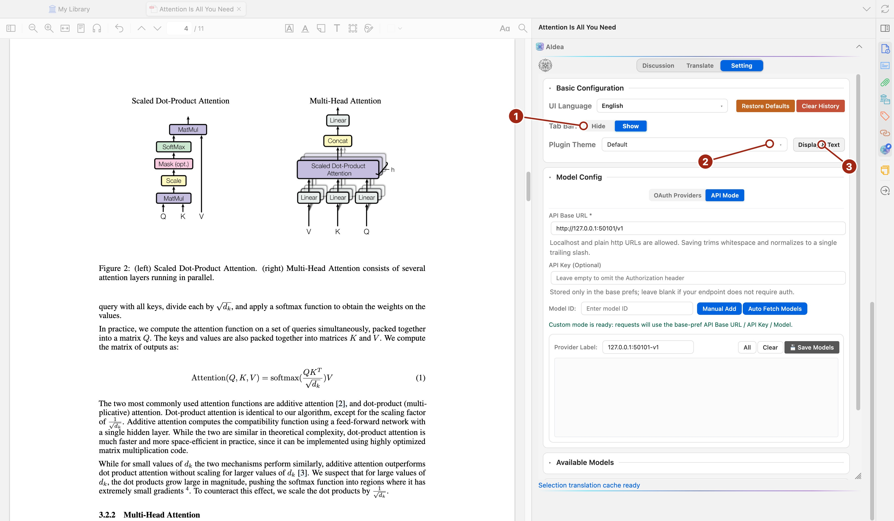
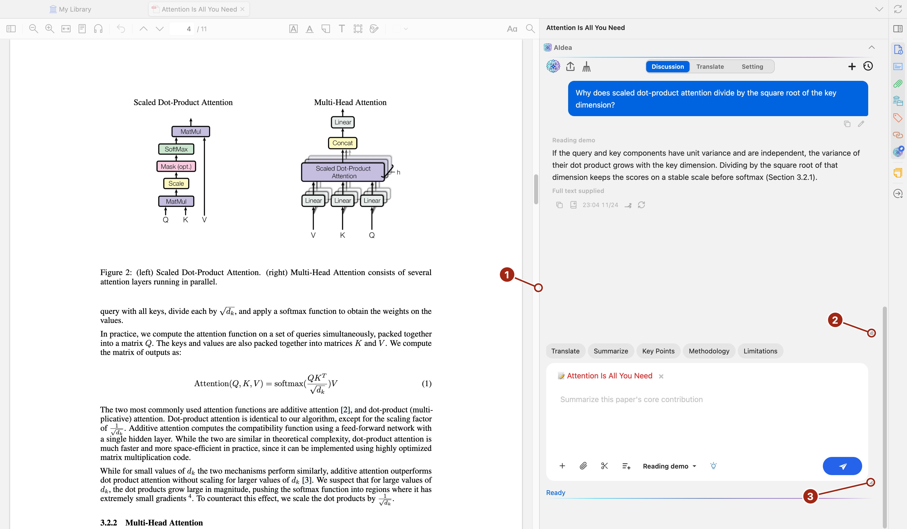
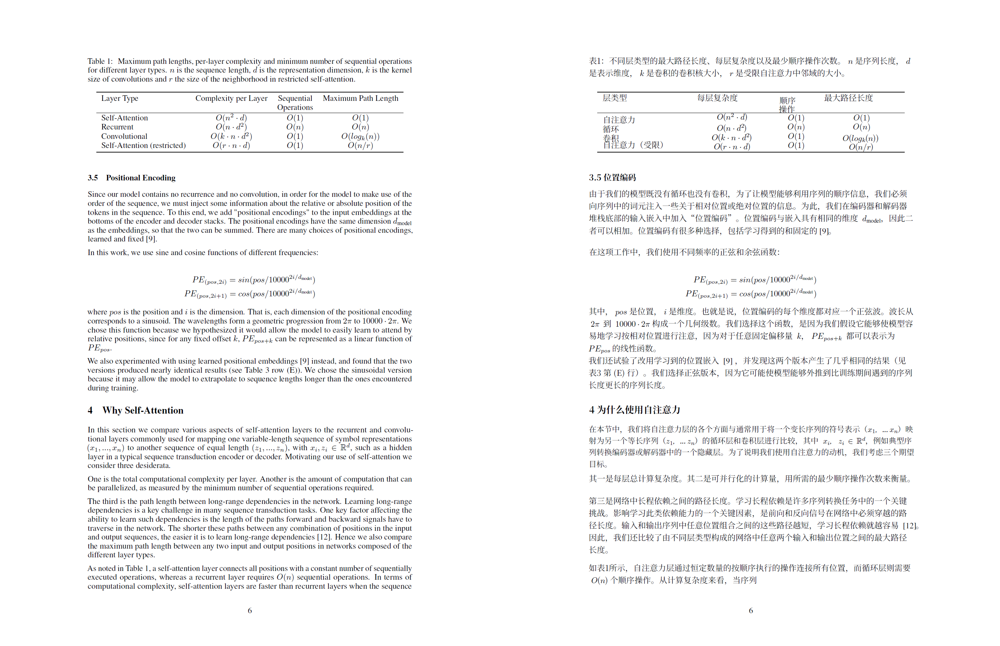

# Manual de AIdea

[简体中文](./zh-CN.md) · [繁體中文](./zh-TW.md) · [English](./en.md) · [日本語](./ja.md) · [한국어](./ko.md) · [Français](./fr.md) · [Deutsch](./de.md) · **Español** · [Русский](./ru.md) · [Português](./pt.md) · [العربية](./ar.md) · [हिन्दी](./hi.md)

Para AIdea 4.0.2 en Zotero 7–10. Conecta un modelo, prueba una pregunta sobre el apartado 3.2.1 de *[Attention Is All You Need](https://arxiv.org/html/1706.03762v7#S3.SS2.SSS1)* y genera un PDF bilingüe en inglés y chino. Las direcciones de ejemplo son ilustrativas.

## Índice

1. [Instalar AIdea y conectar un modelo](#instalar-aidea-y-conectar-un-modelo)
2. [Personalizar la interfaz](#personalizar-la-interfaz)
3. [Configurar el chat](#configurar-el-chat)
4. [Traducir un PDF completo](#traducir-un-pdf-completo)
5. [Traducir una selección](#traducir-una-selección)
6. [Resolver problemas](#resolver-problemas)

## Instalar AIdea y conectar un modelo

Descarga el archivo `.xpi` de la [última versión](https://github.com/Visterainer/aidea-zotero/releases/latest). En **Herramientas → Complementos** de Zotero, abre el engranaje, elige instalar desde un archivo, selecciona la descarga y reinicia Zotero. Abre un artículo y despliega **AIdea → Settings → Model Config** a la derecha.

**ChatGPT.** En la tarjeta de OpenAI, pulsa **Install/Update Env** para instalar la CLI de Codex. Pulsa **OAuth Login**, autoriza en el navegador, vuelve a Zotero y selecciona **Refresh Models**. La CLI gestiona el inicio de sesión en tu equipo y da acceso a los modelos disponibles para tu cuenta.

**GitHub Copilot.** Pulsa **OAuth Login** en la tarjeta de Copilot, comprueba el código de dispositivo, autoriza en GitHub y actualiza la lista. Este método funciona sin la CLI de Codex.

**API o modelo local.** En modo API, introduce la URL base (p. ej., `https://api.example.com/v1`), la clave y el ID exacto del modelo. Obtén la lista o añade el ID manualmente. Con Ollama, inicia el servidor y usa `http://127.0.0.1:11434/v1` y el nombre de un modelo instalado. Deja la clave vacía solo si el servicio admite conexiones sin autenticación.

**Actualizar la CLI.** Por defecto se te avisa tras una comprobación periódica. En modo automático, la actualización empieza al cabo de 60 segundos. Aplazar o minimizar pospone el aviso 24 horas. El modo silencioso desactiva comprobaciones y avisos. Para actualizar a mano, usa **Install/Update Env**. El entorno de PDF se administra por separado en **Translate**.

Configuración del modelo en el panel lateral de Zotero.

## Personalizar la interfaz

### Tema y barra de pestañas

Abre **Settings → Basic Configuration**. Si ocultas la barra de pestañas, acerca el puntero al borde superior para verla. Elige un tema claro, oscuro o predeterminado. Aquí también puedes cambiar el idioma de la interfaz.

① Barra de pestañas ② Tema ③ Pantalla y texto.

### Tamaño de letra, interlineado y márgenes

En **Display & Text** elige una de las cuatro configuraciones y arrastra la ventana por el título para ver el efecto. Mantén 13 px y cambia el interlineado de 1,45 a 1,65 en una respuesta. Escribe dos líneas para comprobar la entrada y selecciona un párrafo para probar la traducción emergente. Cada zona tiene su propio tamaño de letra.

**Message spacing** separa mensajes y **Bubble padding** añade espacio dentro de las burbujas. Ensancha la ventana emergente para reducir los saltos de línea. **Images → Display scale** ajusta las imágenes; **Reset** restaura la tipografía.

 

① Interlineado de preguntas y respuestas ② del borrador ③ de la traducción emergente.

### Anchura del panel y altura de Zotero

En el lector, arrastra a la izquierda el separador entre el documento y AIdea. Para ganar altura, estira el borde inferior de Zotero o maximiza la ventana.

### Ajustar por separado la conversación y la entrada

En **Discussion**, arrastra cada tirador hacia abajo para ampliar o hacia arriba para reducir. Se guardan ambas alturas. Desplaza el panel si no ves el tirador.

① Anchura ② Esquina sobre los atajos para el historial ③ Esquina bajo el envío para escribir.

## Configurar el chat

### Elegir el modelo de una conversación

Tras autenticarte, actualiza la lista en **Settings → Model Config**. Con una API personalizada, consulta los modelos o añade sus identificadores exactos. Marca todos los que quieras conservar y pulsa **Save Models**. El nombre bajo el cuadro de texto permite cambiar de modelo. Para trabajar con imágenes, elige uno que las admita.

① Abre el menú de modelos. ② La marca indica el modelo activo.

### Ajustar el razonamiento, el contexto y las instrucciones

 Pasa el cursor sobre la bombilla para ver el nivel de razonamiento. Haz clic para elegir entre los niveles admitidos. Si está gris, no hay niveles disponibles o faltan datos del modelo. Prueba a actualizar la lista. El chat y las dos modalidades de traducción tienen ajustes independientes. En **Settings → Advanced** puedes indicar el contexto en tokens o dejarlo vacío para la selección automática. La instrucción del sistema se aplica al siguiente envío. Bórrala para recuperar la predeterminada.

① Menú de la bombilla ② Nivel activo. Este modelo ofrece seis niveles.

### Adjuntar artículos, pasajes, figuras y archivos

En el lector aparece el título del PDF o EPUB junto al cuadro de texto. En la biblioteca, busca una referencia con @ y selecciónala con las flechas e Intro o Tab.  **Add Text** añade el pasaje seleccionado. Si falta el botón, actívalo en la configuración avanzada.  Usa las tijeras para recortar una figura del PDF, o Esc para cancelar. También puedes pegar o arrastrar imágenes.

 El clip admite PDF de hasta 50 MiB cada uno, imágenes, Markdown, texto y código. Las referencias y los archivos siguen adjuntos hasta que uses ×. El texto seleccionado y las imágenes pegadas se quitan del borrador tras el envío.

① Clip ② Subir un archivo ③ Elegir un artículo de referencia.

### Enviar preguntas y editar atajos

 Intro envía y Mayús+Intro inserta una línea. En el selector @, Intro elige primero la referencia. **Cancel** detiene la respuesta. Un atajo sustituye el borrador y se envía al instante. Haz clic derecho para añadir, editar, mover o eliminar atajos.

① Clic derecho en el atajo de traducción ② Editar o eliminar la instrucción.

### Probar la conexión con un pasaje

Abre *[Attention Is All You Need](https://arxiv.org/html/1706.03762v7#S3.SS2.SSS1)* en el apartado 3.2.1 y añade la ecuación (1). Pregunta «¿Por qué se divide el producto escalar de la figura 2 por √dₖ? ¿Qué varianza se supone?». Abre la cita y contrástala con el PDF o el pasaje del EPUB. Si el modelo solo recibe un extracto o el resumen, añade el párrafo que falta. Pregunta después qué cambia si la varianza no es unitaria.

La figura 2 junto a una respuesta de ejemplo sobre la escala de la ecuación (1).

### Crear un diagrama de arquitectura para una presentación

En la prueba en Zotero, **gpt-6.1-sol** generó una imagen mediante **ChatGPT OAuth (Codex)**. Elige un modelo con generación de imágenes y adjunta el PDF de *[Attention Is All You Need](https://arxiv.org/html/1706.03762v7#S3.SS2.SSS1)* con el clip. Prueba esta instrucción:

> A partir del apartado 3, dibuja el Transformer para una charla científica en formato 16:9. Usa fondo marfil y rótulos grandes en inglés. Dibuja el codificador y el decodificador como pilas en azul cobalto y bermellón, ambas con ×6. Muestra las representaciones de entrada, la codificación posicional y las flechas de atención cruzada: K y V del codificador y Q del decodificador. Termina con la distribución de probabilidades del próximo token. Devuelve la imagen.

El PDF adjunto y la instrucción para dibujar el diagrama en Zotero.

Haz clic derecho en la imagen y elige **Export** para guardar el PNG. Contrasta las flechas con la figura 1. [PNG de la prueba con rótulos en chino](../../site/public/media/reader/transformer-generated-zh.png).

### Editar preguntas y comparar respuestas

Cuando termine la respuesta, edita la pregunta con el lápiz y envíala de nuevo. Con **Retry** elige un modelo para otro intento y para el siguiente mensaje. Usa las flechas para comparar versiones. **Branch to new chat** conserva el hilo hasta ese punto y **New chat** empieza vacío.

① Editar la pregunta ② Volver a generar la respuesta.

### Conservar las fuentes en conversaciones largas

Si se agota el contexto, los mensajes antiguos pueden resumirse. Para comprobar una cifra, ecuación o pie de figura, vuelve a adjuntar el pasaje y verifica las citas.

### Guardar respuestas y gestionar el historial

Usa **Copy** o **Save as note** para copiar una respuesta o guardarla como nota del artículo. Sin artículo se crea una nota independiente. **Export** permite copiar el chat completo en Markdown o guardarlo como nota.  El reloj abre el historial para retomar, renombrar o fijar conversaciones. La escoba limpia el chat actual. Desde el historial puedes borrar varios chats.

### Trasladar conversaciones a otro dispositivo

 Cuando termine la respuesta, exporta el chat actual, los de ese artículo o los de toda la biblioteca. JSON contiene texto y citas. ZIP incluye también los adjuntos disponibles. En el otro dispositivo, importa desde el mismo menú, revisa la vista previa y confirma la fusión. Sincroniza los artículos originales con Zotero por separado. Las credenciales, los ajustes y la memoria se guardan aparte.

Menú para elegir qué chats exportar o importar un archivo.

## Traducir un PDF completo

### Traducir un solo PDF

Antes del primer trabajo, abre **Translate → Install/Update Translation Environment** y espera a que el entorno esté listo. Es independiente de la CLI de Codex. Selecciona PDF, idiomas de origen y destino, modelo y carpeta. Elige solo la traducción o la versión bilingüe y pulsa **Translate**.

① PDF ② Carpeta de destino ③ Modelo de traducción ④ Formato de salida.

### Añadir varios artículos a un lote

En la biblioteca, usa Ctrl (⌘ en macOS) para seleccionar artículos con PDF o Mayús para un intervalo. Elige **Prepare translation batch** en el menú contextual o **Add selected** en la pestaña de traducción. Revisa los archivos y elige al menos un formato y un destino (adjunto de Zotero o carpeta). Pulsa **Begin batch**, comprueba cuántos resultados faltan, se omiten o se reemplazan y confirma.

Si ya anotaste una traducción, conserva la opción de completar solo lo que falta. Tras reiniciar, usa **Continue**. Si falló el guardado de una traducción terminada, corrige el destino y usa **Retry failed** para guardar el resultado existente.

① Añade los artículos seleccionados ② Inicia el lote tras revisarlo. Aquí hay dos PDF.

### Opciones avanzadas, tablas y figuras

Para este ejemplo, selecciona **English → Simplified Chinese**. Si aparece el error 429, reduce las solicitudes por segundo y los procesos simultáneos y prueba con un PDF. Activa el OCR automático para los escaneos. También puedes ajustar el texto de tablas, las referencias, los apéndices, el glosario y las fuentes de salida.

La tabla 1 de la página 6 compara el coste computacional. Inglés a la izquierda y chino simplificado a la derecha.

También se traducen los rótulos del diagrama. En la figura 1 de FactorMiner, «Memory Retrieval» y «Library Update» a la izquierda corresponden a «记忆检索» y «库更新» a la derecha.

## Traducir una selección

En **Settings → Selection Translation**, activa la función y elige modelo, idioma de origen y de destino. En modo automático basta con seleccionar texto en el PDF o EPUB. En modo manual, pulsa **Translate** en la ventana emergente. Ajusta el razonamiento si el modelo lo admite. Puedes mostrar **Copy** y **Add to note** en esa ventana.

① Activar la traducción ② Elegir modelo ③ Configurar idiomas.

Selecciona «Scaled Dot-Product Attention» en la figura 2. La demostración muestra «缩放点积注意力». Activa **Write translation to annotation** y, cuando aparezca la traducción, elige un color de resaltado. El texto se guarda como comentario del resaltado. La casilla viene desactivada y recuerda tu elección. Para una nota separada, usa **Add to note**.

① Escribir la traducción en la anotación ② Elegir un color ③ Guardar como nota.

## Resolver problemas

### No aparece el panel después de instalar

Comprueba en **Herramientas → Plugins** que AIdea esté activado. Sal de Zotero por completo (⌘Q en macOS), vuelve a abrir un PDF y despliega el panel derecho. Si sigue faltando, anota el sistema operativo y las versiones de Zotero y AIdea.

### He iniciado sesión, pero no aparecen modelos

Actualiza los modelos y mira el paso fallido y el código en **Settings → Console**. Tras cambiar de proxy, el navegador puede iniciar sesión mientras Zotero sigue usando el puerto anterior. Compara el protocolo y puerto activos con la configuración del sistema o PAC. El navegador, el terminal y Zotero pueden seguir rutas distintas. Corrige el ajuste, reinicia Zotero, actualiza los modelos y envía una pregunta breve.

Si recibes 401, comprueba la autorización o clave. Si el mensaje 403 menciona la cuenta o región, consulta al proveedor. Si solo el PDF devuelve 502, compara el mismo modelo en chat, selección y PDF y revisa la consola de traducción.

[#34](https://github.com/Visterainer/aidea-zotero/issues/34) · [#109](https://github.com/Visterainer/aidea-zotero/issues/109) · [#60](https://github.com/Visterainer/aidea-zotero/issues/60) · [Problemas de conexión en Zotero](https://www.zotero.org/support/kb/connection_error)

### Qué registros copiar

**Entorno PDF o traducción.** En **Translate → Console → Copy all**, copia desde el inicio de la operación hasta el primer error y el estado final. Si hay un archivo de registro aparte, incluye el fragmento pertinente. Indica sistema, arquitectura, versiones de Zotero y AIdea, paso, modelo y autenticación. Añade si era un lote, un PDF escaneado o de texto, qué formato elegiste y si ocurre con uno o varios archivos.

**OAuth, CLI o lista de modelos.** En **Settings → Console**, usa los dos botones de copia para obtener el progreso y el registro detallado. Indica proveedor, botón usado, resultado en el navegador, estado en Zotero y código de error. Incluye el resultado tras revisar el proxy y reiniciar.

① Abrir la consola ② Copiar el progreso ③ Copiar el registro detallado.

### Ocultar datos privados antes de compartir

En un editor local, sustituye correos, claves, tokens, códigos de dispositivo, parámetros de retorno OAuth, credenciales del proxy y nombres en rutas por `<redacted>`. Revisa también la barra de direcciones y los campos de cuenta en las capturas. Conserva pasos, versiones, códigos y mensajes de error. [Informar de un problema](https://github.com/Visterainer/aidea-zotero/issues/new/choose).

### Pedir ayuda a un agente local

> Sistema y arquitectura […], Zotero […], AIdea […]. Al pulsar […] esperaba […] y obtuve […]. Con el mismo modelo: chat […], selección […], PDF […]. Registro anonimizado: […]. Localiza el primer error que pueda corregir y propón una comprobación concreta del proxy, OAuth, entorno, modelo o guardado. Usa solo estos datos. No leas credenciales ni subas archivos.

### Otras preguntas

**¿No se traduce la selección?** Revisa la función, el modelo y el idioma de destino. Intenta copiar una frase: un escaneo necesita una capa de texto seleccionable.

**¿Solo funciona el chat?** Instala o repara el entorno PDF desde **Translate**. Se admiten macOS 13 o posterior, Linux con glibc 2.28 o posterior y sistemas Windows de 64 bits compatibles.

**¿Dónde queda el texto?** El historial y la memoria se guardan localmente. El servicio de modelo elegido recibe los pasajes y adjuntos necesarios. Para procesar en tu equipo, usa una dirección local.
