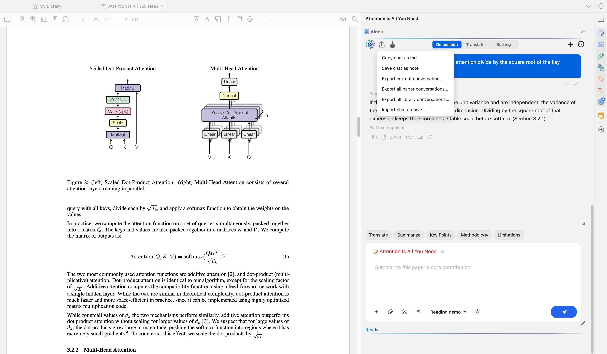

# AIdea ユーザーガイド

[简体中文](./zh-CN.md) · [繁體中文](./zh-TW.md) · [English](./en.md) · **日本語** · [한국어](./ko.md) · [Français](./fr.md)

AIdea 4.0.2、Zotero 7–10 向けです。モデルを接続し、*[Attention Is All You Need](https://arxiv.org/html/1706.03762v7#S3.SS2.SSS1)* 第 3.2.1 節で応答を確認してから、英語と簡体字中国語の対訳 PDF を作成します。接続例の URL は説明用です。

## 目次

1. [インストールとモデル接続](#インストールとモデル接続)
2. [画面の設定](#画面の設定)
3. [チャットの設定](#チャットの設定)
4. [PDF 全文翻訳の設定](#pdf-全文翻訳の設定)
5. [選択範囲の翻訳設定](#選択範囲の翻訳設定)
6. [トラブルシューティング](#トラブルシューティング)
   - [ログインできたがモデルが表示されない](#ログインできたがモデルが表示されない)
   - [環境エラーでコピーするログ](#環境エラーでコピーするログ)
   - [ローカルのエージェントに相談する](#ローカルのエージェントに相談する)

## インストールとモデル接続

1. [最新リリース](https://github.com/Visterainer/aidea-zotero/releases/latest)から AIdea の `.xpi` をダウンロードします。Zotero の **ツール → プラグイン** にある歯車メニューでファイルからのインストールを選び、ダウンロードしたファイルを指定して再起動します。
2. 論文を開き、右側の AIdea パネルで **設定 → モデル設定** を開きます。利用するサービスに合う接続方法を選んでください。

**ChatGPT アカウント。** OpenAI カードで環境のインストール／更新を選び、スタンドアロン版 Codex CLI をインストールします。OAuth ログインを押し、ブラウザーで承認してから Zotero に戻り、モデル一覧を更新します。CLI が手元の端末でログインを処理し、AIdea はその認可を使ってアカウントで利用できるモデルに接続します。

**GitHub Copilot アカウント。** Copilot カードで OAuth ログインを開始し、デバイスコードを確認して GitHub で承認します。Zotero に戻ってモデル一覧を更新します。この方式に Codex CLI は不要です。

**API キーまたはローカルモデル。** API 方式でサービスのベース URL（例 `https://api.example.com/v1`）、キー、正確なモデル ID を入力します。一覧の自動取得と ID の手動追加が可能です。Ollama ではサーバーを起動し、`http://127.0.0.1:11434/v1` とインストール済みのモデル名を入力します。認証不要のサービスではキーを空欄にできます。

**CLI の更新。** OAuth 環境の更新設定は既定で通知のみです。定期確認で通知されたら更新を実行できます。自動更新では通知から 60 秒後に実行し、延期または最小化で 24 時間延期します。サイレントでは定期確認と通知を停止します。手動更新は OpenAI カードから、PDF 翻訳環境の更新は翻訳タブから行います。

## 画面の設定

### 配色とタブバーを変更する

**設定 → 基本設定** を開きます。① タブバーの表示を切り替えます。非表示のときはパネル上端にポインターを置くと表示されます。② テーマ名から明色・暗色・既定の配色を選びます。③ 表示とフォントの設定を開きます。画面の言語もここで選べます。

### 文字サイズ・行間・余白を調整する

表示とフォントの設定を開き、コンパクト、標準、ゆったり、大きな文字から選びます。タイトルをドラッグすると、回答を見ながら調整できます。

① **会話内容の行間** は質問と回答に反映されます。文字を 13 px のまま、行高を 1.45 から 1.65 にすると、同じ回答の行間が広がります。

② **入力欄の行間** は入力中の文章に反映されます。2 行入力して確認します。③ **選択範囲の翻訳の行間** は訳文に反映されます。論文の一節を選択して確認します。

 

文字サイズはそれぞれ個別に変更できます。**メッセージ間隔** は吹き出し同士の距離、**吹き出しの余白** は枠と文字の距離です。訳文の折り返しが多いときはポップアップの幅を広げます。会話内の画像は **画像 → 表示倍率** で調整します。**リセット** で書式を初期値に戻せます。

### サイドバーの幅と Zotero ウィンドウの高さを変える

リーダー右側の **AIdea** を開きます。論文との境界線を左にドラッグするとサイドバーが広がります。高さを増やすには Zotero ウィンドウの下端を引き下げるか、最大化します。

### 会話の高さと入力欄の高さを別々に変える

会話タブで ② ショートカットのすぐ上にある右下隅をドラッグすると回答欄が広がります。③ 送信ボタンの下の外枠をドラッグすると入力欄が広がります。下へ引くと高くなり、上へ引くと低くなります。高さは保存されます。隅が見えないときはサイドバーを下へスクロールします。

## チャットの設定

最初に利用するモデルを登録し、質問ごとに入力欄でモデルと資料を確認します。回答が届いたら、モデルに渡った本文の範囲と、引用元のページを確認してください。

### チャットで使うモデルを選ぶ

1. **ChatGPT・Copilot でログインした場合**は、モデル設定でプロバイダーのカードを開き、モデル一覧を更新します。利用可能なモデルにチェックを入れると、その場で保存されます。
2. **API キー・ローカルサーバーの場合**は、接続先 URL と必要なキーを入力します。一覧を取得するか、正確なモデル ID を手動で追加します。取得した一覧では、残したいモデルをすべて選んで保存します。保存すると、この接続先の一覧が置き換わります。
3. チャットに戻り、入力欄の下にあるモデル名から今回のプロバイダーとモデルを選びます。候補が空なら設定のチェックを確認します。ログイン後も取得件数がゼロなら、[プロキシの設定を確認してください](#ログインできたがモデルが表示されない)。

文章への質問にはテキストモデルを、図やスキャンには画像入力に対応するモデルを選びます。数式の導出なら推論の強さを変更できるか、長い論文を複数扱うならコンテキスト上限を確認します。

モデルを切り替えても過去の回答は残ります。同じ質問を別のモデルに試すには、元の回答の **再試行** を押します。

### 推論の強度・コンテキスト・回答の書き方を設定する

 モデル横の電球にポインターを合わせると推論の強度を確認できます。電球を押し、対応する段階を選んでから送信します。矢印が表示される場合は右側が実際に適用される段階です。電球が灰色なら、調整できる段階がないか、対応情報を取得できていません。後者の場合はモデル一覧を更新します。

| 項目 | 操作と使いどころ |
| --- | --- |
| 推論の強度 | モデル名の横の電球で指定します。まず既定値を使い、導出を詳しく検討したいときに対応する段階を試します。チャット、全文翻訳、選択翻訳で個別に保存されます。 |
| コンテキストの上限 | モデルの詳細設定にあるトークン上限は空欄で自動になります。長い論文が繰り返し抜粋扱いになる場合は、プロバイダーの実際の上限を確認してから入力します。回答用の枠も必要です。 |
| システムプロンプト | 詳細設定で「結論のあとに根拠となる式か段落を示す」などと指定します。次の質問からチャットの既定の指示を置き換えます。空欄で既定値に戻ります。選択翻訳には独自の指示があります。 |

### 論文・選択した文章・図・ファイルを添える

PDF・EPUB のリーダーでは、入力欄のそばに現在の論文名が表示されます。ライブラリから独立したチャットを始めることもできます。

| 資料 | 操作 |
| --- | --- |
|  原文の段落 | 読みたい範囲を選び、ポップアップまたは入力欄のツールバーでテキストを追加します。抜粋が表示されたことを確認します。ポップアップにボタンがなければ、詳細設定で表示を有効にします。 |
|  比較する文献 | `@` に続けて題名の一部を入力するか、クリップから参考文献を選びます。矢印キーで移動し、Enter または Tab で追加します。題名と版を確認します。 |
|  図や数式 | PDF でハサミを押し、凡例を含めて囲みます。Esc で中止できます。画像の貼り付けやドロップも可能です。プレビューで添字まで読めることを確認し、画像入力に対応したモデルを選びます。 |
|  手元のファイル | クリップから PDF、画像、テキスト、Markdown、コードを選ぶか、入力欄にドロップします。アップロードする PDF は 1 件 50 MiB までです。文字を抽出できなければ、該当箇所の抜粋や画像を添えます。 |

参考文献とアップロードしたファイルは次の質問にも残ります。比較が終わったら **×** で外せます。選択した文章とスクリーンショットは送信後に入力欄から消えるので、同じ箇所を明示したいときはもう一度添えます。

① 入力欄の下のクリップを押し、② ファイルのアップロードか ③ 参考論文の選択を選びます。

### 質問を送る・ショートカットを編集する

 **Enter** で送信、**Shift+Enter** で改行します。`@` の候補を表示中は Enter で文献を選びます。生成中はキャンセルボタンで停止できます。

翻訳・要約・要点・研究手法・限界の各ボタンは、入力中の下書きを定型の質問に置き換えてすぐに送信します。先に資料を添え、必要な下書きはコピーしてください。右クリックすると名前や指示を編集でき、追加・削除や移動モードでの並べ替えもできます。

① 翻訳のショートカットを右クリックします。② 編集で指示を書き換え、削除でボタンを取り除けます。

### 原文で接続を確認する

1. *Attention Is All You Need* 第 3.2.1 節の式（1）の下にある、倍率を説明する段落を追加します。図との対応を知りたい場合は図 2 を添えます。
2. 「なぜ内積を √dₖ で割るのですか。分散の仮定とその根拠をこの段落から示してください」と質問します。回答のそばで、今回渡ったのが全文・抜粋・要旨のみ・本文なしのどれかを確認し、足りなければ該当箇所を追加します。
3. 引用を開き、PDF のページまたは EPUB の章を照合します。文章中に書かれただけのページ番号は手動で確認します。リンクから移動できないときは、同じ文献と元ファイルがこの端末にあるか確認します。
4. 同じ会話で「クエリとキーの各成分の分散が 1 でなければ、説明のどこが変わりますか」と聞き、原文と照らし合わせます。

### 論文から構成図を生成する

Zotero 上で **ChatGPT OAuth（Codex）** の **gpt-6.1-sol** を使用し、Transformer 構成図の生成とエクスポートを確認しました。このチャットモデルは画像生成ツールを呼び出します。他の接続先での利用可否はサービスとモデルによります。

1. チャットのクリップから *Attention Is All You Need* の PDF をアップロードし、ファイル名とモデル名を確認します。
2. 次のように依頼します。

   > 添付論文の第 3 節に基づき、画像生成ツールで学会発表に投影できる 16:9 の Transformer 構成図を描いてください。アイボリーの背景に大きな英語ラベルを置き、エンコーダーは青、デコーダーは朱色の等角投影の積層図で表し、両方に ×6 と記します。入力系列と右にずらした目的系列の埋め込み、位置符号から始めてください。エンコーダーの K と V が交差注意へ渡る矢印を強調し、Q はデコーダーから引きます。最後に次トークンの確率を小さな棒グラフで示します。余白を広く取り、会場の後方からも読める文字で画像を返してください。

3. 回答に画像が表示されたら、**画像そのもの**を右クリックし、エクスポートと保存先フォルダーを選ぶと PNG を保存できます。エンコーダーの出力からデコーダーの交差注意に向かう矢印などを、元の図 1 と照合してください。

[Zotero の動作確認で書き出した PNG を開く（中国語ラベル）](../../site/public/media/reader/transformer-generated-zh.png)

### 質問の編集・再試行・会話の分岐

生成が終わったら、自分の質問の **編集** から修正して再送信できます。別のモデルで比較するときは、再試行できる直近の回答でモデルを選び、矢印で回答を切り替えます。選んだモデルは入力欄にも反映されます。

ある回答から別の論点を掘り下げるには、その回答から新しいチャットに分岐します。そこまでの履歴が引き継がれます。空の会話から始める場合は新規チャットを選びます。

① 質問の横の鉛筆で質問を編集します。② 回答の下の円形矢印で再試行します。

### 長い会話で根拠を確認し直す

履歴がコンテキストの上限を超えると、古い内容が要約されたり、最近の発言だけが使われたりします。余裕があれば同じライブラリの関連メモリが質問に加わることもあります。数値・式・図の説明を再確認するときは、その箇所をもう一度添えて新しい回答の引用を確認します。

### 回答を保存して履歴を整理する

回答ごとにコピーやノートへの保存ができます。論文のチャットでは文献の下に、独立したチャットではライブラリにノートを保存できます。コードや数式のブロックには個別のコピーボタンがあります。会話全体を残すには、エクスポートから Markdown のコピーまたはノートへの保存を選びます。

 時計を押すと履歴が開き、再開、名前の変更、ピン留めができます。ほうきは現在の会話を消去します。履歴から一括消去するときは、ピン留め以外と全件のどちらを選んだか確認してください。

### 別の端末に会話を移す

 回答の生成が終わってから、チャットのエクスポートメニューで現在の会話、この論文の全会話、または現在のライブラリの全会話を選びます。文章と引用だけなら JSON、スクリーンショットやアップロードしたファイルを含める場合は ZIP を選びます。別の端末で同じメニューからインポートし、プレビューを確認して統合します。原本は Zotero で別途同期してください。引用からの移動には、対応する文献と同一の原本が必要です。認証情報、設定、メモリーデータベースは別途管理します。

## PDF 全文翻訳の設定

### PDF を一件翻訳する

AIdea の **翻訳** タブを開きます。初回は翻訳環境をインストールまたは更新し、準備が完了するまで待ちます。PDF を生成する環境は、OpenAI の認証用 CLI とは別に管理されます。

① PDF を確認し、② 出力フォルダー、③ 翻訳モデル、④ 訳文のみ／対訳を選びます。 原文と訳文の言語を選び、**翻訳** を押します。

### 複数の文献を一括翻訳に追加する

ライブラリで **Ctrl**（Windows/Linux）または **⌘**（macOS）を押しながら文献を選択します。連続した範囲は **Shift** で選べます。追加後、不要なファイルを外し、モデル、形式、保存先を確認します。

1. 一括翻訳では、PDF が添付された文献を複数選び、右クリックメニューで一括翻訳の準備を選びます。翻訳タブから選択中の文献を追加することもできます。追加後にリストを確認します。
2. 少なくとも一つの形式と保存先（Zotero の添付ファイルまたはフォルダー）を選びます。一括翻訳の開始ボタンを押し、スキップ・不足・置換の件数を確認して実行します。完成したファイルは文献の下または保存先フォルダーから開けます。

既定では不足しているファイルだけを作成します。既存の訳文に注釈がある場合は既定のままにしてください。置換すると注釈が失われることがあります。Zotero の再起動後はキューを開いて再開します。訳文ができた後に保存に失敗した場合は、保存先を修正して失敗項目を再試行すると、生成済みのファイルを保存できます。

① ライブラリで選択した文献を追加します。一覧を確認し、② で一括翻訳を開始します。図では一覧もボタンも 2 件です。

### 翻訳の詳細設定

作例は **英語 → 簡体字中国語** です。`429` が返った場合は、毎秒のリクエスト数（QPS）と並列ワーカー数を減らし、1 件で再試行します。スキャンされたページには自動 OCR を選べます。表内テキスト、参考文献のスキップ、付録の翻訳、用語集、出力フォントも変更できます。

6 ページの対訳。左が英語の原文、右が簡体字中国語の訳文です。表 1 は各層の計算量を比較しています。

全文翻訳では、構成図の中のラベルも翻訳できます。FactorMiner の図 1 で青い矢印をたどると、左の英語原図にある「Memory Retrieval」と「Library Update」が、右の簡体字中国語版では「记忆检索」と「库更新」になっています。

## 選択範囲の翻訳設定

**設定 → 選択範囲の翻訳** で ① 翻訳を有効にし、② モデルと ③ 原文・訳文の言語を選びます。自動翻訳では PDF や EPUB の本文を選ぶと訳文が表示されます。手動の場合はポップアップの翻訳ボタンを押します。

対応モデルでは推論の強さを選べます。ポップアップの **コピー** と **ノートに追加** の表示も切り替えられます。

Vaswani らの『[Attention Is All You Need](https://arxiv.org/html/1706.03762v7#S3.SS2.SSS1)』を使います。図 2 の **Scaled Dot-Product Attention** を選ぶと、簡体字中国語の訳「缩放点积注意力」が表示されます。画像内の回答と選択範囲の訳文にはローカルのデモ応答を使用しています。

① 訳文を注釈に書き込む項目にチェックを入れ、訳文が出たら ② ハイライトの色を選びます。ハイライトを開くとコメントに訳文が残っています。ノートだけに残す場合は ③ **ノートに追加** を押します。チェックは初期状態でオフで、次回から前回の選択が使われます。

## トラブルシューティング

### インストール後にパネルが見つからない

ツールのアドオン画面で AIdea が有効か確認します。Zotero を完全に終了し（macOS は **⌘Q**）、再起動して PDF を開き、右のアイテムペインを展開します。表示されなければ OS、Zotero、AIdea のバージョンを控えます。

### ログインできたがモデルが表示されない

1. モデルを再取得し、設定のコンソールで失敗した段階とコードを確認します。プロキシを変更した後、Zotero が古いポートを使用し、ブラウザーのログインだけ成功した報告があります。
2. プロキシのプロトコルと待受ポートを、OS のプロキシまたは PAC 設定と照合します。ブラウザー拡張、ターミナル、Zotero では経路が異なる場合があります。修正後に Zotero を完全に終了して再起動し、一覧を更新してモデルにチェックを入れ、チャットでそのモデルを選んで短い質問を送ります。
3. `401` なら認可や API キーを、アカウント・地域制限が明記された `403` なら提供元の案内を確認します。全文翻訳だけが `502` なら同じモデルで三つの機能を試した結果を控え、翻訳タブのコンソールを確認します。

[Issue #34](https://github.com/Visterainer/aidea-zotero/issues/34) · [Issue #109](https://github.com/Visterainer/aidea-zotero/issues/109) · [Issue #60](https://github.com/Visterainer/aidea-zotero/issues/60) · [Zotero 公式の接続トラブル対策](https://www.zotero.org/support/kb/connection_error)

### 環境エラーでコピーするログ

| 失敗した操作 | コピーする場所 | 添える情報 |
| --- | --- | --- |
| 翻訳環境の導入・修復、PDF 生成 | 翻訳タブのコンソールで全件コピー。操作開始から最初のエラー、最後の状態までを残します。ログのパスが表示されたら該当箇所を抜粋します。 | OS とアーキテクチャ、Zotero・AIdea のバージョン、失敗段階、モデルと認証方式。生成時は単体か一括か、スキャンか、出力形式、特定ファイルのみかも記載。 |
| OAuth 環境の導入、ログイン、モデル取得 | 設定のコンソールで進行状況と詳細ログをそれぞれのコピーボタンで取得。 | OS・アーキテクチャとバージョン、プロバイダー、押したボタン、ブラウザーの承認結果、Zotero に戻った後の状態、エラーコード、プロキシ確認・再起動後の結果。 |

① 設定でコンソールを開きます。② と ③ で上下のログをそれぞれコピーし、共有前に個人のパスを伏せます。

### 共有前の匿名化

ローカルのエディターでメールアドレス、キー、トークン、デバイスコード、認可コールバックのパラメーター、プロキシ認証情報、パスのユーザー名を `<非公開>` に置き換えます。バージョン、操作、コード、エラー本文は残します。画像のアカウント欄、アドレスバー、キー欄も確認します。

[不具合を報告する](https://github.com/Visterainer/aidea-zotero/issues/new/choose)

### ローカルのエージェントに相談する

次の依頼文と匿名化したログを Codex などのローカルエージェントに渡します。

> OS とアーキテクチャ [記入]、Zotero [版]、AIdea [版]。[ボタン] を押し、期待した結果は [結果]、実際は [エラー]。同じモデルでチャット [結果]、選択翻訳 [結果]、全文翻訳 [結果]。匿名化したログ：[貼付]。最初に原因を示すエラーを特定し、プロキシ、OAuth、翻訳環境、モデルへの要求、ファイル保存のどの段階かと、最小限の確認手順を一つ教えてください。添付した資料だけを使い、認証情報の読み取りやアップロードは行わないでください。

### よくある質問

- **選択しても翻訳されない。** 選択範囲の翻訳が有効か、専用モデルと言語が選ばれているかを確認します。スキャン画像では、一文を選択してコピーできるテキスト層が必要です。
- **チャットは動くが PDF 翻訳環境が使えない。** 翻訳タブで環境をインストールまたは修復します。インストーラーは macOS 13 以降、glibc 2.28 以降の Linux、および対応する 64 ビット版 Windows で動作します。
- **原文の送信先を知りたい。** 履歴とメモリーはローカルに保存されます。質問や翻訳に必要な本文や添付ファイルの内容は選んだモデルのサービスに送信されます。端末内で処理する場合は接続先 URL を確認してください。
