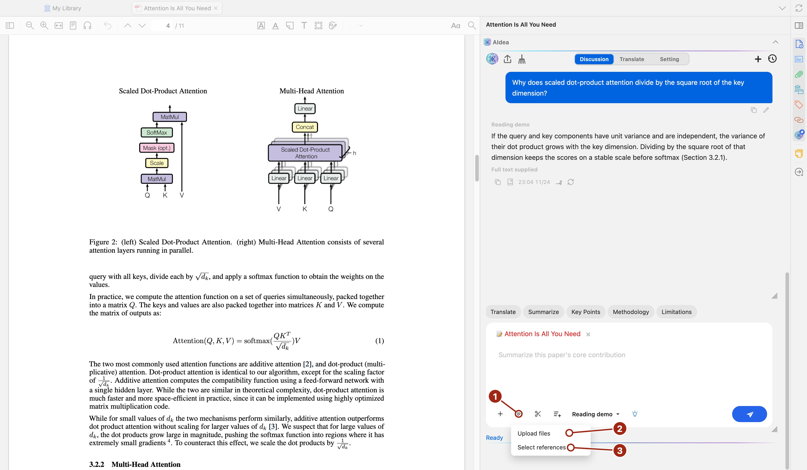
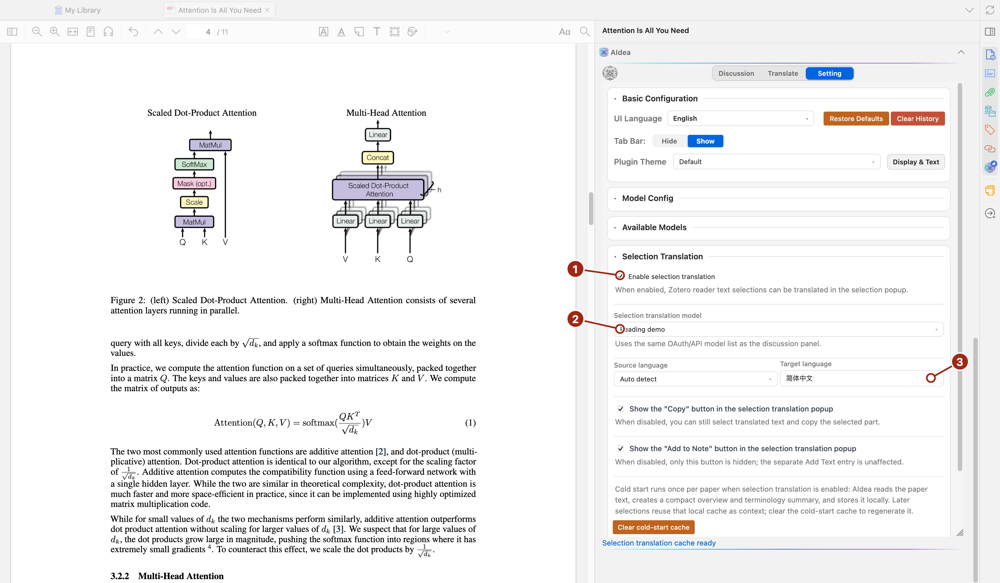

# AIdea 사용 설명서

[简体中文](./zh-CN.md) · [繁體中文](./zh-TW.md) · [English](./en.md) · [日本語](./ja.md) · **한국어** · [Français](./fr.md) · [Deutsch](./de.md) · [Español](./es.md) · [Русский](./ru.md) · [Português](./pt.md) · [العربية](./ar.md) · [हिन्दी](./hi.md)

AIdea 4.0.2와 Zotero 7–10용 안내서입니다. 모델을 연결하고 *[Attention Is All You Need](https://arxiv.org/html/1706.03762v7#S3.SS2.SSS1)* 3.2.1절에서 응답을 확인한 다음 영어·중국어 간체 대조 PDF를 만들어 봅니다. 연결 예시에는 예시 주소를 사용합니다.

## 목차

1. [설치 및 모델 연결](#설치-및-모델-연결)
2. [화면 설정](#화면-설정)
3. [대화 설정](#대화-설정)
4. [PDF 전문 번역 설정](#pdf-전문-번역-설정)
5. [선택 영역 번역 설정](#선택-영역-번역-설정)
6. [오류 해결](#오류-해결)
   - [로그인했는데 모델 목록이 비어 있을 때](#로그인했는데-모델-목록이-비어-있을-때)
   - [환경 오류에서 복사할 로그](#환경-오류에서-복사할-로그)
   - [로컬 에이전트로 진단하기](#로컬-에이전트로-진단하기)

## 설치 및 모델 연결

1. [최신 릴리스](https://github.com/Visterainer/aidea-zotero/releases/latest)에서 AIdea `.xpi` 파일을 내려받습니다. Zotero의 **도구 → 플러그인**에서 톱니바퀴 메뉴를 열고 파일에서 설치를 선택합니다. 내려받은 파일을 지정하고 Zotero를 다시 시작합니다.
2. 논문을 열고 오른쪽 AIdea 패널의 **설정 → 모델 설정**에서 사용할 서비스에 맞는 연결 방식을 선택합니다.

**ChatGPT 계정.** OpenAI 카드에서 환경 설치/업데이트를 눌러 독립 실행형 Codex CLI를 설치합니다. OAuth 로그인을 누르고 브라우저에서 승인한 뒤 Zotero로 돌아와 모델을 새로 고칩니다. CLI가 이 컴퓨터에서 로그인을 처리하며 AIdea는 해당 권한으로 계정에서 사용 가능한 모델에 연결합니다.

**GitHub Copilot 계정.** Copilot 카드에서 OAuth 로그인을 시작하고 기기 코드를 확인합니다. GitHub에서 승인한 후 모델 목록을 새로 고칩니다. 이 방식은 Codex CLI 설치 없이 사용할 수 있습니다.

**API 키 또는 로컬 모델.** API 방식을 선택하고 서비스의 기본 URL(예: `https://api.example.com/v1`), 키, 정확한 모델 ID를 입력합니다. 모델 목록을 가져오거나 ID를 직접 추가할 수 있습니다. Ollama는 로컬 서버를 시작한 뒤 `http://127.0.0.1:11434/v1`과 설치한 모델 이름을 입력합니다. 인증이 필요 없는 서비스에서만 키를 비워 둡니다.

**CLI 업데이트.** OAuth 환경은 기본적으로 주기적으로 확인한 뒤 업데이트를 알립니다. 자동 모드는 알림 60초 후 설치하며, 나중에 실행하거나 최소화하면 24시간 연기됩니다. 무음 모드는 정기 확인과 알림을 끕니다. 수동 업데이트는 OpenAI 카드에서 실행합니다. PDF 번역 환경은 번역 탭에서 별도로 관리합니다.

## 화면 설정

### 테마와 탭 표시줄 변경

**설정 → 기본 설정**을 엽니다. ① 탭 표시줄을 표시하거나 숨깁니다. 숨긴 뒤에는 패널 상단에 마우스를 올리면 다시 보입니다. ② 테마 이름을 눌러 밝은색, 어두운색 또는 기본값을 선택합니다. ③ 화면 및 글꼴 설정을 엽니다. 인터페이스 언어도 여기서 선택합니다.

### 글자 크기와 줄 높이, 여백 조절

화면 및 글꼴 설정에서 촘촘하게, 표준, 넉넉하게, 큰 글자 중 하나를 선택합니다. 창 제목을 끌어 옆으로 옮기면 답변을 보면서 조절할 수 있습니다.

① **대화 내용의 줄 높이**는 질문과 답변에 적용됩니다. 글자 크기를 13 px로 유지하고 줄 높이를 1.45에서 1.65로 바꾸면 한 답변 안에서 줄 사이가 넓어집니다.

② **입력란의 줄 높이**는 작성 중인 글에 적용됩니다. 두 줄을 입력해 비교하세요. ③ **선택 영역 번역의 줄 높이**는 팝업의 번역문에 적용됩니다. 논문에서 한 문단을 선택해 확인하세요.

 

글자 크기는 세 영역에서 따로 조절합니다. **메시지 간격**은 말풍선 사이의 거리이고 **말풍선 안쪽 여백**은 글자와 테두리 사이의 거리입니다. 번역문이 자주 줄바꿈되면 팝업 너비를 늘리세요. 대화 속 이미지는 **이미지 → 표시 배율**에서 조절합니다. **초기화**를 누르면 서식이 기본값으로 돌아갑니다.

### Zotero 사이드바 너비와 창 높이 조절

리더 오른쪽에서 **AIdea**를 엽니다. 논문과 사이드바 사이의 구분선을 왼쪽으로 끌면 플러그인이 넓어집니다. 더 높게 보려면 Zotero 창의 아래쪽 테두리를 끌거나 창을 최대화하세요.

### 대화 높이와 입력란 높이 따로 조절

대화 탭에서 ② 단축 버튼 바로 위의 오른쪽 아래 모서리를 끌면 답변을 더 많이 볼 수 있습니다. ③ 전송 버튼 아래 바깥 모서리를 끌면 입력란이 커집니다. 아래로 끌면 높아지고 위로 끌면 낮아집니다. 높이는 저장됩니다. 모서리가 안 보이면 사이드바를 아래로 스크롤하세요.

## 대화 설정

먼저 설정에서 사용할 모델을 등록합니다. 질문을 보내기 전에는 입력란의 모델과 첨부 자료를, 답변을 받은 뒤에는 실제로 전달된 본문의 범위와 인용 위치를 확인하세요.

### 이번 대화에 사용할 모델 선택

1. **ChatGPT 또는 Copilot으로 로그인한 경우** 모델 설정에서 해당 제공업체의 모델 목록을 새로 고칩니다. 사용 가능한 모델 목록에서 체크하면 선택이 바로 저장됩니다.
2. **API 키나 로컬 서버를 사용하는 경우** 기본 주소를 확인하고 필요한 경우 키를 입력합니다. 모델 목록을 가져오거나 정확한 모델 ID를 직접 추가합니다. 가져온 목록에서는 계속 쓸 모델을 모두 체크하고 선택한 모델을 저장합니다. 저장하면 해당 서비스의 목록이 교체됩니다.
3. 대화로 돌아와 입력란 하단의 모델명을 누르고 제공업체와 모델을 선택합니다. 메뉴가 비어 있다면 설정에서 모델이 체크되어 있는지 확인합니다. 로그인은 성공했지만 새로 고친 목록이 0개라면 [프록시 설정을 확인하세요](#로그인했는데-모델-목록이-비어-있을-때).

문단을 물을 때는 텍스트 모델을, 그림이나 스캔을 읽을 때는 이미지 입력 모델을 고르세요. 수식 유도에는 추론 강도를 조절할 수 있는지, 긴 논문 여러 편을 다룰 때는 문맥 한도가 얼마인지 확인하세요.

모델을 바꿔도 기존 답변은 남습니다. 같은 질문을 다른 모델에 보내려면 원래 답변 옆의 **재시도**를 누르세요.

### 추론 강도와 문맥 한도, 답변 지침 설정

 모델 옆 전구에 마우스를 올려 현재 추론 강도를 확인하세요. 전구를 누르고 지원되는 단계를 선택한 뒤 질문을 보냅니다. 화살표가 표시되면 오른쪽이 실제 적용되는 단계입니다. 전구가 회색이면 선택할 단계가 없거나 지원 정보를 아직 가져오지 못한 상태입니다. 후자의 경우 모델 목록을 새로 고치세요.

| 항목 | 설정 위치와 사용 방법 |
| --- | --- |
| 추론 강도 | 모델명 옆 전구에서 조절합니다. 기본값으로 시작하고 복잡한 유도 과정을 검토할 때 지원되는 단계를 선택하세요. 대화, 전문 번역, 선택 번역은 각각 설정을 저장합니다. |
| 문맥 한도 | 모델의 고급 설정에서 토큰 한도를 비워 두면 자동으로 계산합니다. 긴 논문이 반복해서 발췌문으로만 전달된다면 제공업체의 실제 한도를 확인한 다음 입력하세요. 답변을 생성할 공간도 필요합니다. |
| 시스템 프롬프트 | 고급 설정에서 “결론을 먼저 쓰고 근거가 된 수식이나 문단을 제시해 줘”처럼 지정합니다. 다음 질문부터 대화의 기본 지침을 대체합니다. 비우면 기본값으로 돌아갑니다. 선택 번역은 별도 지침을 사용합니다. |

### 논문과 문단, 그림, 파일 첨부

PDF나 EPUB 리더에서는 입력란 주변에 표시된 논문 제목을 확인하세요. 라이브러리에서 특정 논문에 연결되지 않은 대화를 시작할 수도 있습니다.

| 자료 | 첨부 방법 |
| --- | --- |
|  특정 문단 | 원문을 선택한 뒤 팝업이나 입력 도구 모음에서 텍스트 추가를 누릅니다. 입력란에 발췌문이 표시되는지 확인하세요. 팝업에 버튼이 없다면 고급 설정에서 표시를 켭니다. |
|  비교할 논문 | `@` 뒤에 제목의 일부를 입력하거나 클립 메뉴에서 참고 논문을 선택합니다. 방향키로 이동한 뒤 Enter나 Tab으로 추가합니다. 각 논문의 제목과 판본을 확인하세요. |
|  그림 또는 수식 | PDF에서 가위를 누르고 범례까지 포함해 영역을 지정합니다. Esc로 취소할 수 있습니다. 이미지를 붙여 넣거나 끌어 놓아도 됩니다. 이미지 입력을 지원하는 모델을 고르고 미리 보기에서 첨자가 읽히는지 확인하세요. |
|  로컬 파일 | 클립 메뉴에서 PDF, 이미지, 텍스트, Markdown, 코드 파일을 선택하거나 끌어 놓습니다. 업로드 PDF는 파일당 50 MiB가 한도입니다. 텍스트 추출이 불완전하면 해당 문단이나 선명한 캡처를 첨부하세요. |

참고 논문과 업로드한 파일은 다음 질문에도 남습니다. 비교가 끝나면 **×**로 제거하세요. 선택한 문단과 캡처는 전송 후 입력란에서 사라집니다. 같은 부분을 명시적으로 가리켜야 할 때 다시 첨부하세요.

① 입력란 아래 클립을 누른 뒤 ② 파일 업로드 또는 ③ 참고 논문 선택을 누릅니다.

### 질문 전송과 단축 버튼 편집

 **Enter**로 전송하고 **Shift+Enter**로 줄을 바꿉니다. `@` 목록이 열려 있으면 Enter가 먼저 문헌을 선택합니다. 답변 생성 중에는 취소 버튼으로 중단할 수 있습니다.

번역, 요약, 핵심 내용, 연구 방법, 한계 버튼을 누르면 입력 중인 초안이 해당 프롬프트로 교체되고 즉시 전송됩니다. 자료를 먼저 첨부하고 필요한 초안은 복사해 두세요. 단축 버튼을 오른쪽 클릭하면 이름이나 프롬프트를 편집하고, 버튼을 추가·삭제하거나 이동 모드에서 순서를 바꿀 수 있습니다.

① 번역 단축 버튼을 오른쪽 클릭합니다. ② 편집을 눌러 프롬프트를 바꾸거나 삭제를 눌러 버튼을 제거합니다.

### 원문으로 연결 확인

1. *Attention Is All You Need* 3.2.1절에서 식 (1) 아래의 스케일링 설명 문단을 추가합니다. 도식까지 확인하려면 그림 2도 첨부하세요.
2. “왜 내적을 √dₖ로 나누나요? 이 문단의 분산 가정과 근거를 설명해 주세요”라고 질문합니다. 답변 옆에서 전문, 발췌문, 초록만 전달됨, 본문 없음 중 어떤 상태인지 확인하세요. 필요한 문단이 빠졌다면 직접 추가합니다.
3. 인용을 눌러 PDF 페이지나 EPUB 절에서 근거를 확인합니다. 일반 텍스트로 적힌 페이지 번호는 직접 대조하세요. 인용을 열 수 없다면 같은 Zotero 항목과 원본 파일이 이 기기에 있는지 확인합니다.
4. 같은 대화에서 “쿼리와 키의 각 성분의 분산이 1이 아니라면 설명의 어느 단계가 달라지나요?”라고 묻고 원문과 대조하세요.

### 논문을 바탕으로 구조도 생성

Zotero의 AIdea에서 **ChatGPT OAuth(Codex)** 연결과 **gpt-6.1-sol** 모델로 Transformer 구조도를 생성하고 내보냈습니다. 대화 모델이 이미지 생성 도구를 호출한 결과입니다. 다른 연결의 지원 여부는 서비스와 모델에 따라 다릅니다.

1. 대화에서 클립을 눌러 *Attention Is All You Need* PDF를 업로드합니다. 첨부 파일명과 모델명을 확인하세요.
2. 다음과 같이 요청합니다.

   > 첨부 논문의 3절에 따라 이미지 생성 도구로 학회 발표에서 전체 화면으로 보여 줄 16:9 Transformer 구조도를 그려 주세요. 아이보리 바탕에 큰 영어 레이블을 쓰고 인코더는 코발트블루, 디코더는 주홍색의 등각 투영 층으로 그려 각각 ×6을 표시하세요. 원본 시퀀스와 오른쪽으로 이동한 목표 시퀀스의 임베딩 및 위치 인코딩에서 출발하세요. 인코더가 교차 어텐션에 K와 V를 보내는 화살표를 강조하고 Q는 디코더에서 연결하세요. 마지막에 작은 막대그래프로 다음 토큰 확률을 표시하세요. 뒷자리에서도 이름을 읽을 수 있도록 여백과 글자 크기를 충분히 확보하고 이미지를 반환해 주세요.

3. 답변에 이미지가 나타나면 **이미지 자체**를 오른쪽 클릭한 뒤 내보내기와 저장 폴더를 선택해 PNG로 저장합니다. 인코더 출력이 디코더의 교차 어텐션으로 이어지는지 등 화살표를 원 논문의 그림 1과 대조하세요.

[Zotero 테스트에서 내보낸 PNG 열기(중국어 레이블)](../../site/public/media/reader/transformer-generated-zh.png)

### 질문 수정, 답변 재시도, 대화 분기

생성이 끝나면 내 질문 옆에서 편집을 선택해 수정한 뒤 다시 보냅니다. 모델별 답변을 비교하려면 재시도가 가능한 최근 답변에서 모델을 선택하세요. 화살표로 버전을 오갈 수 있습니다. 재시도에 선택한 모델은 입력란에도 반영됩니다.

특정 답변을 출발점으로 삼으려면 그 답변에서 새 대화로 분기하세요. 해당 시점까지의 대화가 복사됩니다. 빈 대화를 열려면 새 대화를 누릅니다.

① 질문 옆의 연필을 눌러 질문을 수정합니다. ② 답변 아래의 원형 화살표를 눌러 다시 시도합니다.

### 긴 대화에서 원문 근거 유지

기록이 문맥 한도를 넘으면 오래된 내용이 요약되거나 최근 메시지만 전달될 수 있습니다. 여유가 있으면 현재 라이브러리에서 질문과 관련된 기억을 가져오기도 합니다. 특정 수치, 수식이나 그림 설명을 다시 물을 때는 원문을 첨부하고 새 답변의 인용을 확인하세요.

### 답변 저장과 대화 기록 관리

답변 하나를 복사하거나 노트로 저장할 수 있습니다. 논문 대화는 문헌 항목 아래에, 독립 대화는 라이브러리에 노트를 저장할 수 있습니다. 코드와 수식 블록에는 개별 복사 버튼이 있습니다. 전체 대화는 내보내기 메뉴에서 Markdown으로 복사하거나 노트로 저장합니다.

 시계 버튼으로 기록을 열면 대화를 다시 열거나 이름을 바꾸고 고정할 수 있습니다. 빗자루 버튼은 현재 대화를 지웁니다. 기록에서 일괄 삭제할 때는 고정되지 않은 대화만 지우는지, 목록 전체를 지우는지 확인하세요.

### 다른 기기에서 대화 이어가기

 답변 생성이 끝나면 대화 패널의 내보내기 메뉴에서 현재 대화, 현재 논문의 모든 대화, 현재 라이브러리의 모든 대화 중 하나를 선택합니다. 텍스트와 인용만 옮길 때는 JSON, 스크린샷과 업로드한 파일도 옮길 때는 ZIP을 선택합니다. 다른 기기의 같은 메뉴에서 가져오기를 열고 미리 보기를 확인한 뒤 병합합니다. 원본 문헌은 Zotero를 통해 별도로 동기화하세요. 인용으로 이동하려면 같은 문헌과 원본 파일이 있어야 합니다. 인증 정보, 설정, 메모리 데이터베이스는 별도로 관리합니다.

## PDF 전문 번역 설정

### PDF 한 편 번역

AIdea의 **번역** 탭을 엽니다. 처음이라면 번역 환경 설치 또는 업데이트를 누르고 준비가 끝날 때까지 기다립니다. PDF를 생성하는 환경과 OpenAI 로그인에 쓰는 CLI는 별도로 관리됩니다.

① PDF를 확인하고 ② 출력 폴더, ③ 번역 모델, ④ 번역문만 또는 이중 언어 출력을 선택합니다. 원문 및 번역 언어를 선택하고 **번역**을 누르세요.

### 여러 문헌을 일괄 번역에 추가

라이브러리에서 **Ctrl**(Windows/Linux) 또는 **⌘**(macOS)를 누른 채 항목을 선택합니다. 연속 범위는 **Shift**로 선택합니다. 목록에 추가한 뒤 잘못 선택한 파일을 빼고 모델, 출력 형식, 저장 위치를 확인합니다.

1. 여러 편을 번역하려면 라이브러리에서 PDF가 첨부된 문헌을 선택합니다. 오른쪽 클릭 메뉴에서 일괄 번역을 준비하거나 번역 탭에서 선택 항목을 추가합니다. 목록을 검토한 뒤 실행할 수 있습니다.
2. 출력 형식과 저장 위치(Zotero 첨부 파일 또는 폴더)를 각각 하나 이상 고릅니다. 일괄 번역 시작을 누르고 건너뛸 파일, 누락된 파일, 교체할 파일 수를 확인한 뒤 진행합니다. 완료된 PDF는 해당 문헌 아래나 출력 폴더에서 엽니다.

기본 설정에서는 누락된 출력만 생성합니다. 기존 번역본에 주석이 있다면 기본값을 유지하세요. 파일을 교체하면 주석이 손실될 수 있습니다. Zotero를 다시 시작한 후에는 대기열에서 계속을 누릅니다. 번역 후 저장에 실패했다면 저장 위치를 수정하고 실패 항목을 다시 시도해 이미 생성된 파일을 저장합니다.

① 라이브러리에서 선택한 문헌을 추가합니다. 목록을 확인한 뒤 ②에서 일괄 번역을 시작합니다. 예시에는 문헌이 두 편이며 버튼에도 2가 표시됩니다.

### 고급 번역 옵션

예시의 언어는 **영어 → 중국어 간체**입니다. `429` 오류는 초당 요청 수(QPS)와 병렬 작업자 수를 줄인 뒤 PDF 한 편으로 다시 확인합니다. 스캔 페이지는 자동 OCR을 사용할 수 있습니다. 표의 텍스트, 참고문헌 건너뛰기, 부록 번역, 용어집, 출력 글꼴도 조정할 수 있습니다.

6쪽의 영문 원문(왼쪽)과 중국어 간체 번역(오른쪽)입니다. 표 1은 여러 층의 계산 복잡도를 비교합니다.

전문 번역은 구조도 안의 문구도 번역할 수 있습니다. FactorMiner의 그림 1에서 파란색 화살표를 따라가면 왼쪽 영어 원문의 “Memory Retrieval”과 “Library Update”가 오른쪽 중국어 간체 번역에서는 각각 “记忆检索”와 “库更新”으로 표시됩니다.

## 선택 영역 번역 설정

**설정 → 선택 영역 번역**에서 ① 번역을 켜고 ② 모델과 ③ 원문 및 번역 언어를 선택합니다. 자동 번역을 켜면 PDF나 EPUB에서 글을 선택할 때 번역문이 나타납니다. 수동 모드에서는 팝업의 번역 버튼을 누릅니다.

지원 모델에서는 추론 강도를 조절할 수 있습니다. 팝업에 **복사**와 **노트에 추가**를 표시할지도 선택할 수 있습니다.

Vaswani 등의 논문 *[Attention Is All You Need](https://arxiv.org/html/1706.03762v7#S3.SS2.SSS1)*를 사용합니다. 그림 2에서 **Scaled Dot-Product Attention**을 선택하면 중국어 간체 번역 “缩放点积注意力”가 표시됩니다. 화면의 답변과 선택 영역 번역은 로컬 데모 응답입니다.

① 번역문을 주석에 쓰는 항목을 체크합니다. 번역문이 나타나면 ② 하이라이트 색을 고릅니다. 하이라이트를 다시 열면 주석의 댓글에서 번역문을 볼 수 있습니다. 노트로만 남기려면 ③ **노트에 추가**를 누릅니다. 체크박스는 기본적으로 꺼져 있고 마지막 선택이 저장됩니다.

## 오류 해결

### 설치 후 패널이 보이지 않을 때

도구의 플러그인 목록에서 AIdea가 활성화되어 있는지 확인합니다. Zotero를 완전히 종료한 뒤(macOS는 **⌘Q**) 다시 실행하고 PDF를 열어 오른쪽 항목 패널을 펼칩니다. 여전히 보이지 않으면 운영체제, Zotero, AIdea 버전을 기록합니다.

### 로그인했는데 모델 목록이 비어 있을 때

1. 모델을 새로 고치고 설정의 콘솔에서 실패한 단계와 상태 코드를 확인합니다. 프록시 프로그램을 바꾼 뒤 브라우저 로그인은 성공했지만 Zotero가 이전 포트를 사용한 사례가 있습니다.
2. 프록시 프로그램의 실제 프로토콜과 수신 포트를 시스템 프록시 또는 PAC 설정과 대조합니다. 브라우저 확장, 터미널, Zotero의 경로가 서로 다를 수 있습니다. 수정 후 Zotero를 완전히 종료했다가 다시 실행하고 모델 목록을 갱신하고 모델을 체크한 뒤 대화에서 해당 모델을 선택해 짧은 메시지를 보냅니다.
3. `401`이면 인증 또는 API 키를 확인합니다. `403` 메시지가 계정 권한이나 지역 제한을 명시하면 제공업체의 안내를 확인합니다. 전문 번역만 `502`이면 같은 모델을 세 기능에서 시험한 결과를 기록하고 번역 탭의 콘솔을 확인합니다.

[Issue #34](https://github.com/Visterainer/aidea-zotero/issues/34) · [Issue #109](https://github.com/Visterainer/aidea-zotero/issues/109) · [Issue #60](https://github.com/Visterainer/aidea-zotero/issues/60) · [Zotero 공식 연결 오류 안내](https://www.zotero.org/support/kb/connection_error)

### 환경 오류에서 복사할 로그

| 실패한 작업 | 복사 위치 | 함께 적을 내용 |
| --- | --- | --- |
| 번역 환경 설치·복구, PDF 생성 | 번역 탭의 콘솔에서 전체 복사. 버튼을 누른 시점부터 첫 오류와 최종 상태까지 남깁니다. 전체 로그 경로가 보이면 해당 오류 구간을 발췌합니다. | 운영체제와 아키텍처, Zotero·AIdea 버전, 실패 단계, 모델과 인증 방식. 생성 오류는 단건/일괄, 텍스트/스캔, 출력 형식, 특정 파일만 실패하는지도 기재합니다. |
| OAuth 환경 설치, 로그인, 모델 갱신 | 설정의 콘솔에서 진행 상황과 상세 로그를 각 복사 버튼으로 복사합니다. | 운영체제·아키텍처와 버전, 제공업체, 누른 버튼, 브라우저 승인 결과, Zotero로 돌아온 뒤의 상태, 오류 코드, 프록시 확인 및 재시작 후 결과. |

① 설정의 콘솔을 펼칩니다. ②와 ③으로 위아래 로그를 각각 복사하고 공유 전에 개인 경로를 가립니다.

### 공유 전 개인정보 가리기

로컬 편집기에서 이메일, 키, 토큰, 기기 코드, 인증 콜백 URL의 매개변수, 프록시 자격 증명, 경로의 사용자 이름을 `<가림>`으로 바꿉니다. 버전, 단계, 상태 코드, 오류 본문은 남깁니다. 스크린샷의 계정란, 주소 표시줄, 키 입력란도 확인합니다.

[버그 보고하기](https://github.com/Visterainer/aidea-zotero/issues/new/choose)

### 로컬 에이전트로 진단하기

다음 요청문과 가린 로그를 Codex 등의 로컬 에이전트에 전달합니다.

> 운영체제와 아키텍처 [입력], Zotero [버전], AIdea [버전]. [버튼]을 눌렀을 때 예상 결과 [결과], 실제 [오류]. 같은 모델의 대화 [상태], 선택 번역 [상태], 전문 번역 [상태]. 가린 로그: [붙여넣기]. 원인을 보여 주는 첫 오류를 찾아 프록시, OAuth, 번역 환경, 모델 요청, 파일 저장 중 어느 단계인지 알려 주고 확인 절차 하나를 제시해 주세요. 첨부 자료만 사용하고 자격 증명을 읽거나 파일을 업로드하지 마세요.

### 자주 묻는 질문

- **구절을 선택해도 번역되지 않습니다.** 선택 영역 번역 설정, 전용 모델, 번역 언어를 확인하세요. 스캔한 페이지라면 문장 하나를 복사해 보세요. 이 기능에는 선택할 수 있는 텍스트가 필요합니다.
- **대화는 되지만 PDF 번역 환경을 쓸 수 없습니다.** 번역 탭에서 환경을 설치하거나 복구하세요. 설치 프로그램은 macOS 13 이상, glibc 2.28 이상의 Linux, 지원되는 64비트 Windows에서 동작합니다.
- **원문은 어디로 전송되나요?** 대화 기록과 메모리는 로컬에 저장됩니다. 질문이나 번역에 필요한 원문과 첨부 내용은 선택한 모델 서비스에 전송됩니다. 기기 안에서 처리하려면 선택한 주소가 로컬 서비스를 가리키는지 확인하세요.
