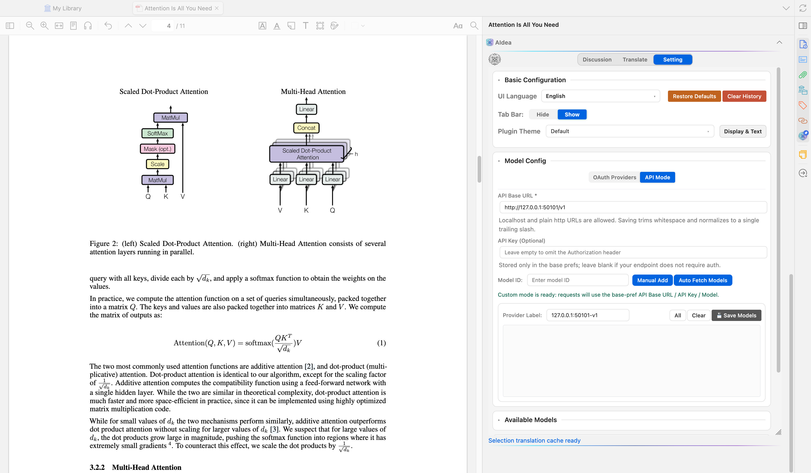

# Guia de utilização do AIdea

[简体中文](./zh-CN.md) · [繁體中文](./zh-TW.md) · [English](./en.md) · [日本語](./ja.md) · [한국어](./ko.md) · [Français](./fr.md) · [Deutsch](./de.md) · [Español](./es.md) · [Русский](./ru.md) · **Português** · [العربية](./ar.md) · [हिन्दी](./hi.md)

Para o AIdea 4.0.2 no Zotero 7–10. Ligue um modelo, faça uma pergunta sobre a secção 3.2.1 de *[Attention Is All You Need](https://arxiv.org/html/1706.03762v7#S3.SS2.SSS1)* e produza um PDF bilingue em inglês e chinês. Os endereços são exemplos.

## Índice

1. [Instalar o AIdea e ligar um modelo](#instalar-o-aidea-e-ligar-um-modelo)
2. [Personalizar a interface](#personalizar-a-interface)
3. [Configurar a conversa](#configurar-a-conversa)
4. [Traduzir PDFs completos](#traduzir-pdfs-completos)
5. [Traduzir uma seleção de texto](#traduzir-uma-seleção-de-texto)
6. [Resolver problemas](#resolver-problemas)

## Instalar o AIdea e ligar um modelo

Descarregue o ficheiro `.xpi` da [versão mais recente](https://github.com/Visterainer/aidea-zotero/releases/latest). No Zotero, abra **Ferramentas → Extensões**, clique na engrenagem, escolha instalar a partir de um ficheiro e selecione a descarga. Reinicie o Zotero, abra um artigo e, à direita, entre em **AIdea → Settings → Model Config**.

**ChatGPT.** No cartão da OpenAI, selecione **Install/Update Env** para instalar a CLI do Codex. Clique em **OAuth Login**, autorize no navegador, regresse ao Zotero e clique em **Refresh Models**. A CLI trata da autenticação no computador; a sua conta determina os modelos disponíveis.

**GitHub Copilot.** No cartão do Copilot, clique em **OAuth Login**, confira o código do dispositivo, autorize no GitHub e atualize os modelos. Este método dispensa a CLI do Codex.

**API ou modelo local.** No modo API, indique o URL base (por exemplo, `https://api.example.com/v1`), a chave e o ID exato do modelo. Obtenha a lista ou introduza o ID manualmente. Com Ollama, inicie o servidor e use `http://127.0.0.1:11434/v1` e o nome de um modelo instalado. Deixe a chave em branco apenas se o serviço dispensar autenticação.

**Atualizar a CLI.** Por predefinição, recebe um aviso após uma verificação periódica. No modo automático, a atualização começa após 60 segundos. Adiar ou minimizar difere a atualização por 24 horas. O modo silencioso desativa verificações e avisos. Para atualizar manualmente, use **Install/Update Env**. O ambiente de PDF é gerido em **Translate**.

Configuração do modelo no painel lateral do Zotero.

## Personalizar a interface

### Tema e barra de separadores

Abra **Settings → Basic Configuration**. Se ocultar a barra de separadores, passe o ponteiro sobre o topo para a mostrar. Escolha um tema claro, escuro ou predefinido. Pode também mudar o idioma da interface.

① Barra de separadores ② Tema ③ Visualização e texto.

### Tamanho da letra, altura de linha e espaçamento

Em **Display & Text**, escolha uma das quatro predefinições e arraste a janela pelo título para acompanhar o efeito. Mantenha a letra a 13 px e altere a altura de linha de 1,45 para 1,65 numa resposta. Escreva duas linhas para testar a entrada e selecione um parágrafo para testar a tradução. Cada zona tem o seu tamanho de letra.

**Message spacing** separa mensagens; **Bubble padding** define a margem interna. Alargue a janela de tradução para reduzir as quebras de linha. **Images → Display scale** ajusta as imagens. **Reset** repõe a tipografia.

 

① Altura de linha das mensagens ② da caixa de escrita ③ da tradução da seleção.

### Largura do painel e altura da janela

No leitor, arraste para a esquerda a divisória entre o artigo e o AIdea. Para ganhar altura, puxe a extremidade inferior da janela ou maximize o Zotero.

### Ajustar separadamente a conversa e a caixa de escrita

Em **Discussion**, arraste cada pega para baixo para ampliar ou para cima para reduzir. As alturas ficam guardadas. Desloque o painel para ver uma pega escondida.

① Largura ② Canto acima dos atalhos para a conversa ③ Canto abaixo de enviar para escrever.

## Configurar a conversa

### Escolher o modelo da conversa

Depois de iniciar sessão, atualize a lista em **Settings → Model Config**. Para uma API própria, obtenha os modelos ou introduza os identificadores exatos. Marque todos os que pretende manter e clique em **Save Models**. Clique no nome sob a caixa de texto para mudar de modelo. Para trabalhar com imagens, escolha um modelo compatível.

① Abra a lista de modelos. ② O visto assinala o modelo ativo.

### Ajustar o raciocínio, o contexto e as instruções

 Passe o ponteiro sobre a lâmpada para ver o nível de raciocínio. Clique para escolher um dos níveis disponíveis. A cinzento, o modelo não oferece níveis ou faltam dados sobre o suporte. Experimente atualizar a lista. A conversa e os dois modos de tradução têm definições independentes. Em **Settings → Advanced**, indique o contexto em tokens ou deixe o campo vazio para seleção automática. Uma instrução de sistema personalizada aplica-se ao próximo pedido. Apague-a para repor a predefinição.

① Menu da lâmpada ② Nível ativo. Este modelo oferece seis níveis.

### Anexar artigos, excertos, figuras e ficheiros

No leitor, o título do PDF ou EPUB aparece junto à caixa de texto. Na biblioteca, procure uma referência com @ e selecione-a com as setas e Enter ou Tab.  Use **Add Text** para juntar o excerto selecionado. Se faltar o botão, ative-o nas definições avançadas.  Use a tesoura para recortar uma figura do PDF, ou Esc para cancelar. Também pode colar ou arrastar imagens.

 O clipe permite anexar PDFs de até 50 MiB cada, imagens, Markdown, texto e código. As referências e os ficheiros ficam anexados até os remover com ×. O texto selecionado e as imagens coladas saem do rascunho depois do envio.

① Clipe ② Carregar um ficheiro ③ Escolher um artigo de referência.

### Enviar perguntas e editar atalhos

 Enter envia e Shift+Enter muda de linha. Na lista @, Enter começa por escolher o artigo. **Cancel** interrompe a resposta. Um atalho substitui o rascunho e envia o pedido de imediato. Clique com o botão direito para adicionar, editar, mover ou apagar atalhos.

① Clique com o botão direito no atalho de tradução ② Edite ou apague a instrução.

### Testar a ligação com um excerto

Abra *[Attention Is All You Need](https://arxiv.org/html/1706.03762v7#S3.SS2.SSS1)* na secção 3.2.1 e junte a equação (1). Pergunte «Por que se divide o produto escalar da figura 2 por √dₖ? Que variância se assume?». Abra a citação e confira-a no PDF ou no excerto do EPUB. Se o modelo receber apenas um excerto ou o resumo, acrescente o parágrafo em falta. Pergunte o que muda se a variância não for unitária.

Figura 2 junto de uma resposta de exemplo sobre a escala na equação (1).

### Criar um diagrama de arquitetura para uma apresentação

No teste em Zotero, **gpt-6.1-sol** gerou uma imagem através de **ChatGPT OAuth (Codex)**. Escolha um modelo com geração de imagens e anexe o PDF de *[Attention Is All You Need](https://arxiv.org/html/1706.03762v7#S3.SS2.SSS1)* com o clipe. Experimente este pedido:

> A partir da secção 3, desenha o Transformer num diapositivo científico 16:9, com fundo marfim e rótulos grandes em inglês. Representa o codificador e o descodificador em pilhas azul-cobalto e vermelhão, ambas com ×6. Mostra as representações de entrada, a codificação posicional e as setas da atenção cruzada: K e V do codificador e Q do descodificador. Termina com a distribuição de probabilidades do próximo token e devolve a imagem.

O PDF anexado e o pedido de diagrama na caixa de texto do Zotero.

Clique com o botão direito na imagem e escolha **Export** para guardar o PNG. Compare as setas com a figura 1. [PNG do teste com rótulos em chinês](../../site/public/media/reader/transformer-generated-zh.png).

### Editar perguntas e comparar respostas

Quando a resposta terminar, edite a pergunta com o lápis e volte a enviá-la. Em **Retry**, escolha um modelo para nova tentativa e para a próxima mensagem. Compare as versões com as setas. **Branch to new chat** leva o histórico até esse ponto para outra conversa. **New chat** começa em branco.

① Editar a pergunta ② Gerar novamente a resposta.

### Manter as fontes em conversas longas

Quando o contexto se esgota, as mensagens antigas podem ser resumidas. Para confirmar um número, equação ou legenda, volte a anexar o excerto e verifique as citações.

### Guardar respostas e gerir o histórico

Use **Copy** ou **Save as note** para copiar a resposta ou guardá-la como nota do artigo. Sem artigo é criada uma nota independente. **Export** permite copiar toda a conversa em Markdown ou guardá-la como nota.  O relógio abre o histórico para retomar, mudar o nome ou fixar conversas. A vassoura limpa a conversa atual. No histórico pode apagar várias.

### Transferir conversas para outro dispositivo

 Depois de a resposta terminar, exporte a conversa atual, as do artigo ou as da biblioteca. JSON inclui texto e citações. ZIP inclui também os anexos disponíveis. No outro dispositivo, importe pelo mesmo menu, reveja a pré-visualização e confirme a integração. Sincronize os artigos originais separadamente com o Zotero. As credenciais, as definições e a memória são guardadas à parte.

Menu para escolher as conversas a exportar ou importar um arquivo.

## Traduzir PDFs completos

### Traduzir um único PDF

Antes do primeiro trabalho, use **Translate → Install/Update Translation Environment** e aguarde até o ambiente estar pronto. É independente da CLI do Codex. Escolha o PDF, as línguas de origem e de destino, o modelo e a pasta. Selecione só a tradução ou a versão bilingue e clique em **Translate**.

① PDF ② Pasta de destino ③ Modelo de tradução ④ Formato de saída.

### Adicionar vários artigos a um lote

Na biblioteca, use Ctrl (⌘ no macOS) para selecionar artigos com PDF ou Shift para um intervalo. Escolha **Prepare translation batch** no menu de contexto ou **Add selected** no separador de tradução. Reveja a lista e escolha pelo menos um formato e um destino (anexo no Zotero ou pasta). Clique em **Begin batch**, confira os resultados em falta, ignorados ou a substituir e confirme.

Se a tradução já tiver anotações, mantenha a opção de preencher apenas os resultados em falta. Após reiniciar, use **Continue**. Se a tradução terminou mas não foi guardada, corrija o destino e use **Retry failed** para guardar o ficheiro existente.

① Adicione os artigos selecionados ② Inicie o lote depois de o verificar. Aqui há dois PDFs.

### Opções avançadas, tabelas e figuras

Para este exemplo escolha **English → Simplified Chinese**. Perante o erro 429, reduza os pedidos por segundo e os processos em paralelo e teste um PDF. Ative o OCR automático para páginas digitalizadas. Também pode configurar texto das tabelas, referências, apêndices, glossário e tipos de letra.

A tabela 1 da página 6 compara a complexidade computacional. Inglês à esquerda e chinês simplificado à direita.

Os rótulos do diagrama também são traduzidos. Na figura 1 do FactorMiner, «Memory Retrieval» e «Library Update», à esquerda, correspondem a «记忆检索» e «库更新», à direita.

## Traduzir uma seleção de texto

Em **Settings → Selection Translation**, ative a função e escolha o modelo e as línguas de origem e de destino. No modo automático basta selecionar texto no PDF ou EPUB. No modo manual, clique em **Translate** na janela de tradução. Ajuste o raciocínio se o modelo o permitir. Pode mostrar **Copy** e **Add to note** nessa janela.

① Ativar a tradução ② Escolher o modelo ③ Definir as línguas.

Selecione «Scaled Dot-Product Attention» na figura 2. A demonstração apresenta «缩放点积注意力». Ative **Write translation to annotation** e escolha uma cor de realce quando a tradução aparecer. O texto fica no comentário do realce. A opção começa desligada e memoriza a sua escolha. Para uma nota separada, use **Add to note**.

① Escrever a tradução na anotação ② Escolher a cor ③ Guardar como nota.

## Resolver problemas

### O painel não aparece após a instalação

Em **Ferramentas → Plugins**, confirme que o AIdea está ativo. Saia completamente do Zotero (⌘Q no macOS), reabra um PDF e expanda o painel direito. Se continuar em falta, anote o sistema operativo e as versões do Zotero e do AIdea.

### Iniciei sessão mas a lista de modelos está vazia

Atualize os modelos e veja a etapa que falhou e o código em **Settings → Console**. Depois de mudar de proxy, o navegador pode iniciar sessão enquanto o Zotero ainda usa a porta anterior. Compare o protocolo e a porta ativa da aplicação de proxy com as definições do sistema ou PAC. O navegador, o terminal e o Zotero podem seguir rotas diferentes. Corrija o valor, reinicie o Zotero, atualize a lista e envie uma pergunta curta.

Para 401, verifique a autorização ou a chave. Se o erro 403 mencionar a conta ou região, consulte o fornecedor. Se só o PDF devolver 502, compare o mesmo modelo na conversa, na seleção e no PDF e consulte a consola de tradução.

[#34](https://github.com/Visterainer/aidea-zotero/issues/34) · [#109](https://github.com/Visterainer/aidea-zotero/issues/109) · [#60](https://github.com/Visterainer/aidea-zotero/issues/60) · [Problemas de ligação no Zotero](https://www.zotero.org/support/kb/connection_error)

### Que registos copiar

**Ambiente PDF ou tradução.** Em **Translate → Console → Copy all**, copie desde o início da operação até ao primeiro erro e estado final. Se houver um ficheiro de registo separado, inclua o excerto relevante. Indique sistema, arquitetura, versões do Zotero e do AIdea, etapa, modelo e autenticação. Acrescente se era um lote, se o PDF era digitalizado ou textual, o formato escolhido e se o problema afeta um ou vários ficheiros.

**OAuth, CLI ou lista de modelos.** Em **Settings → Console**, use os dois botões de cópia para recolher o progresso e o registo detalhado. Indique fornecedor, botão usado, resultado no navegador, estado no Zotero e código de erro. Inclua o resultado após rever o proxy e reiniciar.

① Abrir a consola ② Copiar o progresso ③ Copiar o registo detalhado.

### Ocultar dados pessoais antes de partilhar

Num editor local, substitua endereços de correio, chaves, tokens, códigos de dispositivo, parâmetros de retorno OAuth, credenciais de proxy e nomes em caminhos por `<redacted>`. Reveja também a barra de endereço e os campos da conta nas capturas. Mantenha etapas, versões, códigos e mensagens de erro. [Comunicar um problema](https://github.com/Visterainer/aidea-zotero/issues/new/choose).

### Pedir ajuda a um agente local

> Sistema e arquitetura […], Zotero […], AIdea […]. Ao clicar em […] esperava […] e obtive […]. Com o mesmo modelo: conversa […], seleção […], PDF […]. Registo anonimizado: […]. Identifica o primeiro erro que posso corrigir e propõe um teste simples ao proxy, OAuth, ambiente, modelo ou gravação. Usa apenas estes dados. Não leias credenciais nem carregues ficheiros.

### Outras questões

**A seleção não é traduzida?** Verifique a função, o modelo e a língua de destino. Tente copiar uma frase: um documento digitalizado precisa de uma camada de texto selecionável.

**Só funciona a conversa?** Instale ou repare o ambiente PDF em **Translate**. São suportados macOS 13 ou posterior, Linux com glibc 2.28 ou posterior e sistemas Windows de 64 bits compatíveis.

**Onde fica o texto?** O histórico e a memória são locais. O serviço de modelos escolhido recebe os excertos e anexos necessários. Para processamento local, use um endereço no seu computador.
