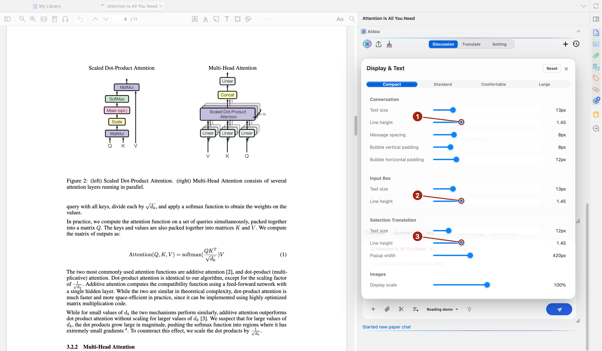
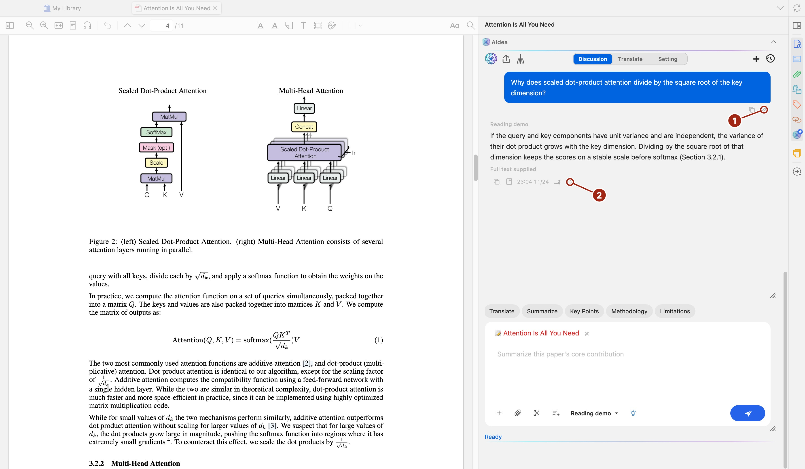

# Руководство по AIdea

[简体中文](./zh-CN.md) · [繁體中文](./zh-TW.md) · [English](./en.md) · [日本語](./ja.md) · [한국어](./ko.md) · [Français](./fr.md) · [Deutsch](./de.md) · [Español](./es.md) · **Русский** · [Português](./pt.md) · [العربية](./ar.md) · [हिन्दी](./hi.md)

Для AIdea 4.0.2 и Zotero 7–10. Подключите модель, задайте вопрос по разделу 3.2.1 статьи *[Attention Is All You Need](https://arxiv.org/html/1706.03762v7#S3.SS2.SSS1)* и создайте англо-китайский PDF. Адреса в примерах даны для иллюстрации.

## Содержание

1. [Установка AIdea и подключение модели](#установка-aidea-и-подключение-модели)
2. [Настройка интерфейса](#настройка-интерфейса)
3. [Настройка чата](#настройка-чата)
4. [Полнотекстовый перевод PDF](#полнотекстовый-перевод-pdf)
5. [Перевод выделенного текста](#перевод-выделенного-текста)
6. [Устранение неполадок](#устранение-неполадок)

## Установка AIdea и подключение модели

Скачайте файл `.xpi` из [последнего выпуска](https://github.com/Visterainer/aidea-zotero/releases/latest). В Zotero откройте **Инструменты → Плагины**, в меню с шестерёнкой выберите установку из файла, укажите скачанный файл и перезапустите Zotero. Откройте статью и разверните справа **AIdea → Settings → Model Config**.

**ChatGPT.** На карточке OpenAI нажмите **Install/Update Env**, чтобы установить Codex CLI. Выберите **OAuth Login**, подтвердите доступ в браузере, вернитесь в Zotero и нажмите **Refresh Models**. CLI отвечает за вход на вашем компьютере; список моделей зависит от аккаунта.

**GitHub Copilot.** На карточке Copilot нажмите **OAuth Login**, сверьте код устройства, подтвердите запрос на GitHub и обновите список. Для этого способа Codex CLI не требуется.

**API или локальная модель.** В режиме API введите базовый URL (например, `https://api.example.com/v1`), ключ и точный ID модели. Загрузите список или введите ID вручную. Для Ollama запустите сервер, укажите `http://127.0.0.1:11434/v1` и имя установленной модели. Ключ можно оставить пустым, только если сервис допускает доступ без авторизации.

**Обновления CLI.** По умолчанию после периодической проверки появляется уведомление. В автоматическом режиме обновление начинается через 60 секунд. Если отложить или свернуть окно, оно откладывается на 24 часа. Тихий режим отключает проверки и уведомления. Для обновления вручную нажмите **Install/Update Env**. Среда перевода PDF обслуживается отдельно на вкладке **Translate**.

Настройки подключения модели в боковой панели Zotero.

## Настройка интерфейса

### Тема и панель вкладок

Откройте **Settings → Basic Configuration**. Скрытые вкладки появляются при наведении на верхнюю границу панели. Выберите светлую, тёмную или стандартную тему. Здесь же меняется язык интерфейса.

① Вкладки ② Тема ③ Отображение и шрифт.

### Шрифт, межстрочный интервал и отступы

В **Display & Text** выберите один из четырёх пресетов. Отодвиньте окно за заголовок, чтобы видеть ответ. При размере 13 px увеличьте межстрочный интервал с 1,45 до 1,65. Для проверки ввода напишите две строки, для проверки перевода выделите абзац. Размер шрифта в каждой области задаётся отдельно.

**Message spacing** меняет расстояние между сообщениями, **Bubble padding** — отступ от текста до рамки. Расширьте всплывающее окно, чтобы уменьшить число переносов. **Images → Display scale** задаёт масштаб изображений, **Reset** восстанавливает настройки шрифта.

 

① Интервал в сообщениях ② в поле ввода ③ во всплывающем переводе.

### Ширина боковой панели и высота окна

В читалке потяните разделитель между статьёй и AIdea влево. Чтобы увеличить высоту, растяните окно Zotero за нижнюю границу или разверните его.

### Раздельная настройка высоты диалога и поля ввода

На вкладке **Discussion** тяните нужный угол вниз для увеличения или вверх для уменьшения. Высота сохраняется. Если угол не виден, прокрутите боковую панель.

① Ширина панели ② Угол над быстрыми командами для диалога ③ Угол под кнопкой отправки для ввода.

## Настройка чата

### Выбор модели для беседы

После входа обновите список в **Settings → Model Config**. Для собственного API запросите список или введите точные идентификаторы. Отметьте все модели, которые хотите оставить, и нажмите **Save Models**. Нажмите название под полем ввода, чтобы сменить модель. Для работы с изображениями выберите модель с соответствующей поддержкой.

① Откройте меню моделей. ② Галочкой отмечена текущая модель.

### Глубина рассуждения, контекст и инструкции

 Наведите указатель на лампочку, чтобы увидеть уровень рассуждения, и нажмите для выбора. Серая лампочка означает, что уровни недоступны или сведения о модели отсутствуют. Попробуйте обновить список. У чата, перевода выделений и перевода PDF отдельные настройки. В **Settings → Advanced** задайте размер контекста в токенах или оставьте поле пустым для автоматического выбора. Системная инструкция действует со следующего запроса. Очистите поле, чтобы вернуть исходную.

① Меню лампочки ② Активный уровень. У этой модели шесть уровней.

### Статьи, фрагменты, рисунки и файлы

В режиме чтения у поля ввода виден заголовок текущего PDF или EPUB. В библиотеке найдите статью через @ и выберите стрелками и Enter или Tab.  Кнопка **Add Text** добавляет выделенный фрагмент. Её можно включить в расширенных настройках.  Ножницами выделите область PDF, для отмены нажмите Esc. Можно также вставить или перетащить изображение.

 Скрепка позволяет добавить PDF до 50 МиБ каждый, изображения, Markdown, текст и код. Ссылки на статьи и файлы остаются до удаления кнопкой ×. Выделенный текст и вставленные изображения исчезают из черновика после отправки.

① Скрепка ② Загрузить файл ③ Выбрать статью.

### Отправка вопросов и настройка быстрых команд

 Enter отправляет запрос, Shift+Enter переносит строку. В списке @ клавиша Enter сначала выбирает статью. **Cancel** останавливает ответ. Быстрая команда заменяет черновик и сразу отправляется. Через правую кнопку мыши можно добавить, изменить, переместить или удалить команду.

① Нажмите правой кнопкой на команду перевода ② Измените или удалите инструкцию.

### Проверка на фрагменте статьи

Откройте § 3.2.1 статьи *[Attention Is All You Need](https://arxiv.org/html/1706.03762v7#S3.SS2.SSS1)* и добавьте формулу (1). Спросите: «Зачем в механизме на рис. 2 делят скалярное произведение на √dₖ? Какое предположение сделано о дисперсии?» Перейдите по цитате и сверьте ответ с PDF или фрагментом EPUB. Если доступна только аннотация или выдержка, добавьте нужный абзац. Уточните, что изменится при неединичной дисперсии.

Рисунок 2 и пример ответа о масштабировании в формуле (1).

### Схема архитектуры для доклада

В проверке в Zotero модель **gpt-6.1-sol** через **ChatGPT OAuth (Codex)** создала изображение. Выберите модель с генерацией изображений и прикрепите PDF статьи *[Attention Is All You Need](https://arxiv.org/html/1706.03762v7#S3.SS2.SSS1)* скрепкой. Пример запроса:

> По разделу 3 нарисуй схему Transformer для научного слайда 16:9. Используй фон цвета слоновой кости и крупные английские подписи. Покажи энкодер и декодер синими и киноварными стопками с пометками ×6. Отобрази эмбеддинги и позиционное кодирование. Проведи K и V от энкодера, а Q от декодера к перекрёстному вниманию. Заверши распределением вероятностей следующего токена. Верни изображение.

Прикреплённый PDF и запрос на построение схемы в Zotero.

Правой кнопкой нажмите на изображение и выберите **Export**, чтобы сохранить PNG. Сверьте стрелки с рисунком 1. [PNG из проверки с китайскими подписями](../../site/public/media/reader/transformer-generated-zh.png).

### Редактирование вопросов и сравнение ответов

После завершения ответа нажмите карандаш, исправьте вопрос и отправьте его снова. В **Retry** можно выбрать модель для нового ответа. Она станет текущей и для следующего сообщения. Стрелками сравните версии. **Branch to new chat** переносит историю до этого места, **New chat** начинает пустую беседу.

① Изменить вопрос ② Сгенерировать ответ заново.

### Источники в длинной беседе

При нехватке контекста старые сообщения могут сокращаться. Если важны число, формула или подпись, снова прикрепите фрагмент и сверьте цитаты.

### Сохранение ответов и история

Используйте **Copy** или **Save as note**, чтобы скопировать ответ или сохранить заметку к статье. В чате без статьи создаётся отдельная заметка. Через **Export** скопируйте весь чат в Markdown или сохраните как заметку.  Через часы можно вернуться к беседе, переименовать или закрепить её. Метла очищает текущий чат. В истории можно удалить сразу несколько.

### Перенос бесед на другое устройство

 Дождитесь конца ответа и экспортируйте текущую беседу, беседы статьи или всей библиотеки. JSON содержит текст и цитаты, ZIP включает также доступные вложения. На другом устройстве импортируйте архив из того же меню, проверьте предварительный просмотр и подтвердите объединение. Исходные статьи синхронизируйте через Zotero отдельно. Данные входа, настройки и память хранятся отдельно.

Выбор бесед для экспорта и импорт архива.

## Полнотекстовый перевод PDF

### Перевод одного файла

Перед первым заданием откройте **Translate → Install/Update Translation Environment** и дождитесь готовности среды. Она устанавливается отдельно от Codex CLI. Укажите PDF, исходный и целевой языки, модель и папку. Выберите перевод или двуязычный PDF и нажмите **Translate**.

① PDF ② Папка назначения ③ Модель перевода ④ Формат результата.

### Пакетный перевод нескольких статей

В библиотеке выберите статьи с PDF, удерживая Ctrl (⌘ в macOS), или диапазон с Shift. Нажмите **Prepare translation batch** в контекстном меню или **Add selected** на вкладке перевода. Проверьте список, выберите хотя бы один формат и место сохранения (вложение Zotero или папка). Нажмите **Begin batch**, проверьте количество пропусков, отсутствующих результатов и замен, затем подтвердите.

Если вы уже аннотировали перевод, оставьте режим заполнения только отсутствующих результатов. После перезапуска нажмите **Continue**. Если перевод готов, но запись не удалась, исправьте путь и выберите **Retry failed**, чтобы сохранить готовый файл.

① Добавьте выбранные статьи ② После проверки запустите пакет. В примере два PDF.

### Параметры перевода, таблицы и схемы

Для примера выберите **English → Simplified Chinese**. При ошибке 429 уменьшите число запросов в секунду и параллельных задач, затем проверьте один PDF. Для сканов включите автоматическое распознавание текста. Отдельно настраиваются текст таблиц, список литературы, приложения, глоссарий и шрифты.

Таблица 1 на странице 6 сравнивает вычислительную сложность. Слева английский оригинал, справа перевод на упрощённый китайский.

Переводятся и подписи внутри схемы. На рисунке 1 FactorMiner надписям «Memory Retrieval» и «Library Update» слева соответствуют «记忆检索» и «库更新» справа.

## Перевод выделенного текста

В **Settings → Selection Translation** включите перевод, задайте модель и языки. В автоматическом режиме выделите текст в PDF или EPUB, в ручном нажмите **Translate** во всплывающем окне. Можно задать поддерживаемый уровень рассуждения и отображать кнопки **Copy** и **Add to note**.

① Включить перевод ② Выбрать модель ③ Задать языки.

Выделите «Scaled Dot-Product Attention» на рисунке 2. В примере показан перевод «缩放点积注意力». Включите **Write translation to annotation** и после появления перевода выберите цвет выделения. Текст сохранится в комментарии к выделению. Флажок изначально снят и запоминает выбор. Для отдельной заметки нажмите **Add to note**.

① Запись перевода в аннотацию ② Цвет выделения ③ Сохранение заметки.

## Устранение неполадок

### После установки нет панели

Проверьте в **Инструменты → Плагины**, что AIdea включён. Полностью выйдите из Zotero (⌘Q в macOS), снова откройте PDF и разверните правую панель. Если AIdea не появился, запишите ОС и версии Zotero и AIdea.

### Вход выполнен, но список моделей пуст

Обновите модели и найдите этап сбоя и код в **Settings → Console**. После смены прокси вход в браузере может работать, пока Zotero обращается к старому порту. Сравните протокол и активный порт приложения с системным прокси или PAC. Браузер, терминал и Zotero могут использовать разные маршруты. Исправьте настройки, перезапустите Zotero, обновите модели и задайте короткий вопрос.

При 401 проверьте авторизацию или ключ. Если сообщение 403 указывает на ограничение аккаунта или региона, обратитесь к указаниям сервиса. При 502 только в PDF сравните работу той же модели в чате, переводе выделения и PDF, затем проверьте консоль перевода.

[#34](https://github.com/Visterainer/aidea-zotero/issues/34) · [#109](https://github.com/Visterainer/aidea-zotero/issues/109) · [#60](https://github.com/Visterainer/aidea-zotero/issues/60) · [Ошибки подключения в Zotero](https://www.zotero.org/support/kb/connection_error)

### Какие журналы скопировать

**Среда PDF или перевод.** В **Translate → Console → Copy all** скопируйте вывод от начала операции, включая первую ошибку и итоговый статус. Если указан отдельный файл журнала, добавьте относящийся к ошибке фрагмент. Укажите ОС, архитектуру, версии Zotero и AIdea, этап, модель и способ входа. Для PDF уточните одиночный или пакетный перевод, скан или текст, формат результата и сбоит ли только один файл.

**OAuth, CLI или список моделей.** В **Settings → Console** двумя кнопками скопируйте ход операции и подробный журнал. Укажите сервис, нажатую кнопку, результат в браузере, статус в Zotero и код ошибки. Опишите результат после проверки прокси и перезапуска.

① Открыть консоль ② Скопировать ход операции ③ Скопировать подробный журнал.

### Удаление личных данных перед отправкой

В локальном редакторе замените адреса почты, ключи, токены, коды устройств, параметры обратного вызова OAuth, учётные данные прокси и имена в путях на `<redacted>`. На снимках экрана проверьте адресную строку и поля аккаунта. Сохраните версии, этапы, коды и сообщения ошибок. [Сообщить об ошибке](https://github.com/Visterainer/aidea-zotero/issues/new/choose).

### Помощь локального агента

> Мои ОС и архитектура […], Zotero […], AIdea […]. После нажатия […] я ожидал […], но получил […]. С той же моделью: чат […], выделение […], PDF […]. Обезличенный журнал: […]. Найди первую устранимую ошибку и предложи одну проверку прокси, OAuth, среды, запроса к модели или сохранения файла. Используй только эти данные. Не читай учётные данные и не загружай файлы в сеть.

### Другие вопросы

**Нет перевода выделения?** Проверьте переключатель, модель и целевой язык. Попробуйте скопировать фразу. В скане нужен выделяемый текстовый слой.

**Работает только чат?** Установите или восстановите среду PDF на вкладке **Translate**. Поддерживаются macOS 13 и новее, Linux с glibc 2.28 и новее и совместимые 64-разрядные системы Windows.

**Где хранится текст?** История и память хранятся локально. Выбранный сервис модели получает нужные фрагменты и вложения. Для локальной обработки задайте адрес на своём компьютере.
