# AIdea 使用手册

**简体中文** · [繁體中文](./zh-TW.md) · [English](./en.md) · [日本語](./ja.md) · [한국어](./ko.md) · [Français](./fr.md) · [Deutsch](./de.md) · [Español](./es.md) · [Русский](./ru.md) · [Português](./pt.md) · [العربية](./ar.md) · [हिन्दी](./hi.md)

使用 AIdea 4.0.2 在 Zotero 7–10 中阅读《[Attention Is All You Need](https://arxiv.org/html/1706.03762v7#S3.SS2.SSS1)》。先连接一个模型，再用论文第 3.2.1 节验证对话，最后生成英中双语 PDF。下面的授权示例只使用占位地址，不需要提供个人账号或密钥。

## 目录

1. [安装和绑定模型](#安装和绑定模型)
2. [界面配置](#界面配置)
3. [对话配置](#对话配置)
4. [全文翻译配置](#全文翻译配置)
5. [划词翻译配置](#划词翻译配置)
6. [报错与问题](#报错与问题)
   - [登录成功但刷新不到模型](#登录成功但刷新不到模型)
   - [环境报错时复制什么](#环境报错时复制什么)
   - [交给本地 Agent 排查](#交给本地-agent-排查)

## 安装和绑定模型

1. 从 [GitHub Releases](https://github.com/Visterainer/aidea-zotero/releases/latest) 下载 AIdea 的 `.xpi` 文件。在 Zotero 打开 **工具 → 插件**，点击齿轮，选择 **从文件安装插件**，选中文件并重启 Zotero。
2. 打开一篇论文，展开右侧 AIdea 面板，进入 **设置 → 模型配置**，按你使用的服务选择一种连接方式。

**ChatGPT 的 OAuth 授权。** 打开 OpenAI 卡片，点 **安装/更新环境**。安装独立版 Codex CLI 后，点 **OAuth 登录**，在浏览器完成账号授权。回到 Zotero，点 **刷新模型**。CLI 负责在本机完成登录，AIdea 使用获得的授权访问该账号可用的模型。

**GitHub Copilot 的 OAuth 授权。** 在 Copilot 卡片点 **OAuth 登录**，核对设备码，在 GitHub 页面确认授权，再回到插件点 **刷新模型**。这个流程由插件发起，无需安装 Codex CLI。

**API Key 或本地模型。** 切换至 **API 方式**。云端服务填写服务商给出的 **API Base URL**（示例 `https://api.example.com/v1`）、**API Key** 和准确的 **模型 ID**。点 **自动获取模型列表**，或手动添加模型 ID。使用本地 Ollama 时，先启动服务，填写 `http://127.0.0.1:11434/v1` 和已下载的模型名称。只有服务允许免鉴权时才留空 Key。

**CLI 如何更新？** OAuth 提供商区域的 **OAuth 环境更新** 默认是 **提示更新**，定期检查，由你点击安装。选择 **自动更新** 后，提示出现 60 秒后会执行，点「稍后」或最小化可推迟 24 小时。选择 **静默** 会关闭定期检查和提醒。要手动检查或更新，点 OpenAI 卡片上的 **安装/更新环境**。生成译文 PDF 所需的环境在「全文翻译」页单独安装。

[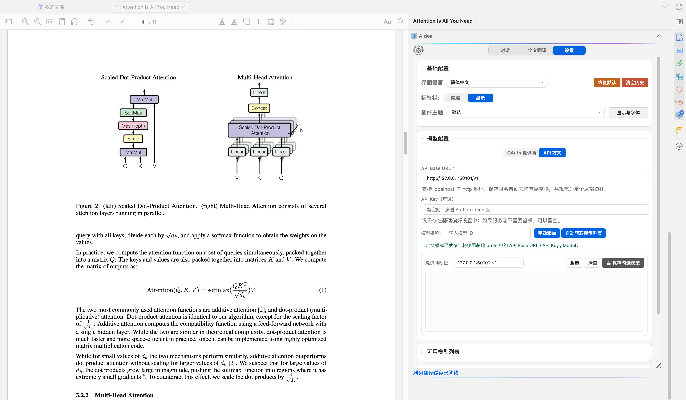](../../site/public/media/reader/settings-zh-CN.jpg)

## 界面配置

### 切换配色和标签栏

在 **设置 → 基础配置** 调整外观。① 标签栏可常显或隐藏，隐藏后移到面板顶部即可展开。② 点主题名切换米白色、暗夜黑或默认配色。③ 点 **显示与字体** 调整排版。界面语言也在此处选择。

[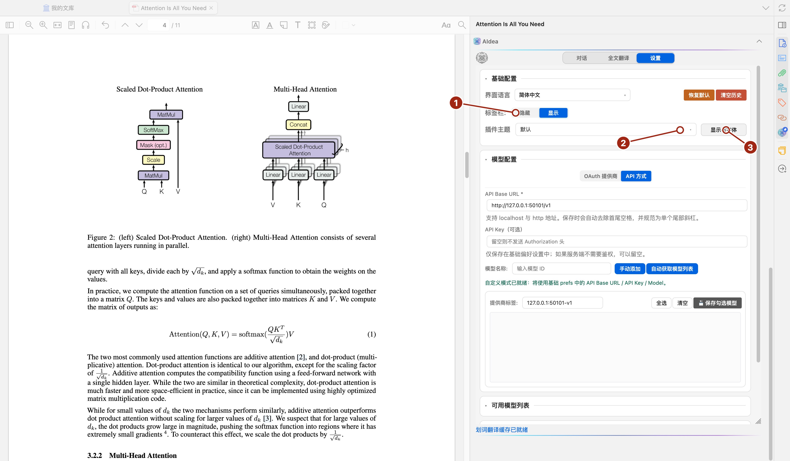](../../site/public/media/reader/window-settings-zh-CN.jpg)

### 调整字号、行高和留白

打开 **显示与字体**，先选紧凑、标准、舒适或大字。拖动窗口标题，可以边看回答边调。

① **对话内容 → 行高** 调整问题和回答。字号保持 13 px，把行高从 1.45 调到 1.65，就能看到同一段回答的行距变大。

② **输入框 → 行高** 调整正在写的文字。输入两行即可比较。③ **划词翻译 → 行高** 调整译文，在论文中选一段话查看。

[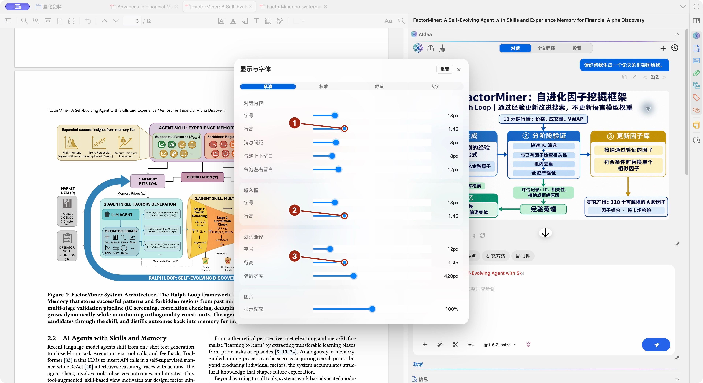](../../site/public/media/reader/window-line-height.jpg) [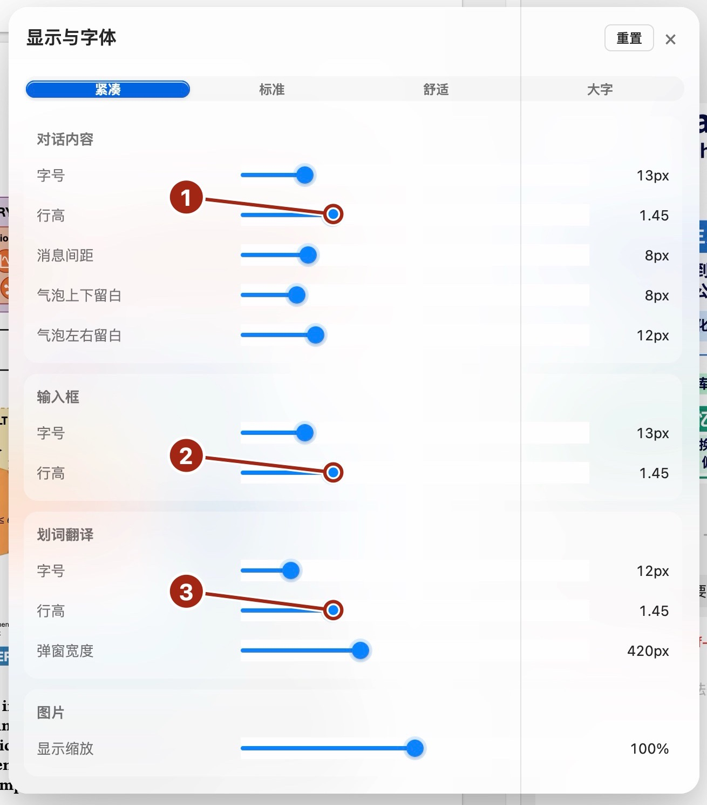](../../site/public/media/reader/detail-line-height.jpg)

三处都可单独调字号。两条消息之间的距离调 **消息间距**，文字到气泡边缘的距离调 **气泡上下／左右留白**。译文换行太频繁可加大 **弹窗宽度**。对话图片大小在 **图片 → 显示缩放** 调整。点 **重置** 恢复排版默认值。

### 调整 Zotero 侧栏宽度和窗口高度

在阅读器展开右侧 **AIdea**。左右拖动论文与侧栏之间的竖线，向左给插件更多空间。拖动 Zotero 主窗口底边或将窗口最大化，可增加整体高度。

### 分别调整对话高度和输入框高度

在 **对话** 页，② 拖快捷按钮上方的右下角，多看几行回答；③ 拖发送按钮右下方的外框，多写几行问题。向下拖增高，向上拖缩短。插件会记住高度。看不到拖柄时，向下滚动侧栏。

[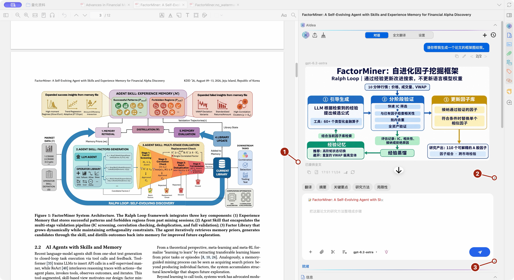](../../site/public/media/reader/window-resize.jpg)

## 对话配置

第一次使用，先在设置里选出可用模型，再到对话输入框指定本次模型。开始阅读后，重点看两个地方：**发送前**检查输入框上方有哪些论文、选段和附件；**收到回答后**检查本轮实际提供了多少原文，以及引用能否定位。

### 选择本次对话的模型

1. **ChatGPT 或 Copilot 登录**。打开 **设置 → 模型配置**，在对应提供商卡片上点 **刷新模型**。展开 **可用模型列表**，勾选想出现在对话菜单中的模型。这里的勾选会自动保存。
2. **API Key 或本地服务**。在模型配置中核对接口地址，按服务要求填写密钥，获取模型列表或手动添加准确的模型 ID。在下方的模型列表中勾选想保留的模型，点 **保存勾选模型**。再次保存会更新这个接口的整个列表，原有模型若要保留也要勾选。
3. 回到 **对话**，点击输入框底部的模型名，按提供商选定本次模型。比较两个服务中的同名模型时，先核对提供商，再看模型 ID。
4. 如果菜单为空，先回设置看提供商是否返回了模型。已经列出模型时，检查勾选状态。若登录成功但刷新结果为零，[检查代理与网络连接](#登录成功但刷新不到模型)。

问段落用文本模型，看图表或扫描页选支持图像输入的模型。解释推导可选支持调节思考强度的模型，比对多篇长文时核对上下文上限。

[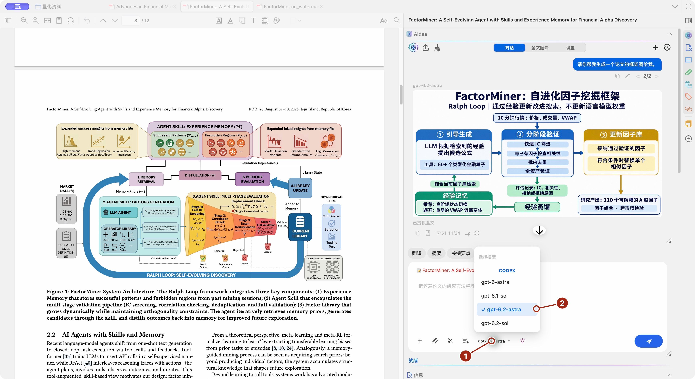](../../site/public/media/reader/window-models.jpg)

切换模型会保留已有对话。要让另一模型回答同一问题，点原回答旁的 **重试**。

### 调整思考强度和上下文上限

 选好模型后，把鼠标移到旁边的**灯泡**，可看到当前思考强度。点灯泡，选择菜单中该模型提供的档位，再发送问题。若提示出现箭头，右侧是这次实际采用的档位。灯泡为灰色时，当前模型没有可选档位或插件尚未获取其支持信息，可先刷新模型列表。

| 你想调整什么 | 在哪里改 | 怎样判断是否需要改 |
| --- | --- | --- |
| 模型思考问题的强度 | 输入框底部，点模型名称旁的**灯泡** | 先用默认档。需要逐步解释推导时，再选模型支持的档位。切换模型后，插件按新模型支持的档位执行，并记住你的偏好。对话、划词翻译、全文翻译各自保存。 |
| 一轮请求能容纳的材料 | **设置 → 模型配置**中的 API 模型，或**可用模型列表**中对应模型的 **高级设置 → 上下文上限（tokens）** | 留空使用自动预算。长文反复显示「已提供部分内容」时，先核对服务商给出的实际上下文窗口，再按需填写。AIdea 会为回答预留空间；调大此值也无法补回未提取的原文。 |
| 后续回答的写法 | **设置 → 高级 → 自定义系统提示词** | 例如填「先给出结论，再引用论文中的公式或段落；原文未说明的地方请标明」。填写后从下一次请求起替换默认对话提示词；清空即可恢复默认。划词翻译另用独立提示词。 |

[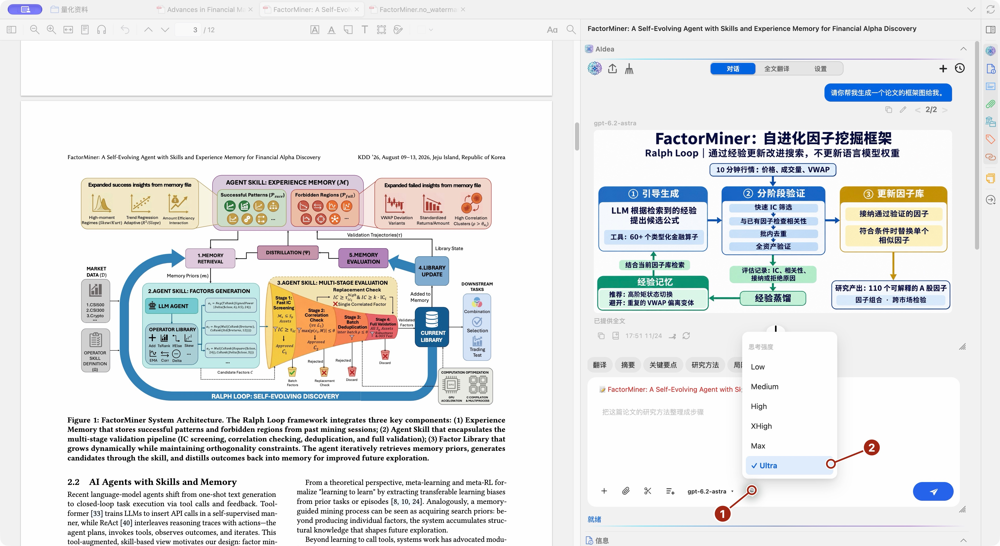](../../site/public/media/reader/window-effort.jpg)

### 给模型提供论文、选段和附件

在 PDF 或 EPUB 阅读器里打开 **对话**，输入框附近的文献标签会显示当前论文。在文库里也能打开独立对话。发送前看一眼标签上的标题，尤其是在切换文献或比较多篇论文之后。

| 手里的材料 | 具体操作 | 发送前检查 |
| --- | --- | --- |
|  当前论文中的一段话 | 在阅读器划选原文，点弹窗里的 **添加文本**，也可点输入区工具栏的 **添加文本** | 确认选段已出现在输入区。弹窗缺少按钮时，到 **设置 → 高级** 启用在阅读器选择弹窗显示「添加文本」。 |
|  要一起比较的论文 | 输入 `@` 并键入标题关键词，或在回形针菜单中点 **选择参考论文**。用方向键选择，按 **Enter** 或 **Tab** 加入 | 检查两篇论文的标题和版本。问题里点明哪篇是比较对象，例如「分别列出两篇论文对计算复杂度的假设」。 |
|  图表或公式的外观 | 在 PDF 页点剪刀图标，拖动框选图、图例或公式，松开后查看截图预览。也可把图片粘贴或拖入输入区 | 选择支持图像输入的模型，确保下标、箭头和图例清晰可读。按 **Esc** 可取消框选。 |
|  本地补充材料 | 从回形针菜单点 **上传文件**，或拖入文件。可附 PDF、图片、Markdown、文本或代码 | 检查文件名；单个上传 PDF 限制为 50 MiB。若提示文字提取不完整，可改选原文段落或附清晰截图，再问对应内容。 |

参考论文和上传文件可留在输入区供后续轮次使用。结束比较后，用标签上的 **×** 移除无关材料。截图和选段发送后会清出待发送区；下一轮若要明确指定同一幅图或某句话，重新添加并检查预览。

① 点输入框下方的回形针，选 ② 上传文件或 ③ 选择参考论文。

[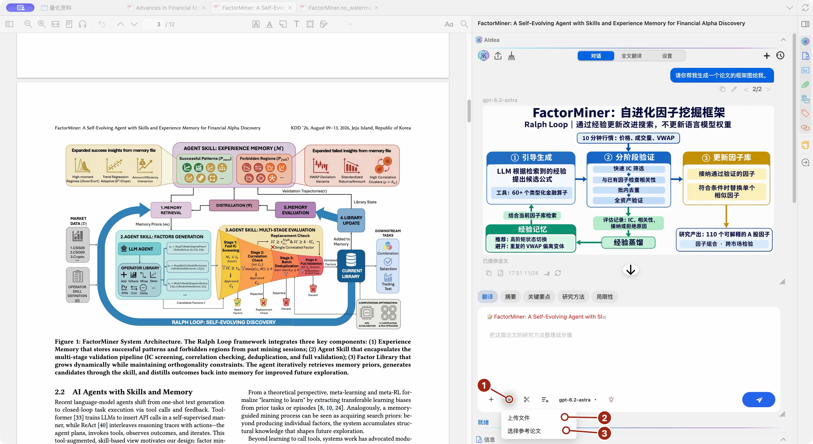](../../site/public/media/reader/window-context-menu.jpg)

### 发送问题和使用快捷指令

 输入框里按 **Enter** 发送，**Shift+Enter** 换行。若正在用 `@` 选择论文，Enter 会先选中条目。生成过程中点 **取消** 可以停止当前请求，随后可补充材料或改写问题。

**翻译、摘要、关键要点、研究方法、局限性** 是预设问题。点击后，按钮会把自己的提示词放入输入框并立即发送。因此，先选好论文或选段，再点击按钮；已有手写草稿需要保留时，请先复制。想长期改变某个按钮的问法，右键点击它可以编辑名称和提示词，也可以新增、删除，或进入移动模式拖动排序。例如，将一个快捷指令设为「列出本文报告的两个局限，每条附一个可核对的原文位置」。

[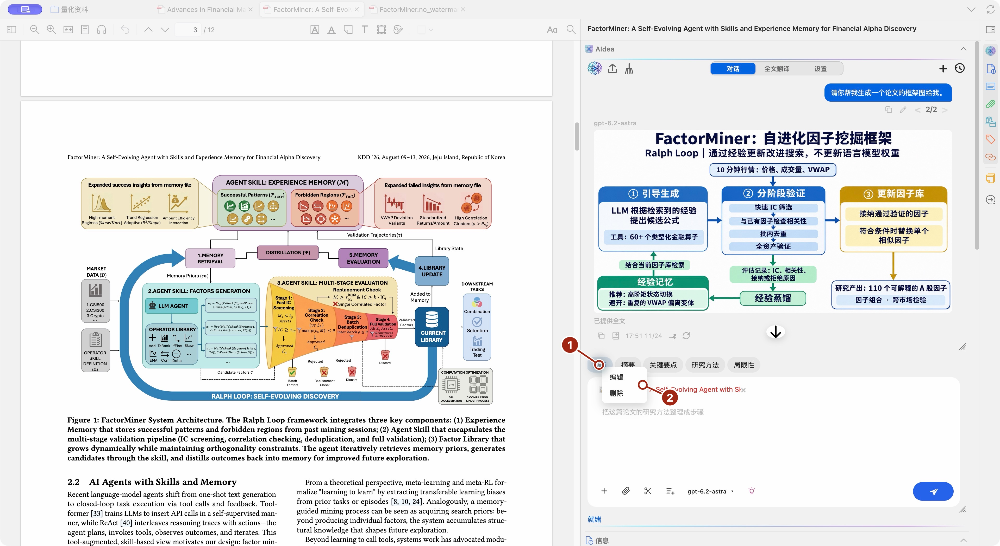](../../site/public/media/reader/window-shortcuts.jpg)

① 在「翻译」快捷按钮上点右键。② 选择「编辑」修改提示词，或选择「删除」移除该按钮。

### 用一段原文验证连接

1. 打开《Attention Is All You Need》第 3.2.1 节，把公式（1）下方解释缩放因子的段落 **添加文本**。需要对照图示时，再截取图 2。
2. 发送「为什么要把点积除以 √dₖ？请用这一段中的方差假设解释，并指出原文依据。」收到回复后，看回答旁的本轮材料状态。**已提供全文**表示本轮包含全文；**已提供部分内容**表示模型拿到的是节选；**仅提供摘要**或**未提供正文**时，应先补上所问段落。
3. 点击回答中可定位的引用，回到 PDF 页面或 EPUB 章节核对。回答里普通文字写出的页码，仍需自己核查。若只显示来源、无法跳转，检查对应的 Zotero 条目和原附件是否在本机，以及文件是否被替换。
4. 保留同一会话，追问「如果查询和键各分量的方差不再是 1，上一步的结论依赖哪一项假设？」这样可以检验解释是否真的对应刚才那段原文。

[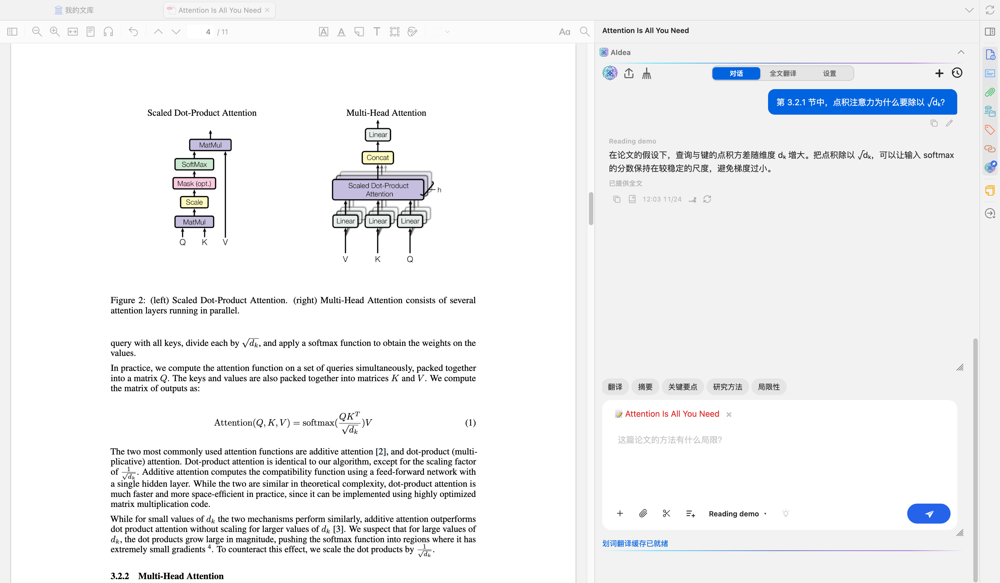](../../site/public/media/reader/chat-zh-CN.jpg)

### 根据论文生成框架图

这次在 Zotero 的 AIdea 对话中，通过 **ChatGPT OAuth（Codex）** 选择 **gpt-6.1-sol**，实际生成并导出了下面这张图。这个模型通过绘图工具返回图片。其他连接是否能绘图，取决于服务是否为所选模型提供图片生成功能。

1. 打开对话，用回形针的 **上传文件** 添加《Attention Is All You Need》PDF。确认输入区显示论文文件名，并在底部选好模型。
2. 发送下面的提示词。

   > 请根据附件《Attention Is All You Need》第 3 节，调用图片生成工具，制作一张适合学术报告全屏投影的 16:9 Transformer 框架图。用象牙白底和大号中文标签，分别用钴蓝、朱橙两组轴测叠层表现编码器和解码器，每组标 ×6。从源序列与右移目标序列的嵌入和位置编码画起，用一条主箭头突出编码器向交叉注意力提供 K、V，Q 由解码器提供。输出端用小幅概率柱图表示下一词预测。留出宽边距，让观众在后排也能读清模块名称。直接返回图片。

3. 发送后，等回答中出现实际图片。右键点击**图片本身**，选 **导出** 并指定文件夹，即可得到 PNG。可以对照原论文图 1 检查连线，例如编码器输出是否连到解码器的交叉注意力层。

[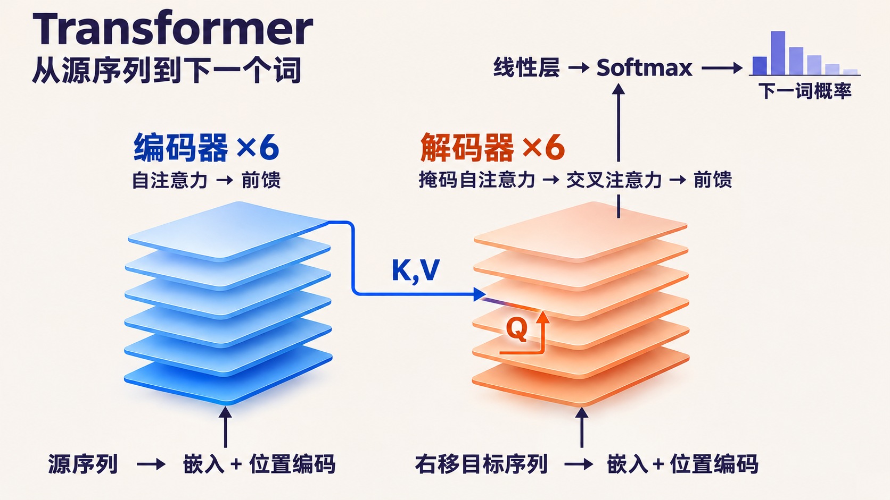](../../site/public/media/reader/transformer-generated-zh.png)

### 编辑问题、重试回答或另开分支

- **要改问题**：等生成结束，点自己那条消息旁的 **编辑**，在原位置修改后点 **发送**。同一位置有多个版本时，用左右箭头切换。
- **想比较模型的答案**：点可重试回答旁的 **重试**，从弹出的菜单选择模型。用左右箭头对照同一问题的不同回答。重试选用的模型也会成为输入框里的当前模型。
- **想沿某个答案深入**：点该回答旁的 **分支到新聊天**。新会话带上截至该回答的对话，适合把数学推导单独展开。若要从空白开始，点 **新建对话**。

[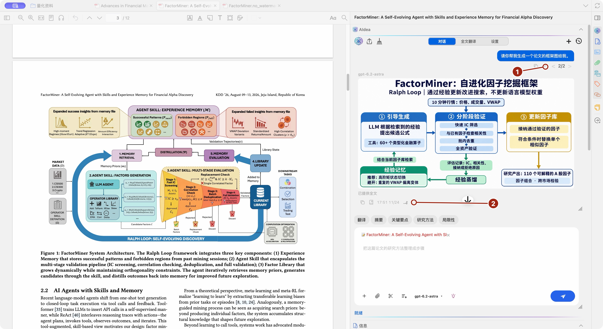](../../site/public/media/reader/window-reply.jpg)

FactorMiner 实例。左边是论文原图，右边是生成的框架图。① 铅笔可以修改提问，旁边的箭头切换版本。② 回答下方的环形箭头用于重试。

### 长对话里怎样保留原文依据

对话超过模型的上下文预算后，较早的轮次可能会被压缩成摘要，或只保留近期消息。AIdea 也可能在预算允许时，调入当前文库中与问题有关的记忆。追问某个数字、公式或图注时，重新加入那段原文，再核对这一轮回答的引用。

### 保存回答和管理历史

要保留一条解释，点该回答旁的 **复制** 或 **保存为笔记**。论文对话的笔记可在对应条目下找到；独立对话可保存成文库里的独立笔记。回答中的代码块和数学块也有单独的复制按钮。若要整理整段讨论，打开顶部的 **导出** 菜单，选择 **复制对话 Markdown** 或 **将对话保存为笔记**。

 点时钟图标打开 **历史**，可恢复、重命名或置顶会话。准备开始新话题时用 **新建对话**；扫帚图标的 **清空** 会移除当前会话的记录。历史列表里的 **清理非置顶** 和 **全部清理** 范围更大，操作前先核对要保留的记录。

### 换电脑后继续对话

 等待当前回答结束，从对话面板的导出菜单选择导出当前会话、当前论文的全部会话，或当前文库的全部会话。只需文字和引用时选 JSON；需要一并带走截图和上传文件时选 ZIP。在另一台设备用同一菜单导入归档，核对预览后确认合并。论文原件请通过 Zotero 单独同步，匹配到相同条目和原文后，引用才能继续定位。模型密钥、设置和记忆库需单独处理。

## 全文翻译配置

### 翻译单篇 PDF

在 AIdea 侧栏打开 **全文翻译**。首次使用时点击 **安装/更新翻译环境**，等待环境就绪。它用于生成 PDF，独立于 OpenAI 登录卡片上的 Codex CLI。

① 确认 PDF，② 选择输出文件夹，③ 选择翻译模型，④ 勾选仅译文或双语对照。 选好源语言、目标语言后，点 **翻译**。

[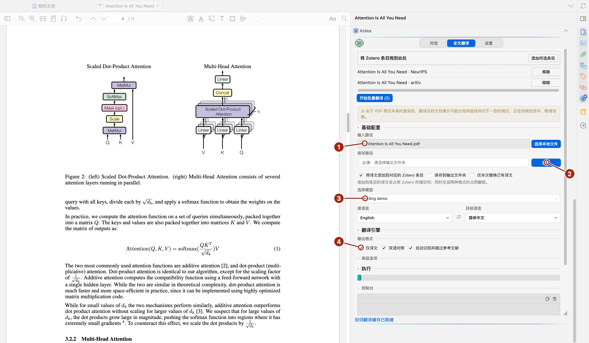](../../site/public/media/reader/window-translation-zh-CN.jpg)

### 多选后加入批量翻译

在文库中按住 **Ctrl**（Windows/Linux）或 **⌘**（macOS）逐个点选文献，按 **Shift** 可选中连续条目。将文献加入列表后，移除误选项，再核对模型、格式和保存位置。

1. 翻译多篇时，在文库选中带 PDF 的条目，右键选择 **准备批量翻译**，或在全文翻译页点击 **添加所选条目**。加入列表后仍可检查文件。
2. 选择至少一种格式和一个去向（Zotero 附件或文件夹）。点击 **开始批量翻译**，核对跳过、缺少和待替换的数量后确认。完成后从文献条目或输出文件夹打开译本。

默认只补齐缺少的输出。如果已有译本上有批注，请保留默认设置；替换文件可能使批注失效。Zotero 重启后，打开队列点 **继续**。如果译文已生成，但添加附件或写入文件夹失败，修复保存位置后点 **重试失败项**，可重新归档已有译文。

[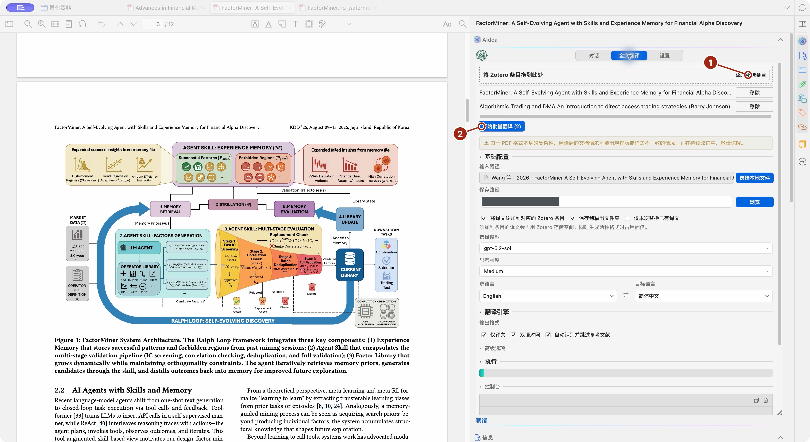](../../site/public/media/reader/window-batch.jpg)

① 把文库选中的论文加入队列。核对列表后，② 从这里开始批量翻译。本例已经列出两篇，按钮上的数量也是 2。

### 翻译引擎的高级选项

在范文中使用 **English → 简体中文**。遇到 `429` 限流，可降低 **QPS（每秒请求数）** 和 **并行线程数**，用一篇 PDF 重试。扫描页可启用自动 OCR；还可手动设置表格文本翻译、参考文献跳过、附录翻译、术语表及输出字体。

论文第 6 页的英中对照译例。左侧为英文原文，右侧为简体中文；表 1 对比了不同网络层的计算复杂度。

全文翻译也能翻译框架图里的文字。FactorMiner 图 1 的左侧是英文原图，右侧是简体中文译图。沿蓝色箭头对照两侧，可以看到 “Memory Retrieval” 译为「记忆检索」，“Library Update” 译为「库更新」。

## 划词翻译配置

在 **设置 → 划词翻译** 中，① 启用划词翻译，② 选模型，③ 选源语言和目标语言。开启自动翻译后，在 PDF 或 EPUB 中划选即可查看译文；手动模式下点弹窗里的翻译按钮。

[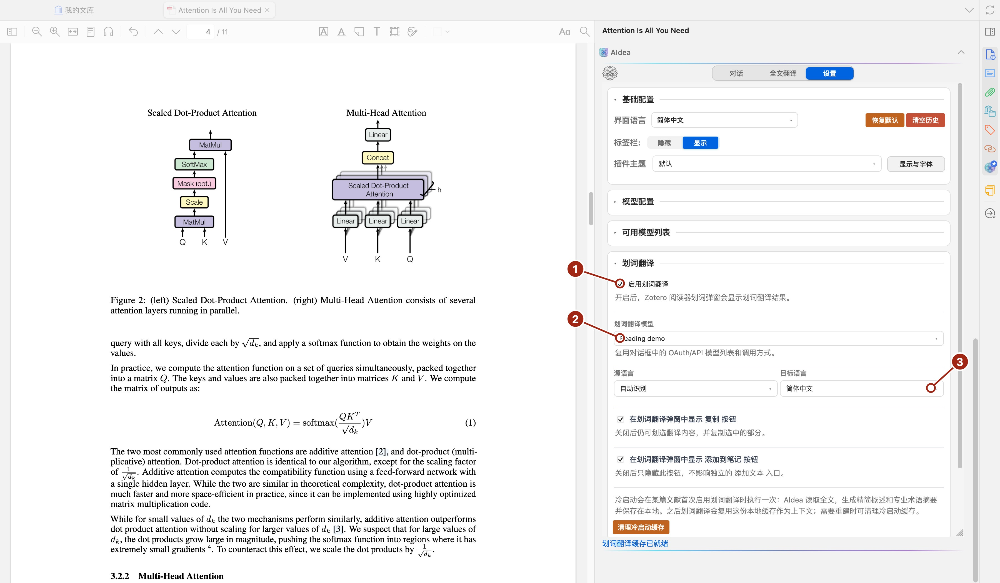](../../site/public/media/reader/window-selection-settings-zh-CN.jpg)

可单独选择模型支持的思考强度，也可控制弹窗是否显示 **复制** 和 **添加到笔记**。

范文采用 Vaswani 等人的《[Attention Is All You Need](https://arxiv.org/html/1706.03762v7#S3.SS2.SSS1)》。在图 2 中选中 **Scaled Dot-Product Attention**，英译中结果为「缩放点积注意力」。截图中的问答和划词译文使用本地演示内容。

① 勾选 **将译文写入标注**，等译文出现，再点 ② 高亮颜色。重开高亮即可在评论里看到译文。只想摘录时，点 ③ **添加到笔记**。写入标注默认关闭，之后会记住上次选择。

[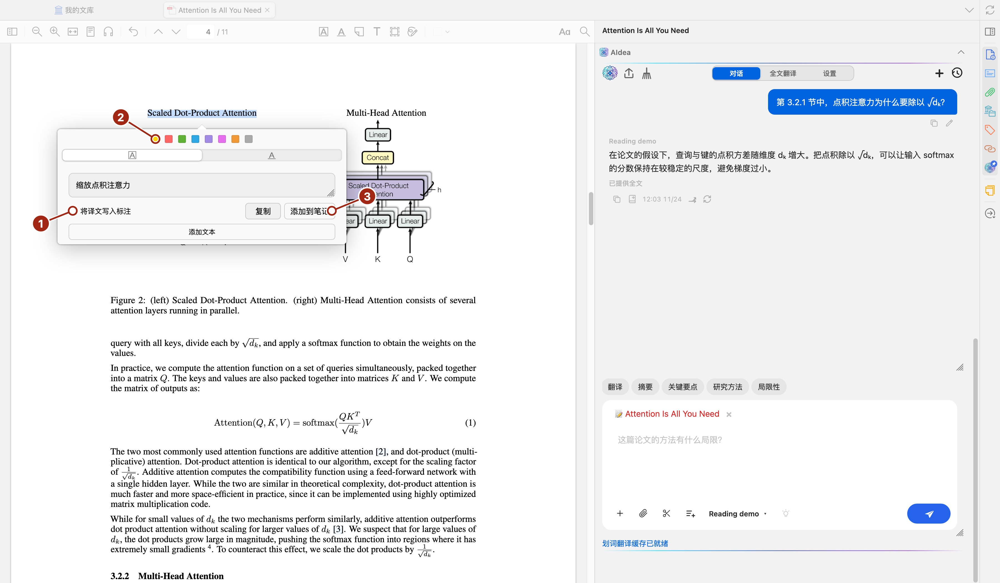](../../site/public/media/reader/window-selection-zh-CN.jpg)

## 报错与问题

### 安装后看不到面板

在 **工具 → 插件** 确认 AIdea 已启用。完全退出 Zotero（macOS 按 **⌘Q**），重新打开一篇 PDF，展开右侧条目面板并找到 AIdea。仍未出现时，记下系统、Zotero 和插件版本。

### 登录成功但刷新不到模型

1. 再点一次 **刷新模型**，查看 **设置 → 控制台**，记下失败步骤和状态码。已有案例中，换代理软件后本地监听端口改变，Zotero 仍使用旧端口，浏览器却能登录。
2. 需要代理时，对照代理软件实际使用的协议、端口与系统代理或 PAC 配置。浏览器扩展、终端和 Zotero 可以走不同的网络路径。改正后完全退出 Zotero，重新打开，刷新模型，勾选模型，回到对话选择它并发送一句话验证。
3. 若返回 `401`，核对授权或 API Key；若 `403` 正文指明账号权限或地区限制，按服务商说明核查。若对话、划词都成功，只有全文翻译返回 `502`，记录同一模型在三处的结果，转查**全文翻译控制台**。

[Issue #34](https://github.com/Visterainer/aidea-zotero/issues/34) · [Issue #109](https://github.com/Visterainer/aidea-zotero/issues/109) · [Issue #60](https://github.com/Visterainer/aidea-zotero/issues/60) · [Zotero 官方连接故障说明](https://www.zotero.org/support/kb/connection_error)

### 环境报错时复制什么

| 出错操作 | 复制位置 | 随日志说明 |
| --- | --- | --- |
| 安装、修复翻译环境或生成 PDF | **全文翻译 → 控制台 → 全部复制**。保留从点击按钮到首次错误和最终状态的记录；若控制台给出完整日志路径，可摘取对应错误段。 | 操作系统及架构、Zotero 和 AIdea 版本、失败阶段、模型及认证方式。生成 PDF 失败时，加上单篇或批量、普通或扫描 PDF、输出格式，以及是否只有某篇失败。 |
| 安装 OAuth 环境、登录或刷新模型 | 在 **设置 → 控制台** 分别点复制按钮，复制 **运行进度** 和 **详细日志**。 | 系统及架构、软件版本、提供商、点击的按钮、浏览器是否授权成功、回到 Zotero 后的状态与错误码，以及代理和重启的复测结果。 |

[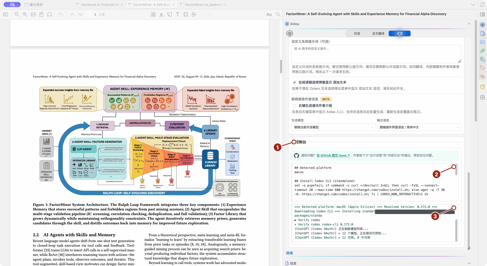](../../site/public/media/reader/window-logs.jpg)

① 打开设置页的控制台。② 和 ③ 分别复制上下两个日志框的内容，提交前遮住个人路径。

### 提交前脱敏

将日志先粘贴到本地文本编辑器，把邮箱、API Key、令牌、设备码、授权回调 URL 中的参数、代理凭据和路径中的个人用户名替换为 `<已隐藏>`。保留版本、失败步骤、状态码和错误正文。附截图前也检查账号栏、地址栏和密钥输入框。

[提交 Bug 报告](https://github.com/Visterainer/aidea-zotero/issues/new/choose)

### 交给本地 Agent 排查

将以下提示词复制给 Codex 或其他本地 Agent，附上脱敏日志。

> 我使用 [系统及架构]、Zotero [版本]、AIdea [版本]。点击 [按钮] 后，预期 [结果]，实际出现 [错误]。同一模型的对话 [状态]、划词 [状态]、全文翻译 [状态]。以下是脱敏日志：[粘贴]。请指出第一处有效错误，判断出在代理、OAuth、翻译环境、模型请求还是文件保存，给出一个最小验证步骤。仅分析所附材料，不读取凭据或上传文件。

### 其他常见问题

- **没有出现选段译文。** 检查划词翻译开关、专用模型和目标语言。试着复制原文中的一句话；纯扫描页需要先取得可选文字。
- **对话正常，全文翻译却提示环境未就绪。** 在 **全文翻译** 页安装或修复翻译环境。自动安装器支持 macOS 13 及以上、glibc 2.28 及以上的 Linux 和受支持的 64 位 Windows。
- **文献内容会发到哪里？** 聊天记录和记忆保存在本地。提问和翻译时，模型所需的原文及附件内容会发送到所选服务；使用本机模型时，请确认所选地址指向本机。
