# AIdea 使用手冊

[简体中文](./zh-CN.md) · **繁體中文** · [English](./en.md) · [日本語](./ja.md) · [한국어](./ko.md) · [Français](./fr.md)

適用於 AIdea 4.0.2 與 Zotero 7–10。用《[Attention Is All You Need](https://arxiv.org/html/1706.03762v7#S3.SS2.SSS1)》第 3.2.1 節測試模型連線，再產生英文與簡體中文對照的 PDF。授權範例採用示意網址。

## 目錄

1. [安裝與連接模型](#安裝與連接模型)
2. [介面設定](#介面設定)
3. [對話設定](#對話設定)
4. [全文翻譯設定](#全文翻譯設定)
5. [劃詞翻譯設定](#劃詞翻譯設定)
6. [錯誤排查](#錯誤排查)
   - [已登入但模型清單為空](#已登入但模型清單為空)
   - [環境錯誤應複製哪些紀錄](#環境錯誤應複製哪些紀錄)
   - [交給本機 Agent 排查](#交給本機-agent-排查)

## 安裝與連接模型

1. 從[最新版本](https://github.com/Visterainer/aidea-zotero/releases/latest)下載 AIdea 的 `.xpi` 安裝檔。在 Zotero 的 **工具 → 外掛程式** 中點選齒輪，從檔案安裝，選取剛下載的檔案後重新啟動 Zotero。
2. 開啟論文，展開右側 AIdea 面板，進入 **設定 → 模型設定**，依使用的服務選擇連線方式。

**ChatGPT 帳號。** 在 OpenAI 卡片按 **安裝/更新環境** 安裝獨立版 Codex CLI，再按 **OAuth 登入**。在瀏覽器授權後回到 Zotero，重新整理模型。CLI 在本機完成登入，AIdea 使用取得的授權存取帳號可用的模型。

**GitHub Copilot 帳號。** 在 Copilot 卡片選擇 OAuth 登入，核對裝置代碼，在 GitHub 確認授權，再回到外掛程式重新整理模型。裝置授權流程無須安裝 Codex CLI。

**API 金鑰或本機模型。** 選擇 API 方式，輸入服務商的 API 基底網址（如 `https://api.example.com/v1`）、金鑰及正確的模型 ID。可以自動取得清單，也可以手動新增模型 ID。使用 Ollama 時，先啟動本機服務，輸入 `http://127.0.0.1:11434/v1` 和已下載的模型名稱。服務允許免驗證時可留空金鑰。

**更新 CLI。** OAuth 環境更新預設為提示更新，定期檢查後由使用者決定何時安裝。自動更新模式會在提示後 60 秒執行，選擇稍後或將提示最小化可延後 24 小時。靜默模式關閉定期檢查與提醒。也可在 OpenAI 卡片手動安裝或更新。PDF 翻譯環境在全文翻譯分頁另外管理。

[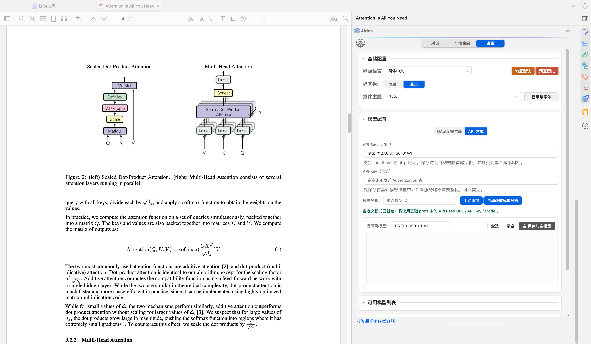](../../site/public/media/reader/settings-zh-CN.jpg)

## 介面設定

### 切換配色與標籤列

在 **設定 → 基本設定** 調整外觀。① 分頁列可常駐或隱藏，隱藏後將游標移到面板頂部即可展開。② 按主題名稱切換米白、深色或預設配色。③ 按 **顯示與字型** 調整排版。介面語言也在這裡選。

[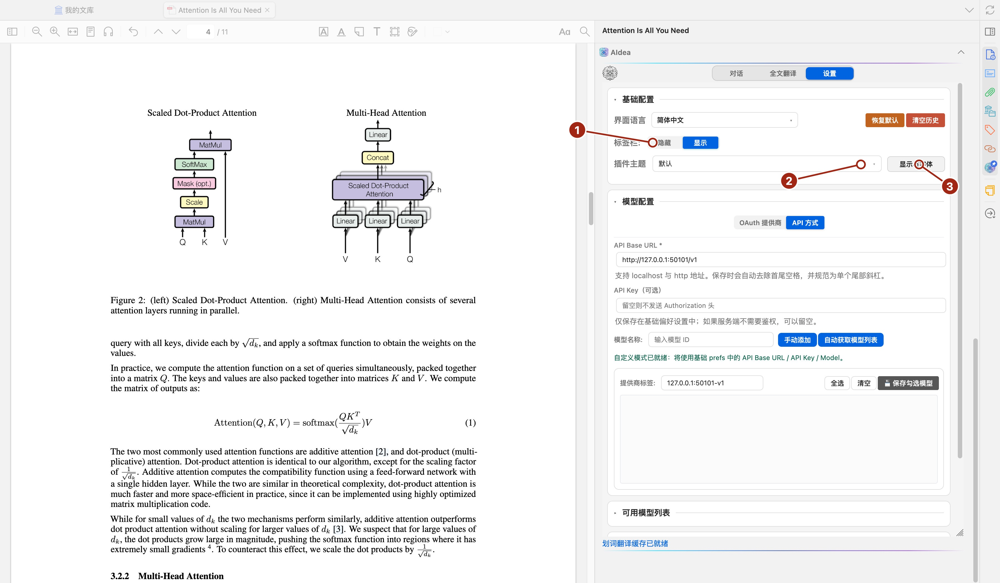](../../site/public/media/reader/window-settings-zh-CN.jpg)

### 調整字級、行高與留白

開啟 **顯示與字型**，先選緊湊、標準、舒適或大字。拖曳視窗標題，可一邊閱讀回答一邊調整。

① **對話內容 → 行高** 調整提問與回答。維持 13 px 字級，將行高從 1.45 調到 1.65，即可看到同一段回答的行距變大。

② **輸入框 → 行高** 調整正在輸入的文字，輸入兩行即可比較。③ **劃詞翻譯 → 行高** 調整彈出的譯文，在論文中選取一段文字查看。

[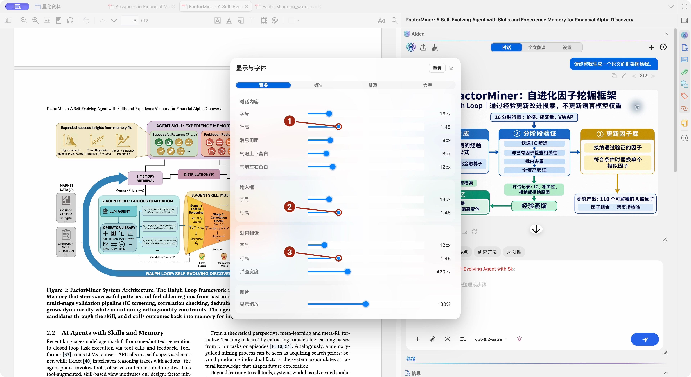](../../site/public/media/reader/window-line-height.jpg) [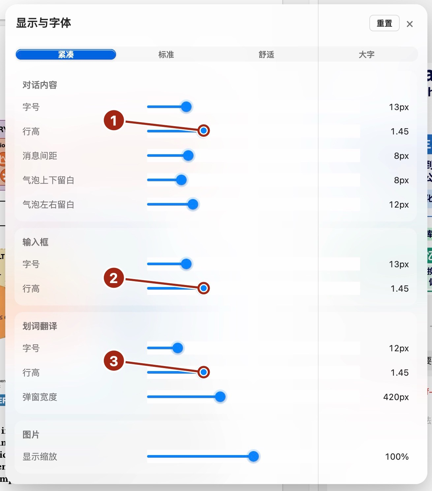](../../site/public/media/reader/detail-line-height.jpg)

三處皆可個別調整字級。**訊息間距** 控制兩則訊息的距離，**氣泡上下／左右留白** 控制文字與邊框的距離。譯文太容易換行可加大 **彈窗寬度**。在 **圖片 → 顯示縮放** 調整對話圖片。按 **重設** 恢復排版預設值。

### 調整 Zotero 側欄寬度與視窗高度

在閱讀器展開右側 **AIdea**。左右拖曳論文與側欄之間的分隔線，向左可讓側欄更寬。拖曳 Zotero 主視窗底邊或將視窗最大化，可增加整體高度。

### 分別調整對話與輸入框高度

在 **對話** 頁，② 拖曳快捷按鈕上方的右下角，可多看幾行回答；③ 拖曳傳送按鈕右下方的外框，可多寫幾行問題。往下拖增高，往上拖縮短。高度會自動儲存。看不到拖曳處時，往下捲動側欄。

[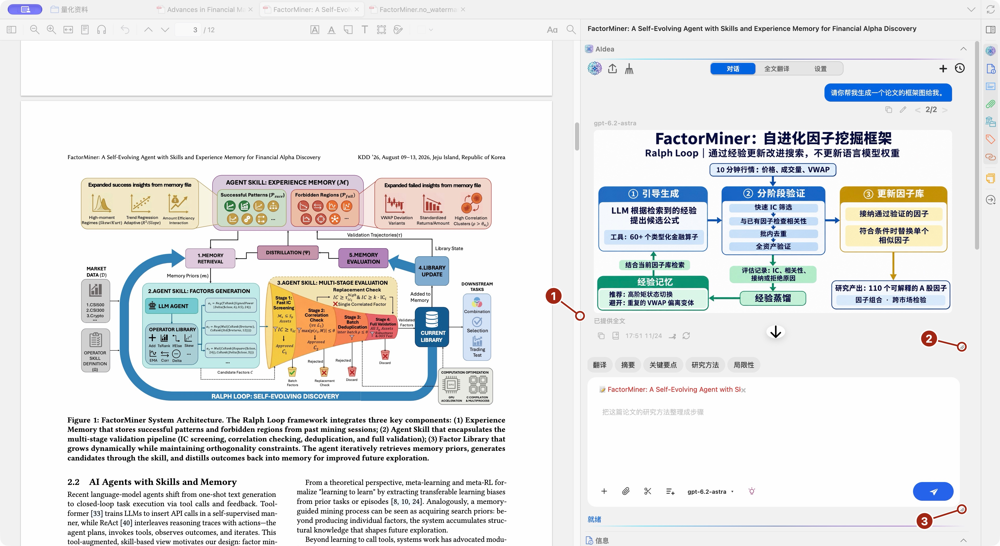](../../site/public/media/reader/window-resize.jpg)

## 對話設定

第一次使用，先在設定裡選出可用模型，再到對話輸入框指定本次模型。開始閱讀後，重點看兩個地方：**傳送前**檢查輸入框上方有哪些論文、選段和附件；**收到回答後**檢查本輪實際提供了多少原文，以及引用能否定位。

### 選擇本次對話的模型

1. **ChatGPT 或 Copilot 登入**。打開 **設定 → 模型設定**，在對應服務商卡片上點 **重新整理模型**。展開 **可用模型清單**，勾選想出現在對話選單中的模型。這裡的勾選會自動儲存。
2. **API Key 或本機服務**。在模型設定中核對服務端點網址，按服務要求填寫金鑰，取得模型清單或手動加入準確的模型 ID。在下方的模型清單中勾選想保留的模型，點 **儲存勾選模型**。再次儲存會更新這個端點的整個清單，原有模型若要保留也要勾選。
3. 回到 **對話**，點選輸入框底部的模型名，按服務商選定本次模型。比較兩個服務中的同名模型時，先核對服務商，再看模型 ID。
4. 如果選單為空，先回設定看服務商是否傳回模型。已經列出模型時，檢查勾選狀態。若登入成功但重新整理結果為零，[檢查代理與網路連線](#已登入但模型清單為空)。

詢問段落用文字模型，看圖表或掃描頁選支援影像輸入的模型。解釋推導可選能調推理強度的模型，比較多篇長文時檢查上下文上限。

[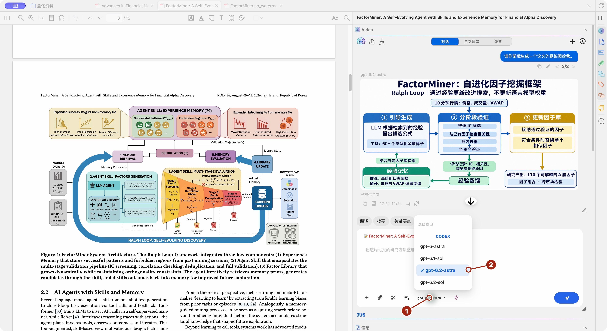](../../site/public/media/reader/window-models.jpg)

切換模型會保留既有對話。想讓另一個模型回答同一問題，按原回答旁的 **重試**。

### 調整思考強度和上下文上限

 選好模型後，將游標移到旁邊的燈泡查看目前的推理強度。按燈泡可選該模型支援的等級，再傳送問題。提示中若出現箭頭，右側為實際套用的等級。燈泡呈灰色時，模型可能沒有可選等級，或外掛尚未取得支援資訊，可先重新整理模型清單。

| 你想調整什麼 | 在哪裡改 | 怎樣判斷是否需要改 |
| --- | --- | --- |
| 模型思考問題的強度 | 輸入框底部，點模型名稱旁的**燈泡** | 先用預設值。需要逐步解釋推導時，再選模型支援的等級。切換模型後，外掛按新模型支援的等級執行，並記住你的偏好。對話、劃詞翻譯、全文翻譯各自儲存。 |
| 一輪請求能容納的材料 | **設定 → 模型設定**中的 API 模型，或**可用模型清單**中對應模型的 **進階設定 → 上下文上限（tokens）** | 留空使用自動預算。長文反覆顯示「已提供部分內容」時，先核對服務商給出的真實上下文視窗，再按需填寫。AIdea 會為回答預留空間；調大此值也無法補回未擷取的原文。 |
| 後續回答的寫法 | **設定 → 進階 → 自訂系統提示詞** | 例如填「先給出結論，再引用論文中的公式或段落；原文未說明的地方請標明」。填寫後從下一次請求起替換預設對話提示詞；清除即可恢復預設。劃詞翻譯另用獨立提示詞。 |

[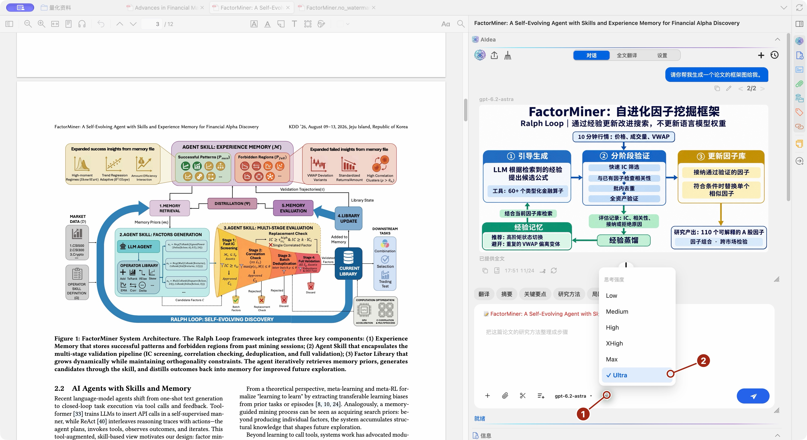](../../site/public/media/reader/window-effort.jpg)

### 給模型提供論文、選段和附件

在 PDF 或 EPUB 閱讀器裡打開 **對話**，輸入框附近的文獻標籤會顯示目前論文。在文獻庫裡也能打開獨立對話。傳送前看一眼標籤上的標題，尤其是在切換文獻或比較多篇論文之後。

| 手裡的材料 | 具體操作 | 傳送前檢查 |
| --- | --- | --- |
|  目前論文中的一段話 | 在閱讀器選取原文，點彈出視窗裡的 **加入文字**，也可點輸入區工具列的 **加入文字** | 確認選段已出現在輸入區。彈出視窗缺少按鈕時，到 **設定 → 進階** 啟用在閱讀器選擇彈出視窗顯示「加入文字」。 |
|  要一起比較的論文 | 輸入 `@` 並鍵入標題關鍵字，或在迴紋針選單中點 **選擇參考論文**。用方向鍵選擇，按 **Enter** 或 **Tab** 加入 | 檢查兩篇論文的標題和版本。問題裡點明哪篇是比較對象，例如「分別列出兩篇論文對計算複雜度的假設」。 |
|  圖表或公式的外觀 | 在 PDF 頁點剪刀圖示，拖動框選圖、圖例或公式，放開後查看截圖預覽。也可把圖片貼上或拖入輸入區 | 選擇支援圖像輸入的模型，確保下標、箭頭和圖例清晰可讀。按 **Esc** 可取消框選。 |
|  本機補充材料 | 從迴紋針選單點 **上傳檔案**，或拖入檔案。可附 PDF、圖片、Markdown、文字或程式碼 | 檢查檔名；單個上傳 PDF 限制為 50 MiB。若提示文字擷取不完整，可改選原文段落或附清晰截圖，再問對應內容。 |

參考論文和上傳檔案可留在輸入區供後續輪次使用。結束比較後，用標籤上的 **×** 移除無關材料。截圖和選段傳送後會清出待傳送區；下一輪若要明確指定同一幅圖或某句話，重新加入並檢查預覽。

① 按輸入框下方的迴紋針，選 ② 上傳檔案或 ③ 選擇參考論文。

[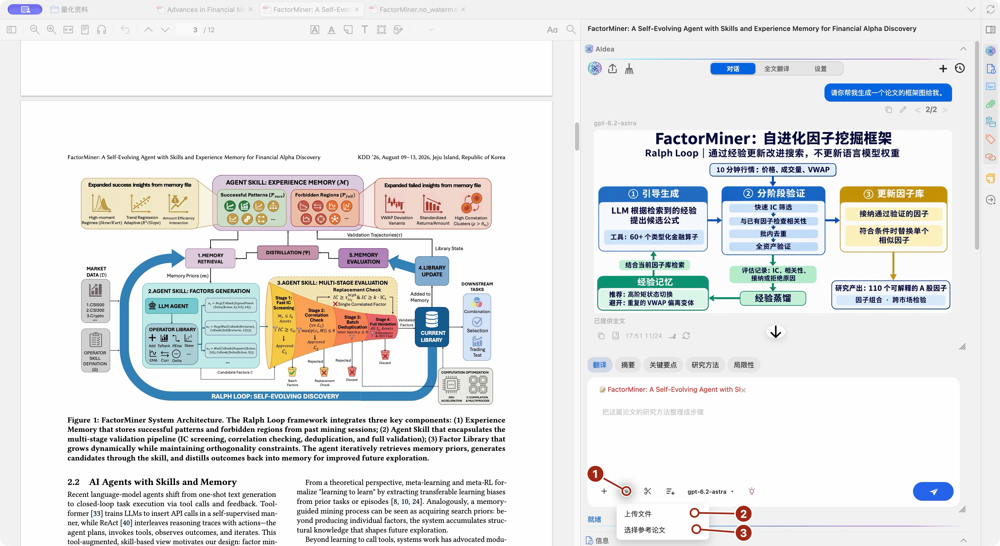](../../site/public/media/reader/window-context-menu.jpg)

### 傳送問題和使用快捷指令

 輸入框裡按 **Enter** 傳送，**Shift+Enter** 換行。若正在用 `@` 選擇論文，Enter 會先選中條目。生成過程中點 **取消** 可以停止目前請求，隨後可補充材料或改寫問題。

**翻譯、摘要、關鍵要點、研究方法、研究限制** 是預設問題。點選後，按鈕會把自己的提示詞放入輸入框並立即傳送。因此，先選好論文或選段，再點選按鈕；已有手寫草稿需要保留時，請先複製。想長期改變某個按鈕的問法，右鍵點選它可以編輯名稱和提示詞，也可以新增、刪除，或進入移動模式拖動排序。例如，將一個快捷指令設為「列出本文報告的兩個限制，每條附一個可核對的原文位置」。

[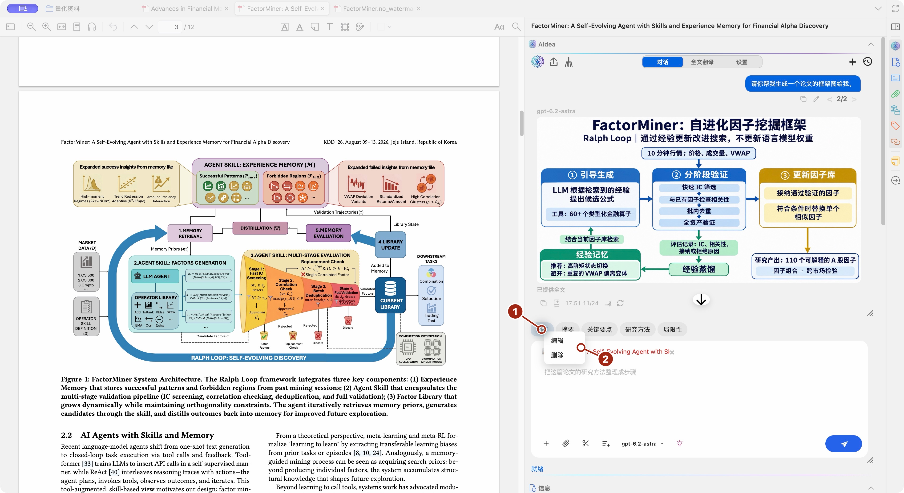](../../site/public/media/reader/window-shortcuts.jpg)

① 在翻譯快捷按鈕上按右鍵。② 選擇編輯以修改提示詞，或選擇刪除以移除按鈕。

### 用原文測試連線

1. 打開《Attention Is All You Need》第 3.2.1 節，把公式（1）下方解釋縮放因子的段落 **加入文字**。需要對照圖示時，再截取圖 2。
2. 傳送「為什麼要把點積除以 √dₖ？請用這一段中的變異數假設解釋，並指出原文依據。」收到回覆後，看回答旁的本輪材料狀態。**已提供全文**表示本輪包含全文；**已提供部分內容**表示模型拿到的是節選；**僅提供摘要**或**未提供正文**時，應先補上所問段落。
3. 點選回答中可定位的引用，回到 PDF 頁面或 EPUB 章節核對。回答裡普通文字寫出的頁碼，仍需自己核查。若只顯示來源、無法跳回原文，檢查對應的 Zotero 條目和原附件是否在本機，以及檔案是否被替換。
4. 保留同一對話，追問「如果查詢和鍵各分量的變異數不再是 1，上一步的結論依賴哪一項假設？」這樣可以檢驗解釋是否真的對應剛才那段原文。

[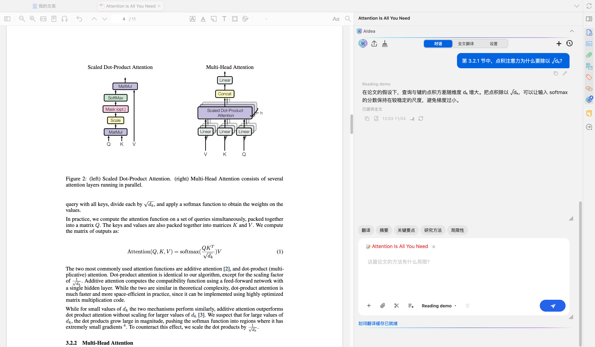](../../site/public/media/reader/chat-zh-CN.jpg)

### 根據論文產生架構圖

實測在 Zotero 的 AIdea 對話中透過 **ChatGPT OAuth（Codex）** 選擇 **gpt-6.1-sol**，產生並匯出了下圖。此模型透過繪圖工具傳回圖片，其他連線可否繪圖取決於服務對所選模型的支援。

1. 在對話中按迴紋針，上傳《Attention Is All You Need》的 PDF。檢查輸入區的檔名與模型。
2. 傳送以下提示詞。

   > 請根據附件《Attention Is All You Need》第 3 節，使用圖片生成工具，製作一張適合學術簡報全螢幕投影的 16:9 Transformer 架構圖。使用象牙白背景與大字中文標籤，以鈷藍和朱橙兩組等角堆疊圖形呈現編碼器與解碼器，各標 ×6。從來源序列與右移目標序列的嵌入和位置編碼畫起，用主箭頭凸顯編碼器向交叉注意力提供 K、V，Q 來自解碼器。輸出端以一幅小型機率長條圖呈現下一詞預測。保留寬邊界，讓後排觀眾也能讀清標籤。直接傳回圖片。

3. 等圖片出現在回答中，在**圖片上**按右鍵，選擇匯出及目標資料夾，即可取得 PNG。對照原論文圖 1，檢查編碼器輸出是否連到解碼器的交叉注意力層。

[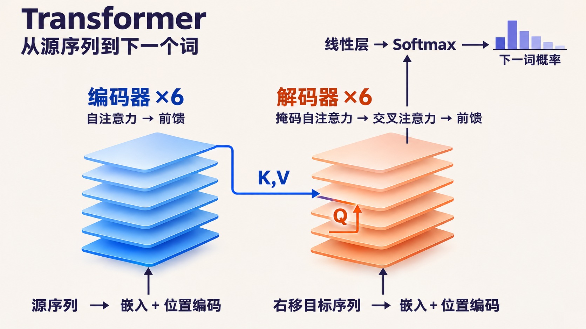](../../site/public/media/reader/transformer-generated-zh.png)

### 編輯問題、重試回答或另開分支

- **要改問題**：等生成結束，點自己那條訊息旁的 **編輯**，在原位置修改後點 **傳送**。同一位置有多個版本時，用左右箭頭切換。
- **想比較模型的答案**：點可重試回答旁的 **重試**，從跳出的選單選擇模型。用左右箭頭對照同一問題的不同回答。重試選用的模型也會成為輸入框裡的目前模型。
- **想沿某個答案深入**：點該回答旁的 **分支到新聊天**。新對話帶上截至該回答的對話，適合把數學推導單獨展開。若要從空白開始，點 **新建對話**。

[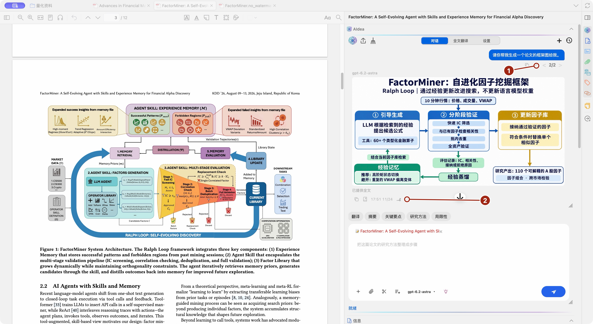](../../site/public/media/reader/window-reply.jpg)

FactorMiner 範例。左側是論文原圖，右側是產生的架構圖。① 鉛筆可修改提問，旁邊的箭頭可切換版本。② 回答下方的環形箭頭可重新嘗試。

### 長對話裡怎樣保留原文依據

對話超過模型的上下文預算後，較早的輪次可能會被壓縮成摘要，或只保留近期訊息。AIdea 也可能在預算允許時，調入目前文獻庫中與問題有關的記憶。追問某個數字、公式或圖說時，重新加入那段原文，再核對這一輪回答的引用。

### 儲存回答和管理歷史記錄

要保留一條解釋，點該回答旁的 **複製** 或 **儲存為筆記**。論文對話的筆記可在對應條目下找到；獨立對話可儲存成文獻庫裡的獨立筆記。回答中的程式碼區塊和數學區塊也有單獨的複製按鈕。若要整理整段討論，打開上方的 **匯出** 選單，選擇 **複製對話 Markdown** 或 **將對話儲存為筆記**。

 點時鐘圖示打開 **歷史記錄**，可恢復、重新命名或釘選對話。準備開始新話題時用 **新建對話**；掃帚圖示的 **清除** 會移除目前對話的記錄。歷史記錄清單裡的 **清理非釘選** 和 **全部清理** 範圍更大，操作前先核對要保留的記錄。

### 在另一部電腦繼續對話

 等回答產生完畢，在對話面板的匯出選單選擇目前對話、該篇論文的所有對話，或目前文獻庫的所有對話。只需文字與引用可用 JSON，要包含現有截圖與上傳檔案則選 ZIP。在另一部電腦從相同選單匯入，檢查預覽並確認合併。原始文獻請另由 Zotero 同步；要從引用跳回原文，兩端需要相同的條目和原始檔。帳號憑證、設定與記憶資料庫須另行處理。

## 全文翻譯設定

### 翻譯一份 PDF

在側邊欄開啟 **翻譯** 分頁。首次使用時安裝或更新翻譯環境，等待環境就緒。這套環境用來產生 PDF，與 OpenAI 登入使用的 CLI 分開管理。

① 確認 PDF，② 選輸出資料夾，③ 選翻譯模型，④ 勾選僅譯文或雙語對照。 選好來源與目標語言後，按 **翻譯**。

[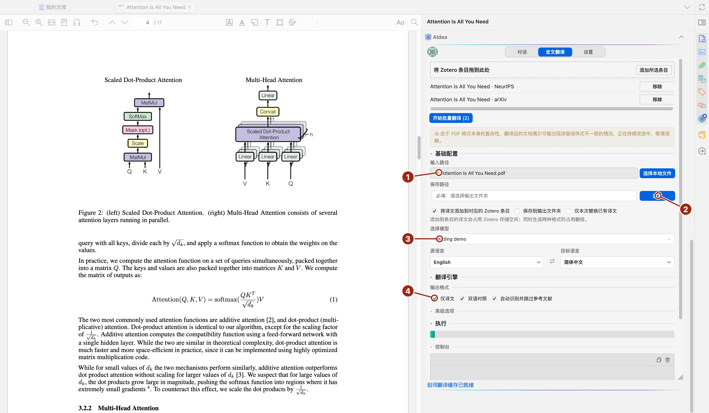](../../site/public/media/reader/window-translation-zh-CN.jpg)

### 多選後加入批次翻譯

在文獻庫按住 **Ctrl**（Windows/Linux）或 **⌘**（macOS）逐一選取文獻，按 **Shift** 選取連續項目。加入清單後可移除誤選項，再核對模型、格式與目的地。

1. 批次翻譯時，在文獻庫選取附有 PDF 的條目，按右鍵選擇 **準備批次翻譯**，或在翻譯分頁點選 **加入所選項目**。加入後可先檢查清單。
2. 選擇至少一種格式和一個目的地（Zotero 附件或資料夾），點選 **開始批次翻譯**。核對略過、缺少與將取代的數量後確認。完成後從條目或輸出資料夾開啟譯本。

預設只補齊缺少的檔案。若已在譯本上做註解，請保留預設值，以免取代檔案時遺失註解。重新啟動 Zotero 後可在佇列中選擇繼續。若已產生譯文但儲存失敗，修正目的地後選擇 **重試失敗項目**，即可再次儲存該譯本。

[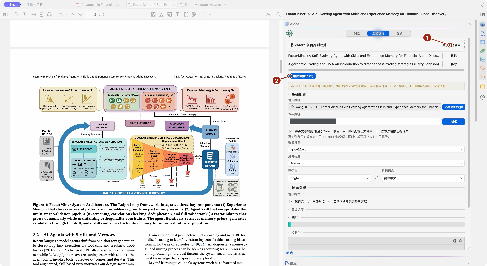](../../site/public/media/reader/window-batch.jpg)

① 加入文獻庫中選取的論文。核對清單後，按 ② 開始批次翻譯。此例已列出兩篇，按鈕也顯示 2。

### 翻譯引擎的進階選項

範例使用 **English → 簡體中文**。出現 `429` 時，降低每秒請求數（QPS）與平行執行緒數，再用一份 PDF 測試。掃描頁可啟用自動 OCR。也可調整表格文字翻譯、略過參考文獻、附錄翻譯、術語表和輸出字型。

第 6 頁的英中對照：左側是英文原文，右側是簡體中文。表 1 比較不同網路層的計算複雜度。

全文翻譯也能翻譯架構圖中的文字。FactorMiner 圖 1 左側是英文原圖，右側是簡體中文譯圖。沿著藍色箭頭對照兩側，可以看到「Memory Retrieval」譯為「记忆检索」，「Library Update」譯為「库更新」。

## 劃詞翻譯設定

在 **設定 → 劃詞翻譯** 中，① 啟用翻譯，② 選模型，③ 選來源與目標語言。開啟自動翻譯後，在 PDF 或 EPUB 中選取文字即可查看譯文；手動模式請按彈窗的翻譯按鈕。

[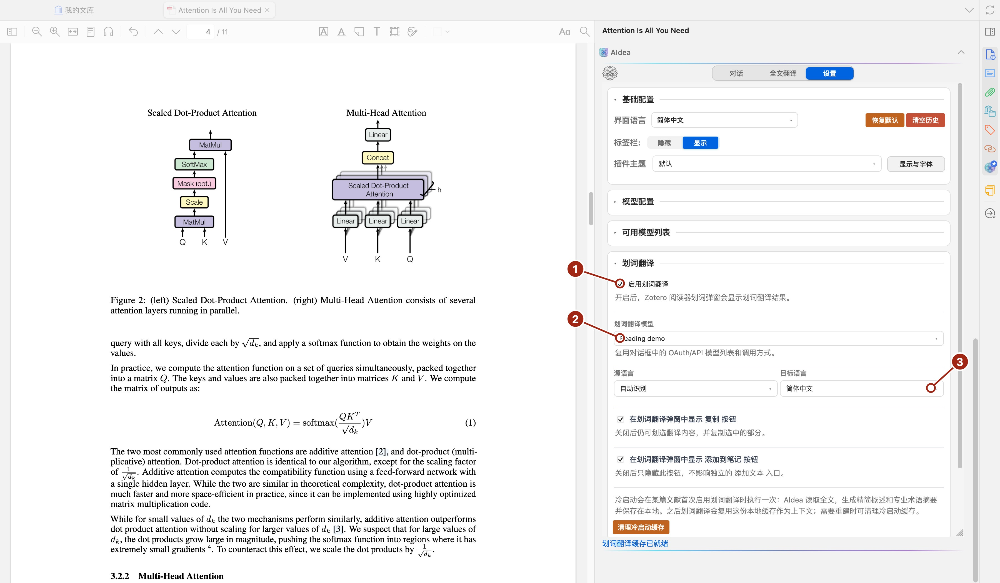](../../site/public/media/reader/window-selection-settings-zh-CN.jpg)

可個別調整模型支援的推理強度，並決定彈窗是否顯示 **複製** 和 **加入筆記**。

範例採用 Vaswani 等人的《[Attention Is All You Need](https://arxiv.org/html/1706.03762v7#S3.SS2.SSS1)》。選取圖 2 的 **Scaled Dot-Product Attention**，即可看到簡體中文譯文「缩放点积注意力」。截圖中的問答與選段譯文使用本機示範內容。

① 勾選 **將譯文寫入標註**，等譯文出現後按 ② 螢光標記顏色。再開啟標記即可在評論中看到譯文。僅需摘錄時按 ③ **加入筆記**。寫入標註預設關閉，之後會記住上次選擇。

[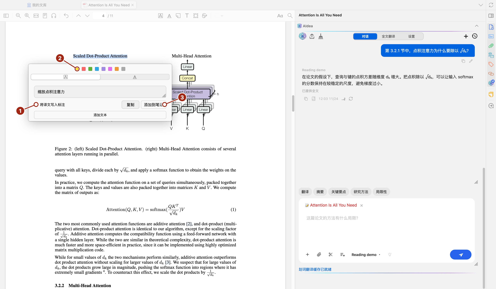](../../site/public/media/reader/window-selection-zh-CN.jpg)

## 錯誤排查

### 安裝後找不到面板

在 **工具 → 外掛程式** 確認 AIdea 已啟用。完全結束 Zotero（macOS 可按 **⌘Q**），再開啟 PDF，展開右側項目面板。仍找不到 AIdea 時請記錄系統、Zotero 與外掛程式版本。

### 已登入但模型清單為空

1. 重新整理模型，在設定的主控台找出失敗步驟與狀態碼。有使用者換了代理工具，瀏覽器仍可登入，但 Zotero 還在使用舊的連接埠。
2. 若需代理，核對工具實際監聽的協定和連接埠與系統代理或 PAC 設定。瀏覽器擴充功能、終端機與 Zotero 可能使用不同連線設定。修正後完全結束並重啟 Zotero，重新整理並勾選模型，再回到對話選取該模型並測試提問。
3. 遇到 `401` 請核對授權或金鑰；若 `403` 訊息指明帳號權限或地區限制，請依服務商說明查核。只有全文翻譯出現 `502` 時，記錄同一模型在三處的測試結果，查看全文翻譯主控台。

[Issue #34](https://github.com/Visterainer/aidea-zotero/issues/34) · [Issue #109](https://github.com/Visterainer/aidea-zotero/issues/109) · [Issue #60](https://github.com/Visterainer/aidea-zotero/issues/60) · [Zotero 官方連線疑難排解](https://www.zotero.org/support/kb/connection_error)

### 環境錯誤應複製哪些紀錄

| 失敗的操作 | 複製位置 | 一併說明 |
| --- | --- | --- |
| 安裝或修復翻譯環境、產生 PDF | **全文翻譯 → 主控台 → 全部複製**。保留按下按鈕、首次錯誤與最終狀態的紀錄。若提供完整紀錄檔位置，可擷取對應錯誤段落。 | 系統及架構、Zotero 和 AIdea 版本、失敗階段、模型、認證方式。產生 PDF 時再列出單篇或批次、有文字層或掃描件、輸出格式及是否只有特定檔案失敗。 |
| 安裝 OAuth 環境、登入、取得模型 | 在 **設定 → 主控台** 分別複製執行進度與詳細紀錄。 | 系統及架構、軟體版本、服務商、按下的按鈕、瀏覽器授權結果、回到 Zotero 後的狀態、錯誤碼與代理及重啟測試結果。 |

[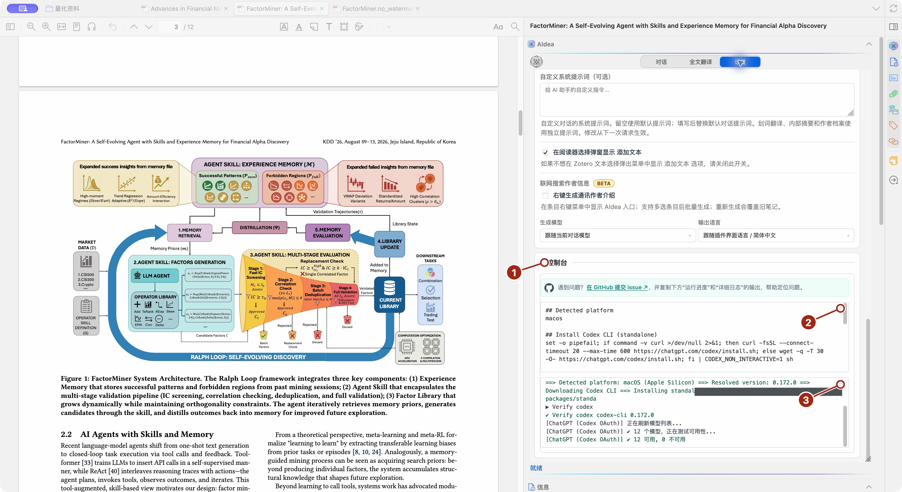](../../site/public/media/reader/window-logs.jpg)

① 展開設定頁的主控台。② 和 ③ 分別複製上下兩個紀錄框的內容，分享前遮蔽個人路徑。

### 提交前遮蔽個人資訊

先貼到本機文字編輯器，將電子郵件、金鑰、權杖、裝置代碼、授權回呼網址參數、代理憑證及路徑中的使用者名稱改為 `<已隱藏>`。保留版本、步驟、狀態碼與錯誤訊息。檢查截圖的帳號欄、網址列和金鑰欄位。

[提交錯誤報告](https://github.com/Visterainer/aidea-zotero/issues/new/choose)

### 交給本機 Agent 排查

將下列提示詞交給 Codex 或其他本機 Agent，附上已遮蔽個資的紀錄。

> 系統與架構 [填寫]，Zotero [版本]，AIdea [版本]。按下 [按鈕] 後，預期 [結果]，實際 [錯誤]。同一模型的對話 [狀態]、劃詞翻譯 [狀態]、全文翻譯 [狀態]。已遮蔽個資的紀錄：[貼上]。請找出第一個有診斷價值的錯誤，判斷屬於代理、OAuth、翻譯環境、模型請求或檔案儲存問題，並提供一個最小驗證步驟。僅分析附上的材料，不讀取憑證或上傳檔案。

### 其他常見問題

- **選取文字後沒有譯文。** 檢查功能開關、指定模型與目標語言。嘗試從原文複製一句話；掃描頁需有可選取的文字層。
- **可以對話，但無法翻譯整份 PDF。** 請在翻譯分頁安裝或修復環境。安裝程式支援 macOS 13 以上、glibc 2.28 以上的 Linux，以及受支援的 64 位元 Windows 系統。
- **文獻內容會送到哪裡？** 對話紀錄與記憶儲存在本機。提問與翻譯會將所需原文和附件內容傳給選定的模型服務。使用本機模型時，請確認所選網址指向本機。
